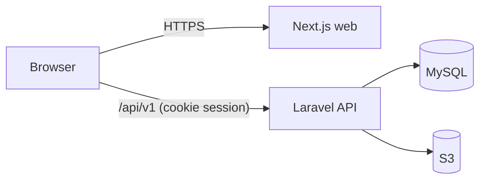

# CyberCompass

A personalized learning platform for cybersecurity. Take a knowledge assessment, choose a career goal, and follow a roadmap built from what you already know: lessons, exercises and safe browser-based labs, with progress tracking throughout.

> **Status: Phase 1 (Foundation), in progress.** The architecture, schema, API contract and design system are documented. The frontend foundation is built. The Laravel backend and Docker environment are next. Features listed below are **planned** unless marked otherwise. See [docs/IMPLEMENTATION_ROADMAP.md](docs/IMPLEMENTATION_ROADMAP.md).

## Features

| Feature | Status |
|---|---|
| Design system: tokens, light/dark/system themes, component states | ✅ Built (`/design-system`) |
| English / Vietnamese interface | ✅ Built (switcher, cookie-persisted) |
| Typed API client (Sanctum cookie auth, XSRF, error envelope) | ✅ Built, unit-tested |
| Auth: register, login, remember me, password reset | Planned (Phase 2) |
| Course catalog, course detail, lesson reader | Planned (Phase 3) |
| Initial knowledge assessment with transparent scoring | Planned (Phase 4) |
| Personalized, interactive learning roadmap | Planned (Phase 4–5) |
| Exercises (7 question types) and browser-based labs | Planned (Phase 5) |
| Dashboard, analytics, streaks, notifications | Planned (Phase 6) |

## Screenshots

_Screenshots are added as features ship._

## Technology

| Layer | Stack |
|---|---|
| Frontend | Next.js 16 (App Router), React 19, TypeScript, Tailwind CSS 4, TanStack Query, next-intl, next-themes, Motion, Lucide. React Flow and Recharts arrive with the roadmap and dashboard. |
| Backend | Laravel 12, PHP 8.3, Sanctum (SPA cookie auth), MySQL 8 |
| Testing | Vitest + Testing Library (frontend), Pest (backend), Playwright (E2E, Phase 7) |
| Infrastructure | Docker, AWS ECS Fargate, ECR, RDS MySQL, S3, CloudFront, ALB, Secrets Manager, CloudWatch |

## Architecture



The frontend and backend are independent apps that communicate only through the versioned REST API. Details: [docs/ARCHITECTURE.md](docs/ARCHITECTURE.md).

## Repository structure

```text
CyberCompass/
├── frontend/        Next.js app
├── backend/         Laravel API (Phase 1, pending Docker setup)
├── infrastructure/  Docker and AWS configuration (Phase 1 / Phase 7)
└── docs/            Architecture, schema, API, design system, roadmap
```

## Getting started

### Prerequisites

- Node.js 22 or newer
- Docker Desktop, which runs PHP, Composer, MySQL and Mailpit. Nothing else needs installing on the host.

### Frontend

```bash
cd frontend
cp .env.example .env.local
npm install
npm run dev          # http://localhost:3000
```

| Command | Purpose |
|---|---|
| `npm run dev` | Development server |
| `npm run build` / `npm start` | Production build / serve |
| `npm run typecheck` | TypeScript check |
| `npm run lint` | ESLint |
| `npm test` | Unit and component tests (Vitest) |

The home page shows a live system status panel. Until the backend is running, it reports the API as unreachable.

### Backend, Docker, database

Coming in the rest of Phase 1: `docker compose up`, migrations and seeding instructions.

## Documentation

- [Project overview](docs/PROJECT_OVERVIEW.md)
- [Architecture and key decisions](docs/ARCHITECTURE.md)
- [Database schema (ERD)](docs/DATABASE_SCHEMA.md)
- [API specification](docs/API_SPECIFICATION.md)
- [Design system](docs/DESIGN_SYSTEM.md)
- [Implementation roadmap](docs/IMPLEMENTATION_ROADMAP.md)

## AWS deployment

Planned target: ECS Fargate services for `web`, `api` and `worker` behind an ALB, with RDS MySQL, S3 + CloudFront and Secrets Manager. See [ARCHITECTURE.md §8](docs/ARCHITECTURE.md#8-deployment-architecture-aws). A step-by-step guide arrives in Phase 7.

## Contributors

_To be added._

## License

_To be decided by the project team._
