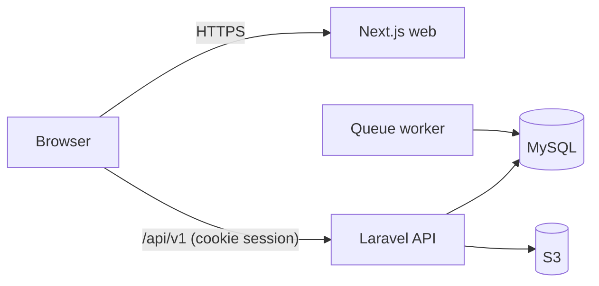

# CyberCompass

A personalized learning platform for cybersecurity. Take a knowledge assessment, choose a career goal, and follow a roadmap built from what you already know: lessons, exercises and safe browser-based labs, with progress tracking throughout.

> **Status: Phase 1 (Foundation) complete.** The frontend, the API, MySQL and the Docker environment run end to end. Product features start in Phase 2. Features listed below are **planned** unless marked as built. See [docs/IMPLEMENTATION_ROADMAP.md](docs/IMPLEMENTATION_ROADMAP.md).

## Features

| Feature | Status |
|---|---|
| Design system: tokens, light/dark/system themes, component states | ✅ Built (`/design-system`) |
| English / Vietnamese interface | ✅ Built (switcher, cookie-persisted) |
| Typed API client (Sanctum cookie auth, XSRF, error envelope) | ✅ Built, unit-tested |
| Versioned REST API: error envelope, CORS, rate limiting, health, OpenAPI docs | ✅ Built, feature-tested |
| Docker development environment and production images | ✅ Built |
| Auth: register, login, remember me, password reset | Planned (Phase 2) |
| Course catalog, course detail, lesson reader | Planned (Phase 3) |
| Initial knowledge assessment with transparent scoring | Planned (Phase 4) |
| Personalized, interactive learning roadmap | Planned (Phase 4–5) |
| Exercises (7 question types) and browser-based labs | Planned (Phase 5) |
| Dashboard, analytics, streaks, notifications | Planned (Phase 6) |

## Screenshots

_Screenshots are added as features ship._

## Technology

| Layer | Stack |
|---|---|
| Frontend | Next.js 16 (App Router), React 19, TypeScript, Tailwind CSS 4, TanStack Query, next-intl, next-themes, Motion, Lucide. React Flow and Recharts arrive with the roadmap and dashboard. |
| Backend | Laravel 13, PHP 8.5, Sanctum (SPA cookie auth), MySQL 8.4, Scramble (OpenAPI) |
| Testing | Vitest + Testing Library (frontend), Pest on MySQL (backend), Playwright (E2E, Phase 7) |
| Infrastructure | Docker, AWS ECS Fargate, ECR, RDS MySQL, S3, CloudFront, ALB, Secrets Manager, CloudWatch |

## Architecture



The frontend and backend are independent apps that communicate only through the versioned REST API. Details: [docs/ARCHITECTURE.md](docs/ARCHITECTURE.md).

## Repository structure

```text
CyberCompass/
├── frontend/            Next.js app (own package.json, Dockerfile)
├── backend/             Laravel API (own composer.json, Dockerfile)
├── infrastructure/      Docker support files; AWS configuration arrives in Phase 7
├── docs/                Architecture, schema, API, design system, roadmap
├── docker-compose.yml   Local environment: mysql, mailpit, api, worker, web
└── .env.example         Compose variables
```

## Getting started

### Prerequisites

- **Docker Desktop.** PHP, Composer, MySQL and Mailpit all run in containers, so nothing PHP-related is installed on your machine.
- Node.js 22 or newer, only if you want to run frontend tests or the dev server outside Docker.

### First run

```bash
cp .env.example .env                       # compose variables: DB credentials, ports
cp backend/.env.example backend/.env       # Laravel settings (DB_PASSWORD must match .env)
cp frontend/.env.example frontend/.env.local

docker compose up -d --build               # mysql, mailpit, api, worker, web
docker compose exec -u root api chmod -R a+rwX storage bootstrap/cache   # once; see note below
docker compose exec api php artisan key:generate
docker compose exec api php artisan migrate
```

On first start, the API container runs `composer install` into its `vendor` volume, which takes about a minute.

| URL | What |
|---|---|
| http://localhost:3000 | Web app. The home page shows live API and database status. |
| http://localhost:8000/api/v1/health | API health |
| http://localhost:8000/docs/api | OpenAPI documentation (local only) |
| http://localhost:8025 | Mailpit, which catches outgoing email |

### Everyday commands

| Task | Command |
|---|---|
| Backend tests (Pest, on MySQL) | `docker compose exec api php artisan test` |
| Backend code style | `docker compose exec -u root api ./vendor/bin/pint` |
| Artisan / Composer | `docker compose exec -u root api php artisan …` / `… composer …` |
| Frontend tests | `cd frontend && npm test` |
| Frontend checks | `npm run typecheck` and `npm run lint` |
| Logs | `docker compose logs -f api worker web` |

**Windows note:** inside the container, the bind-mounted `backend/` folder appears owned by root. Commands that write source files therefore use `-u root`, and `storage/` and `bootstrap/cache` are made writable once with the `chmod` above. The setting persists on disk.

### Production images

```bash
docker build --target production -t cybercompass-api backend
docker build --target production --build-arg NEXT_PUBLIC_API_URL=https://api.example.com -t cybercompass-web frontend
```

The API image caches Laravel's configuration at boot. Database migrations run as a separate one-off task, never on container start. The queue worker uses the same API image with `php artisan queue:work` as its command.

## Documentation

- [Project overview](docs/PROJECT_OVERVIEW.md)
- [Architecture and key decisions](docs/ARCHITECTURE.md)
- [Database schema (ERD)](docs/DATABASE_SCHEMA.md)
- [API specification](docs/API_SPECIFICATION.md). The generated OpenAPI is at `/docs/api` when running locally.
- [Design system](docs/DESIGN_SYSTEM.md)
- [Implementation roadmap](docs/IMPLEMENTATION_ROADMAP.md)

## AWS deployment

Planned target: ECS Fargate services for `web`, `api` and `worker` behind an ALB, with RDS MySQL, S3 + CloudFront and Secrets Manager. See [ARCHITECTURE.md §8](docs/ARCHITECTURE.md#8-deployment-architecture-aws). A step-by-step guide arrives in Phase 7.

## Contributors

_To be added._

## License

_To be decided by the project team._
