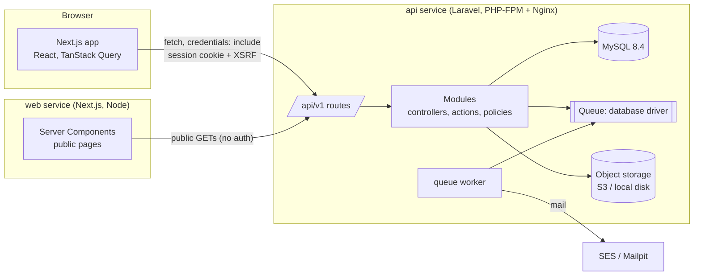
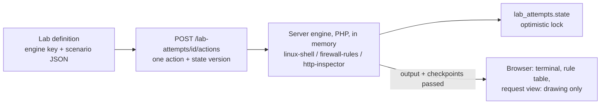
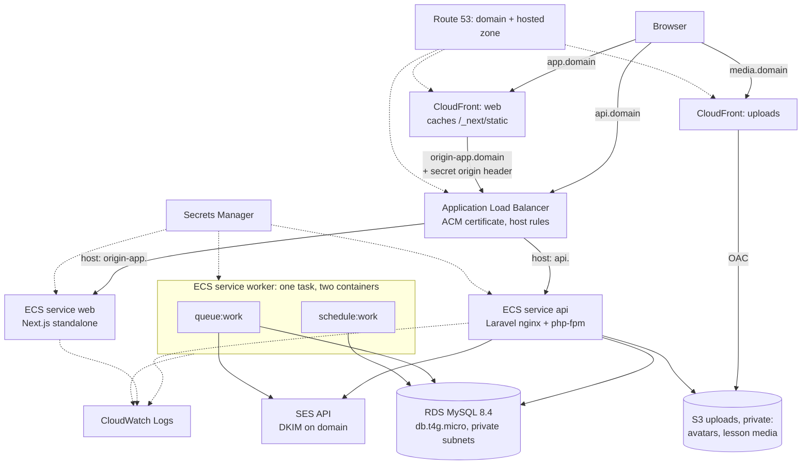

# Architecture

## 1. System overview



There are two independently deployable applications in one monorepo:

| App | Path | Runtime | Responsibility |
|---|---|---|---|
| Frontend | `frontend/` | Next.js (App Router), Node 22 | UI, routing, i18n, client state, rendering visuals and lab simulations |
| Backend | `backend/` | Laravel 13, PHP 8.5 | Auth, business rules, scoring, roadmap generation, persistence, notifications |

The frontend contains no business rules such as scoring, unlock logic or progress completion. It renders what the API returns. The only logic duplicated on the client is form validation for UX, and the server validates again as the authority.

## 2. Repository layout

```text
CyberCompass/
├── frontend/              Next.js app (independent package.json)
├── backend/               Laravel app (independent composer.json)
├── infrastructure/
│   ├── docker/            nginx/php config shared by images
│   └── aws/               ECS task definitions, deployment notes (no app code)
├── docs/
├── docker-compose.yml     local dev: mysql, mailpit, api, worker, web
├── .env.example           compose-level variables only
└── README.md
```

## 3. Backend architecture

### 3.1 Module layout

The code is organized by business domain. Each module owns its HTTP layer, actions and policies. Eloquent models stay in `app/Models` because many modules share them, and splitting them by module causes circular imports.

```text
backend/app/
├── Models/                         Eloquent models + relationships only
├── Modules/
│   ├── Auth/         Http/{Controllers,Requests}, Actions/
│   ├── Profile/      Http/..., Actions/
│   ├── Catalog/      courses, chapters, favorites, enrollments
│   ├── Content/      block registry (JSON Schema per block type), importer, serializer, lesson editor: drafts, publish, revisions, media (Phase 3.5)
│   ├── Admin/        EnsureAdmin, user administration, append-only audit log, make-admin command (Phase 3.5)
│   ├── Learning/     lessons, lesson progress, exercises, attempts
│   ├── Assessment/   assessments, attempts, ScoringService
│   ├── Careers/      careers, goal selection
│   ├── Roadmap/      learning paths, RoadmapGenerator, node status resolver
│   ├── Labs/         labs, attempts, checkpoint validators
│   ├── Progress/     dashboard stats, activities, streaks
│   └── Notifications/ list/read/delete, preferences, Notification classes
│       each: Http/Controllers, Http/Requests, Http/Resources, Actions/, Services/, Policies/, routes.php
├── Support/                        ApiResponse helpers, base exceptions, enums
└── Providers/
```

`routes/api.php` mounts each module's `routes.php` under `/api/v1`.

### 3.2 Layer rules

| Layer | Does | Doesn't |
|---|---|---|
| Controller | Accepts a Form Request, calls one action or service, returns a Resource | Query building, business rules |
| Form Request | Validation and `authorize()` through policies | Side effects |
| Action | One use case (`SubmitAssessmentAttempt`, `CompleteLesson`), wrapped in `DB::transaction` when it writes several rows | HTTP concerns |
| Service | Reusable domain logic (`AssessmentScorer`, `RoadmapGenerator`, `StreakCalculator`) | Persistence of unrelated aggregates |
| Resource | Turns models into the public JSON shape | Exposing internal columns (`is_correct` before submission, password hashes) |
| Policy | Ownership and visibility (`AttemptPolicy::view` checks that the attempt belongs to the user) | |

Cross-module side effects use **domain events** (`LessonCompleted`, `AssessmentSubmitted`, `MilestoneReached`). Listeners record activities and send notifications, so modules don't call each other's internals (D33, D34).

### 3.3 Error handling

One exception renderer in `bootstrap/app.php` produces the error envelope described in [API_SPECIFICATION.md](API_SPECIFICATION.md#errors). Stack traces never reach clients outside `local`.

## 4. Authentication and authorization

**Decision: Laravel Sanctum in SPA mode, with a cookie-based session.**

- The browser first calls `GET /sanctum/csrf-cookie`, then `POST /api/v1/auth/login`. Laravel sets an `HttpOnly`, `Secure`, `SameSite=Lax` session cookie. JavaScript never sees a token, which satisfies the rule against storing tokens in unsafe browser storage.
- Mutating requests send `X-XSRF-TOKEN`, which the API client reads from the `XSRF-TOKEN` cookie. This is Laravel's standard CSRF protection.
- "Remember me" uses Laravel's remember-token cookie.
- Password reset uses Laravel's password broker. The reset link points to the frontend route `/reset-password?token=…&email=…`.
- **Constraint:** the frontend and the API must share a registrable domain (for example `app.example.com` and `api.example.com`, or a single host with the ALB routing `/api/*`). Locally this means `localhost:3000` and `localhost:8000`. `SANCTUM_STATEFUL_DOMAINS` and `CORS_ALLOWED_ORIGINS` list the frontend origin, and CORS uses `supports_credentials`.
- **Route protection on the frontend:** the `(app)` route group is wrapped in `RequireAuth`, which asks `GET /api/v1/me` and redirects guests to `/login?next=…`. Laravel issues a session cookie to *every* visitor, so a cookie-presence check (the original `proxy.ts` plan) cannot tell guests from learners. The API's `auth:sanctum` middleware is the real gate. `next` only accepts same-site paths, so login cannot become an open redirect.
- **Brute force:** login locks an email+IP pair for 60 s after 5 failures. Register is limited to 10 per hour per IP, and password endpoints to 5 per minute.
- **Session hygiene:** the session id is regenerated on login. Logout invalidates the session and rotates the CSRF token. A password change ends all *other* sessions, and a password reset ends *all* of them.
- **Rate limits:** login locks an email and address pair for 60 s after 5 failures, and the `login` limiter allows 20 attempts a minute per address (password spraying); `password` 5 a minute; `api` 120 a minute per user. The full table is in [SECURITY_REVIEW.md](SECURITY_REVIEW.md#rate-limits).
- **Production preflight:** `php artisan cybercompass:preflight` refuses an unsafe production configuration (debug, cookie flags, CORS, mail, uploads, logs, demo passwords); the migration task runs it before every deployment.
- **Roles:** `learner` and `admin`, as an enum column on `users`. `role` is not fillable; it changes only through `Admin\Actions\ChangeUserRole` or the `cybercompass:make-admin` command (D16).
- **Admin console (Phase 3.5, D16):** `/api/v1/admin/*` runs `auth:sanctum`, then `EnsureAdmin` (learners get 403), then the `admin` rate limiter (120 per minute per admin). Each action is also checked by `UserAdminPolicy`. An admin can't demote or suspend themselves, and the last active admin can't lose access; those checks lock the admin rows inside the transaction. Every mutating admin action writes an append-only `admin_audit_logs` row in the same transaction, with secrets stripped from `changes`. Admins never see or set passwords; they can only trigger the standard reset email. The frontend `(admin)` route group is wrapped in `RequireAuth` and `RequireAdmin`, which shape the interface only; the API is the gate.
- **Suspension:** a suspended account is refused at login (told so only after the correct password). Suspending, and changing a role, deletes the user's sessions and rotates their remember token (`Auth\Actions\EndUserSessions`). `RejectSuspendedUsers` on the `api` group signs out any request that still arrives as a suspended user.

## 5. Frontend architecture

```text
frontend/src/
├── app/                    routes only: layouts, pages, loading/error boundaries
│   ├── (marketing)/        landing, public careers and courses
│   ├── (auth)/             login, register, forgot/reset password
│   └── (app)/              authenticated shell: dashboard, roadmap, learn, labs, profile
├── components/
│   ├── ui/                 shadcn primitives, restyled with tokens
│   ├── layout/             header, app shell, footer
│   └── shared/             cross-feature pieces (EmptyState, Measured, StatusChip)
├── features/<feature>/     components/, hooks/, api.ts, types.ts per feature
├── lib/                    api client, query client, utils, env
├── i18n/                   next-intl config, messages/en.json, messages/vi.json
├── styles/                 tokens.css, globals.css
└── types/                  generated API types (openapi-typescript)
```

- **Data fetching:** public pages (landing, course detail, careers) are Server Components using `serverGet` (`lib/api/server.ts`), revalidated every 60 s, through `INTERNAL_API_URL` when the API has a private address. Signed-in state on those pages (enrolled, favorited, lesson status) loads separately on the client, so the public HTML is the same for everyone. Authenticated pages are client components using **TanStack Query** through a single `apiClient` (base URL from `NEXT_PUBLIC_API_URL`, `credentials: 'include'`, XSRF header, envelope unwrapping, typed errors). No component calls `fetch` directly.
- **Types:** the backend publishes an OpenAPI document (generated by **Scramble**). `npm run api:types` turns it into `src/types/api.d.ts`. That gives the frontend one contract and no hand-copied interfaces.
- **State:** server state lives in TanStack Query. The only global client state is the theme (`next-themes`) and transient UI state such as the exercise draft. No Redux, and no Zustand unless a real need appears.
- **i18n:** **next-intl**, with the locale stored in a cookie and synced from the user's saved preference. There is no locale prefix in URLs (assumption: SEO for a second locale is not a goal). Every user-facing string lives in `messages/*.json`.
- **Visuals:** lesson diagrams are static SVG from `lib/graph` (dagre layout, D23); the roadmap graph and knowledge map use the same approach, with HTML nodes over SVG edges (D27; no React Flow), Recharts for analytics, and Motion for state transitions. React Three Fiber is loaded only on the specific lessons that use it (dynamic import), and never on first paint.

## 6. Personalization engine

Rule-based, deterministic and documented, so a learner can see why a node was recommended.

### 6.1 Assessment scoring

- Each question has a domain and a difficulty of 1, 2 or 3. The **weight is the difficulty**.
- `domain_score = Σ weight(correct) / Σ weight(answered in domain) × 100`
- Unanswered questions count as incorrect once the attempt is submitted.
- Bands: **gap** below 40, **developing** from 40 to 74, **strength** from 75 up.
- The overall score uses the same weighted formula across all questions.
- The result page shows the formula and the counts per domain. For questions answered wrongly (or left unanswered) it shows the correct option and the explanation; correctly answered questions only show that they were correct (D26).
- The bank is fixed (5 questions per domain, difficulties 1, 1, 2, 2, 3). This is a transparent questionnaire, not an adaptive or AI assessment, and the UI says so.

### 6.2 Roadmap generation (✅ Phase 4, `Roadmap\Services\RoadmapGenerator`)

Input: the learner's career goal (its template: topics in stages) and the domain scores of the latest submitted assessment attempt.

For each topic in the career template, in order:

| Condition | Node recommendation | Reason shown |
|---|---|---|
| Domain score ≥ 75 and the topic's level ≤ 2 (intermediate) | `review`: optional | "You scored 82% in Networking" |
| Domain score below 40 | `required`, with the domain's foundation topics inserted before it when they are missing | "Networking is a gap (31%)" |
| Otherwise | `required` | "Needed for SOC Analyst" |

- **Foundations:** a domain's lowest-level topics. They are inserted only when the gap topic sits above that level; a gap in a foundation topic itself inserts nothing. An inserted topic goes into the same stage, just before the topic that needed it, after any of its own missing prerequisites; its reason is "Foundation for <topic>". A topic is never placed twice.
- **Left out:** topics with no lesson a learner can see.
- **No assessment:** every topic is `required`.
- **Versions:** the path is a snapshot (`learning_paths`, `learning_path_nodes`), so it stays stable while the learner works through it. Only `POST /learning-path/generate` creates a version (D26); it archives the active one in the same transaction. A unique index on a generated column keeps one active path per learner. Progress lives in `lesson_progress` and is never copied, so it carries over.
- **Out of date:** the path reports `career_changed` when the goal's career differs from the path's, and `new_assessment` when a newer attempt was submitted. The learner decides when to update.
- **Other goal fields:** areas of interest order the assessment's next steps within a band; the weekly study time gives the estimate (remaining required minutes ÷ weekly minutes, rounded up to weeks); the self-rated level is shown beside the result and never affects scoring or generation.

### 6.3 Node status (computed on read, never stored; `Roadmap\Services\TopicStatus`, used by `PathProgress` and `KnowledgeMap`)

- **completed:** every required lesson in the topic is completed (all its lessons, if none is marked required). A topic whose lessons were all archived after generation counts as completed, so it never blocks the next one.
- **in_progress:** at least one lesson started or completed.
- **available:** every prerequisite topic that is part of the path is completed or marked `review`. Prerequisites outside the path are not part of the plan and are ignored.
- **locked:** otherwise. Locking is guidance: the lessons themselves stay open.

Completion counts the required lessons of `required` topics only. The next lesson is the first unfinished lesson of the first open `required` topic, else of the first open `review` topic.

Lesson completion rule (D31, `Learning\Actions\RecordLessonProgress`): the learner marks the lesson complete at its end (the client reports time on page, capped at 4 hours per visit); a lesson with an exercise is completed instead by a passing attempt (score at or above `pass_percent`), in the same transaction as the attempt, and `POST /complete` returns 422 until then. Completions recorded before the exercise existed stay. Completing the last lesson of an enrolled course stamps `enrollments.completed_at` once.

## 7. Labs architecture (D28)



- Each lab names an **engine** and a scenario. A scenario holds a virtual filesystem, a rule set or a simulated web app, plus checkpoints. The scenario's checkpoint answers never leave the server.
- **The server runs the simulation** (D28). The browser sends one action at a time (a command, a rule change, a request), the engine applies it to the attempt's stored state and returns the output and the checkpoints passed. The browser only draws. There is one engine per lab type, so nothing is duplicated between PHP and TypeScript (master prompt rule 4), and completion cannot be faked by editing client state.
- **Engines are pure in-memory simulations.** They interpret a whitelisted subset (for the shell: `pwd`, `ls`, `cd`, `cat`, `head`, `tail`, `grep`, `wc`, `sort`, `uniq`, `find`, `whoami`, `id`, simple `|` pipes) against a virtual filesystem held in the state JSON. See §7.1 for the security rules.
- **Future sandboxes:** the `LabProvider` interface (`simulated` today) takes the same "action in, output out" calls, so a `container` provider (an isolated ECS task with no egress) can replace an engine without changing the API, the lab or the attempt schema.
- Labs never gate lesson completion. Completing every checkpoint stamps `lab_attempts.completed_at` once and fires `LabCompleted` after commit (Phase 6 listeners).

### 7.1 Lab engine security rules

| Rule | How it is enforced |
|---|---|
| No process or real filesystem access | Engines never call `exec`, `shell_exec`, `system`, `passthru`, `proc_open`, `popen`, backticks, or any filesystem function (`fopen`, `file_get_contents`, `scandir`, ...). An architecture test scans `app/Modules/Labs/Engines` and fails if any appears. Files exist only as arrays in the attempt state. |
| No shell metacharacters | The tokenizer accepts words, quotes and `|`. Redirects (`>`, `<`, `>>`), `;`, `&&`, `||`, `&`, backticks, `$()` and `${}`, and `find -exec`/`-delete` are refused with a friendly message, never an exception. Unknown commands and flags get the same treatment. |
| No ReDoS | `grep` matches literal text by default (`-i` folds case). `grep -E` accepts a regex only up to 100 characters, run through `Engines\SafeRegex` with `pcre.backtrack_limit` (10 000) and `pcre.recursion_limit` (1 000) lowered and the PCRE JIT off for the call (the JIT ignores the backtrack limit), all restored afterwards; a pattern that does not compile or hits a limit returns an error message. Any future learner-supplied pattern uses the same helper. |
| Bounded work | Command length ≤ 500 characters, ≤ 5 pipe stages, output ≤ 64 KB (truncated with a notice), stored state ≤ 256 KB (the action is refused above it), and a per-user rate limit on the action endpoint (`throttle:lab-actions`, 60 per minute). |
| No lost updates | `lab_attempts.state_version` is sent with every action and checked under a row lock; a stale version returns 409, so two tabs cannot overwrite each other. |
| No external targets | The HTTP inspector answers only from the scenario's routes; there is no outbound request. Requests are bounded (method from a list, path ≤ 200 characters without spaces, ≤ 10 headers and cookies of ≤ 500 characters, body ≤ 2 000). |
| Bounded envelope | The action request is at most 8 KB; answers are at most 200 characters; the firewall holds at most 20 rules; the shell keeps 40 history entries of at most 4 KB each. |

## 8. Deployment architecture (AWS)

Decided in the Phase 7 impact check (D37 to D45, 2026-11-21). Region: `ap-southeast-1`. `<domain>` stands for the project's domain until it is registered.



| Piece | How it runs | Why |
|---|---|---|
| `web` | ECS service, Next.js standalone image. Reached only through CloudFront: the ALB rule for `origin-app.<domain>` requires a secret header that CloudFront adds, so the ALB address cannot bypass CloudFront | CloudFront caches `/_next/static` (immutable, hashed) from the app itself, so a deployment has no separate S3 sync step (D41) |
| `api` | ECS service, Laravel production image, `api.<domain>` straight on the ALB (no CloudFront) | The ALB's `X-Forwarded-For` entry is the real client, so per-IP limits (login lockout, register) stay per person (D41) |
| `worker` | ECS service with one task holding two containers from the api image: `queue:work` and `schedule:work` | Notifications and the lesson fan-out are queued (D37); the hourly reminder runs from `routes/console.php` with no extra AWS service (D38) |
| migrations | One-off ECS task from the api image: `migrate --force`, then the content import (never the demo users) | Never on container start, so two api tasks cannot race |
| Database | RDS MySQL 8.4, `db.t4g.micro`, single AZ, private subnets, reachable only from the three services' security group | D43; Multi-AZ is a documented upgrade |
| Uploads | Private S3 bucket through the `s3` disk, served by CloudFront with origin access control | The bucket is never public (D41) |
| Mail | SES through Laravel's `ses` mailer with the task role's permission; DKIM on `<domain>` | No mail password to store (D39) |
| Network | Tasks in public subnets with public IPs; security groups accept traffic only from the ALB; RDS in private subnets; no NAT gateway | Cheapest path to ECR, Secrets Manager, CloudWatch, S3 and SES (D40) |

MVP deliberately leaves out, each documented as a later step:

- ElastiCache. Sessions, cache and queue use the **database** driver, which is enough at this scale. Switching to Redis is a config change.
- A NAT gateway or VPC endpoints with private task subnets (D40), Multi-AZ RDS (D43) and infrastructure as code (D44).
- EventBridge: the scheduler is a container (D38).
- Container Insights (D48) and a permanent WAF (D50, trial first).

Configuration is read from environment variables only. Secrets come from Secrets Manager, injected through ECS task definitions; the task role grants S3 and SES access, so no AWS keys exist in the app's configuration. No AWS resource names appear in application code. Files go through Laravel's `Storage` facade (`s3` disk in production, `public` disk in development).

## 9. Key decisions

| # | Decision | Alternatives considered | Why |
|---|---|---|---|
| D1 | Sanctum SPA cookie auth | JWT in localStorage, Next.js BFF proxy | Tokens can't be read by scripts, CSRF protection is built in, and it's the least custom code. The cost is the same-site domain constraint. |
| D2 | Modules under `app/Modules`, shared `app/Models` | Full DDD packages, nwidart/modules | Clear boundaries without a framework that fights Laravel's conventions |
| D3 | Rule-based personalization | ML or LLM recommendations | Transparent, testable, and honest about what it is |
| D4 | Roadmap snapshot plus computed status | Store status per node | No derived state that can drift, and history is kept across versions |
| D5 | OpenAPI (Scramble) to generated TS types | Hand-written types | One source of truth for the contract |
| D6 | Database queue, cache and session in the MVP | Redis | Fewer moving parts on AWS. Easy to switch later. |
| D7 | next-intl with a cookie locale | URL-prefixed locales | Simpler routing for an app that is mostly behind auth |
| D8 | Browser-simulated labs | Live containers | Safe by construction. A provider interface leaves room for containers later. |
| D9 | Next.js 16 with **Cache Components off** | Cache Components + `use cache: private` | Every route reads request cookies (locale, theme, session), and user data comes from the API on the client. With it on, every cookie read would need its own Suspense boundary for no real gain. Public catalog pages can opt into `fetch` revalidation. |
| D10 | Route protection by a client `RequireAuth` gate backed by `/me` (revised in Phase 2) | Cookie-presence check in `proxy.ts`; server-side `/me` call per navigation | Laravel gives guests a session cookie too, so its presence means nothing. A server-side check would add an API round trip to every navigation. The API enforces auth on every route regardless. |
| D11 | Dev containers keep `vendor/` in a named volume, with OPcache on and timestamp validation | Plain bind mount of the whole tree | On Docker Desktop for Windows, reading vendor files through the 9p mount made each boot about 6s. With the volume it is under 1s, and the test suite runs in 2s instead of 85s. |
| D12 | Backend tests run on MySQL (`cybercompass_testing`), not SQLite | In-memory SQLite | The schema uses MySQL features (FULLTEXT, enums, JSON). Tests run against the engine that runs in production. |
| D13 | Next.js dev server runs on the host (`npm run dev`); the `web` container is opt-in (`--profile web`) | Next.js inside Docker for development | Docker Desktop on Windows and macOS delays or drops file events across its file share, so hot reload in the container was unreliable. This is the setup Next.js's own docs recommend. The API, MySQL and the worker stay in Docker. |
| D14 | Diagram content lives in lesson data (`lesson_sections.payload.data`), validated by a zod schema per diagram; React components only draw it | Text inside diagram components | Keeps learning content out of UI code (master prompt rule 5). A diagram whose data is malformed shows a notice instead of breaking the lesson. |
| D15 | Catalog search is a case-insensitive substring match on title and summary (`LIKE`, wildcards escaped) | MySQL FULLTEXT | FULLTEXT ignores words under 3 characters and does not match prefixes ("netw"). At catalog scale substring search is predictable and fast enough. Revisit with a search engine if the catalog grows into the thousands. |
| D16 | An admin console exists: `/api/v1/admin/*` and a `/admin` web area for users, lessons, course structure and lesson images | Seeders as the only way to change content or accounts | The Phase 3.5 prompt. One `admin` role (assumption A1), with a policy method per action so finer roles change one class. Details: [PHASE_3_5_CONTENT_AND_ADMIN.md](PHASE_3_5_CONTENT_AND_ADMIN.md) §5, §8. |
| D17 | One `Content` module owns every write to content tables, through one `BlockRegistry` | The seeder and the admin each validating payloads their own way | Block rules exist once. The importer (seeder, `content:import`) and the admin actions call the same registry. |
| D18 | JSON Schema per block type is the canonical contract (backend, opis/json-schema); zod mirrors it for rendering; shared fixtures are checked by both test suites | zod only; PHP rules only | The backend must reject bad content before it is stored, and errors name the exact field (`sections.1.payload.items.1`). Fixtures stop the two schemas drifting. |
| D19 | Once a lesson is edited in the admin (`updated_by` set, or a draft exists), the database owns it; imports skip it unless `--force` | The seeder always overwrites | Re-seeding must never destroy an admin's work. Lessons removed from a content file are archived, never deleted. |
| D20 | Lesson sections have stable UUIDs (uuid5 of lesson slug + section key for seeded content; content files carry an explicit `uuid` for sections made in the admin console, added by `content:export`); the API's section `id` is the UUID | Position-based ids | Phase 5 exercises link to theory sections; references must survive edits, reordering and re-imports. |
| D21 | One MySQL schema, with table ownership per module | A separate content database | Foreign keys from progress, topics and future exercises to lessons and sections, and the transactions across them, need one schema. No new AWS service. |
| D22 | Interactive 3D lesson blocks run only in a sandbox: `<iframe sandbox="allow-scripts">` (opaque origin) under a no-network CSP, with Three.js in a Web Worker on an OffscreenCanvas and a watchdog. Two block types share it: `scene-3d` (declarative, the default) and `script-3d` (admin-written Three.js, operator kill switch `CONTENT_SCRIPTED_3D`) | Author JS in the page; sanitising JS; a sandboxed iframe running code on its own thread; declarative-only | Admins asked for creative freedom up to code. Code on the app origin would be account takeover; a same-thread sandbox can still freeze the page and phish by navigating. The worker has no DOM, origin, storage or network and can be terminated. Decision record and threat model: [SANDBOXED_3D.md](SANDBOXED_3D.md). |
| D23 | Lesson graph blocks (`flow`, `tree`, `topology`) render as static, themed SVG. `flow` and `tree` are laid out by a pure dagre function (`lib/graph/layout.ts`); `topology` uses the author's positions. Nodes with details are keyboard buttons, and every graph has a text version | React Flow for lesson diagrams | Lesson diagrams are read-only. A pan-and-zoom canvas traps page scrolling and touch, and React Flow adds about 50 KB plus its CSS for no interaction a reader needs. SVG prints, follows theme tokens and stays legible because wide graphs scroll in their own box. dagre (about 19 KB gzip) loads only on lessons with a flow or tree. The Phase 5 roadmap follows the same approach (D27). |
| D24 | The `Assessment` module owns its tables (`assessments`, questions, options, attempts, answers) and its own content loader (`seeders/content/assessment.php`). D17 covers lesson content only | Routing question import through the `Content` module | Questions are not lesson blocks and have no draft, revision or block registry. The loader follows the same rules as the content importer: questions are matched by a stable `key`, removed questions are archived (`is_archived`) rather than deleted, and the file is validated before anything is written. A question admin, when built, belongs to this module (Phase 4 impact check, 2026-11-21). |
| D25 | Phase 4 ships the personal roadmap as an **outline** (`/roadmap`: stages, topics with status and reason, lessons). Phase 5 adds the interactive graph, expand and collapse, the lesson drawer and the knowledge map on the same `GET /learning-path` response; the outline stays as the phone view | Graph in Phase 4; generate-only in Phase 4 | A generated roadmap with nothing to show it would be a fake interaction. The outline is the view Phase 5 needed for phones anyway. The graph renders as static SVG with HTML nodes (D27). |
| D26 | The assessment result shows every domain score, band and the formula, and **reveals the correct answer and explanation only for questions the learner got wrong**. Correct answers are listed as correct without the key being restated. A new roadmap version is created only by an explicit "Update my roadmap" action | Revealing every question; regenerating automatically on submit | Learners learn from their mistakes without the whole key being handed out, which keeps retakes somewhat meaningful until the question pool grows (a follow-up content task: a larger pool with random selection per attempt). An explicit update means the path never changes behind the learner's back. |
| D27 | The Phase 5 roadmap graph and knowledge map use the D23 approach: **static, themed SVG edges with our own HTML nodes**, no React Flow. Coordinates come from stage-based columns, with `layoutGraph()` (dagre) used for coordinates only when automatic placement is needed. Layout (pure functions from the `GET /learning-path` data to positions) is kept separate from rendering, so another renderer could replace the SVG without changing the API or the data. The page scrolls normally: no pan or zoom canvas. Nodes are real focusable elements (keyboard and screen reader) built on `RoadmapNodeCard`, with the four statuses, expand and collapse of lessons, prerequisite edges, a lesson drawer and overall completion. Below `md` the Phase 4 outline stays the view (D25). It reuses the existing SVG pieces (`lib/graph`, the career map, the lesson graph blocks) rather than adding a second graph system | React Flow (`@xyflow/react`) | The roadmap is read-only for learners, with at most a few dozen topic nodes in stages, which is the shape D23 already handles. A canvas would trap scrolling and touch, add about 50 KB plus its CSS, and duplicate `lib/graph`. Native elements give focus, screen reader names and printing for free. **Revisit** if a roadmap grows past about 60 to 100 nodes (where pan, zoom and virtualised rendering start to matter) or if the admin console needs a drag-and-drop roadmap editor; the separate layout step means only the renderer would change (Phase 5 decision, 2026-11-21). |
| D28 | Labs run **on the server**: each action goes to `POST /lab-attempts/{id}/actions`, a PHP engine applies it to the attempt's stored state in memory and returns the output and the checkpoints passed; the browser only draws. Engines follow the §7.1 security rules | A TypeScript engine with a PHP re-check of the action log; one TypeScript engine on both sides through a Node service | A re-check means two interpreters that must agree forever (master prompt rule 4), and it ships the solution to the browser. A Node service adds an AWS service. Server engines cannot be faked, keep answers server-side, and give the `LabProvider` seam the same calls a future container provider needs. One request per command (about 50 to 100 ms) is acceptable for a training shell (Phase 5 decision, 2026-11-21). |
| D29 | The `Learning` module owns exercises (`exercises`, questions, attempts, answers) and their loader, `ExerciseLoader`, which reads `seeders/content/exercises/<course>.php`. Questions are keyed by lesson slug and a stable `key`, archived (`is_archived`) when removed, and reference theory by section UUID; the loader fails the seed when a reference does not exist | Exercises inside each course file through the `Content` importer | Like D24, exercises are not lesson blocks. A separate loader keeps exercises updating from the file even for lessons an admin owns (D19 skips only the lesson). |
| D30 | **A section referenced by an active exercise question cannot be deleted.** `SectionWriter`, used by both publishing and the content importer, refuses with 409 naming the sections and questions; the lesson editor warns when such a section is removed from the draft and shows which questions use it | Clearing the reference and flagging it | Clearing would let an admin's publish break the next seed (the loader rejects missing references) and would leave questions without theory silently. Refusing keeps references valid everywhere. To remove the section, the exercise file changes first (no exercise admin yet). Archived questions do not block; their reference is set to null on delete. |
| D31 | Exercise scoring: every question weighs the same and is all or nothing (multiple choice must match the set exactly, matching and ordering must be fully right, blanks accept listed answers ignoring case and extra spaces). Pass at `pass_percent` (default 70). After submission every question shows correct or incorrect and its explanation; wrong ones also show the correct answer and the theory reference. A passing attempt completes the lesson in the same transaction; `POST /lessons/{slug}/complete` returns 422 for a lesson whose exercise is not passed. Completions recorded before an exercise existed stay | Partial credit; revealing answers before submission; revoking earlier completions | Simple and explainable, like the assessment formula. Exercises are practice with unlimited retries, so revealing the key after submission is the teaching moment the master prompt asks for. |
| D32 | Dashboard charts are **our own static SVG components** in `frontend/src/lib/charts` (bars, a line, a meter), drawn with the design tokens, rendered on the server where possible, laid out by container queries, and each paired with a data table for screen readers. Recharts is not installed | Recharts (named in the brief) | Same reasoning as D23 and D27: the five charts are simple (weekly bars, a cumulative line, domain bars with bands, assessment history, course completion), so a library adds 50 to 60 KB gzipped, client-only rendering and restyling work for little gain. Revisit for interactive exploration (zoom, brushing), many overlaid series, or more than about ten chart kinds |
| D33 | Learning activity is an **append-only `learning_activities` table written only by listeners** on domain events after commit (`LessonStarted`, `LessonCompleted`, `ExerciseSubmitted`, `AssessmentSubmitted`, `LabCompleted`), never by controllers. Study time is the seconds reported when a lesson is completed (capped per visit) plus exercise attempt time; lab time is not measured. Streaks and weeks use the learner's **local date** from `user_profiles.timezone` (IANA, filled from the browser, editable under Preferences, UTC until known). A day counts when it has any activity; today does not break a streak until it ends. Existing history is filled once by `progress:backfill` | Computing from `lesson_progress` and attempts on every read; UTC days; a timezone header on each request | One source for streaks, weekly time and the feed, with dated durations that `lesson_progress` cannot give. A stored timezone is needed anyway by the reminder job, which runs without a request |
| D34 | Notifications use Laravel's **database channel plus opt-in mail**, queued and sent after commit. Types: `recommendation` (a lesson published for the first time, sent to learners whose active roadmap holds one of its topics or who are enrolled in its course; fanned out by a queued job in chunks), `lesson_completed`, `milestone` (`MilestoneReached`: course completed, roadmap 25/50/75/100%, streaks of 7, 30 and 100 days; each sent once), `reminder`, `assessment_result`. Preferences are stored only when changed; the defaults live in code (in app on, email off for every type). The reminder job runs hourly and notifies, at 18:00 local time and at most once a day, learners with a learning goal and no activity that day. The header polls the unread count every 60 seconds and on focus | Preference rows created at registration; websockets (Reverb) for live counts; in-app only | Email is what reaches a learner who stopped visiting, and the queue and mail setup already exist (Mailpit locally, SES on AWS). Polling needs no extra service on ECS. Lazy defaults avoid backfilling rows for existing users |
| D35 | `/dashboard` is the learner's home: the page after login and the first header link | Keeping `/settings/profile` as the landing | The dashboard is where progress, next lessons and notifications meet |
| D36 | Global search (`GET /search`, header search) is Phase 6 Part E and reuses the D15 substring matching across courses, lessons and careers (at most 5 each), with lessons through `Lesson::scopeVisibleToLearners` | A search engine; leaving search to Phase 7 | The brief lists Search in the navigation; at this scale D15 matching is enough, and the visibility scope keeps drafts out |
| D37 | The queue worker runs as its own ECS service (`worker`, one task, `queue:work --tries=3`) on the api image | Worker containers inside the `api` task; no worker (`sync` or `deferred` queue) | Every notification is queued after commit and a first publish fans out through `RecommendNewLesson`. With `sync` the publish request would wait for the fan-out and every mail call and fail with them; `deferred` drops failed jobs. A separate service keeps slow mail away from API requests and scales on its own. About $13 a month (Phase 7 impact check, 2026-11-21) |
| D38 | The scheduler is a **second container in the worker task** running `schedule:work`; it replaces the planned EventBridge rule that ran `schedule:run` every minute | EventBridge every minute (the earlier plan); EventBridge Scheduler running `notifications:send-reminders` hourly | Laravel runs an `hourly()` task only if the clock still reads minute 0 when `schedule:run` starts, and a Fargate task takes 30 to 60 s to start, so reminders would be skipped; starting about 43 000 tasks a month also costs as much as a running container. A container keeps the schedule in `routes/console.php` only, adds no AWS service, and `onOneServer()` (database cache lock) keeps it single if the worker scales |
| D39 | Mail in production goes through **Amazon SES's API** (Laravel `ses` mailer) with permission from the task role; `<domain>` is verified with DKIM. `league/flysystem-aws-s3-v3` (which brings `aws/aws-sdk-php`) is added, because the `s3` uploads disk could not work without it | SES SMTP with stored credentials; a third-party SMTP service; no production mail | Password reset (Phase 2) needs mail, and notification email is opt-in (D34), so volume is tiny (about $0.10 per 1 000). The SDK is required for S3 anyway, and the task role means no mail secret exists. SES starts in its sandbox: production access is requested during deployment |
| D40 | ECS tasks run in **public subnets with public IPs**; their security groups accept traffic only from the ALB. RDS sits in private subnets, reachable only from the tasks' security group. No NAT gateway | Private subnets with a NAT gateway (about $43 a month); private subnets with VPC endpoints (about $70 a month or more) | Tasks need outbound access to ECR, Secrets Manager, CloudWatch, S3 and SES. A public IP costs about $3.65 per task per month and inbound traffic is still refused. NAT is the documented hardening step |
| D41 | **Domain layout (closes O3):** the domain is registered in Route 53 (hosted zone for ACM and SES DNS records). `api.<domain>` goes straight to one ALB with an ACM certificate. `app.<domain>` is a CloudFront distribution in front of the same ALB (origin `origin-app.<domain>`, an ALB host rule that also requires a secret header from CloudFront), caching `/_next/static` from the app. A second CloudFront distribution (`media.<domain>`) serves the private uploads bucket through origin access control | One host with `/api/*` path routing behind CloudFront; S3 for static assets | Two subdomains match the Sanctum and CORS setup (D1). Keeping the API off CloudFront means the ALB's `X-Forwarded-For` entry is the real client, so the per-IP limits are not shared by everyone behind one CloudFront edge. Caching static files from the app removes an S3 sync step from every deployment. The uploads bucket is never public |
| D42 | Security headers on every response: HSTS, `X-Content-Type-Options`, `Referrer-Policy: strict-origin-when-cross-origin` (`no-referrer` on `/reset-password`), `frame-ancestors`, `Permissions-Policy`; a **nonce-based CSP** set in `proxy.ts`, shipped report-only first and enforced once the E2E suite passes under it. The API sends the same non-CSP headers | No CSP; a static CSP with `'unsafe-inline'` | Every route is already dynamic (D9), so nonces cost little. The reset token sits in the URL and must not leak through the Referer header. The sandbox keeps its own stricter CSP (D22) |
| D43 | RDS MySQL 8.4 on `db.t4g.micro`, single AZ, 20 GB gp3, automated backups for 7 days | Multi-AZ (twice the cost); Aurora Serverless | Enough for a graduation demo (about $15 a month plus storage). Multi-AZ is a documented upgrade |
| D44 | AWS setup is **documented AWS CLI commands and JSON templates** in `infrastructure/aws/`, written to be read and explained step by step. A real deployment is Phase 7 Part H: the owner runs each step in their account and the result is verified. Infrastructure as code is future work | Terraform or CDK | The owner must understand and defend every resource, and the brief asks for deployment documentation. IaC would add a tool to learn without changing the architecture |
| D45 | End-to-end tests use **Playwright** (`@playwright/test`, plus `@axe-core/playwright` for Part E), dev dependencies only: Edge locally (no browser download), bundled Chromium in CI. Accounts are throwaway `e2e-*@example.test` users made and purged by `cybercompass:e2e-users`, which refuses to run in production | The scratchpad puppeteer scripts; Cypress | Playwright is what the roadmap named, runs Edge through its `msedge` channel, and replaces the session-only check scripts with a committed suite. Creating accounts by command keeps the register limit (10 per hour per IP) a real limit while the suite registers one learner through the UI per run |
| D46 | **CI with GitHub Actions** on every pull request and every push to `main`: backend (Pint, Pest on a MySQL service container), frontend (tsc, ESLint, Vitest, production build) and the Playwright suite on the compose stack with bundled Chromium | No E2E in CI; E2E nightly only | The repository is public, so standard runners cost nothing. Work is committed straight to `main`, so pull-request triggers alone would never run. The E2E suite needs no secrets (D45) (Phase 7 decision, 2026-11-21) |
| D47 | **CD with GitHub Actions and OIDC:** after CI passes on `main`, images are built, tagged with the commit SHA and pushed to ECR (a lifecycle rule keeps the last 10); the run then waits for approval on the GitHub Environment `production` (required reviewer), runs the migration task and updates the services **without changing their desired count**, so a deployment never wakes a sleeping environment. The IAM role trusts only `repo:VoHieu906/Cyber-Compass:environment:production`. Task definitions change only in git | Manual trigger plus approval; a documented `deploy.sh` only | No long-lived AWS keys, every deployment traceable to a commit and approved by the owner. Required reviewers are free on public repositories. The D44 CLI guide stays the documented first deployment; CD automates the same JSON templates. ECR storage is under $1 a month |
| D48 | **Monitoring:** an AWS Budget (monthly, email alerts at 50, 80 and 100% actual and 100% forecast), created before any other resource; an SNS topic with an email subscription for alarms; nine CloudWatch alarms (ALB 5xx, p95 latency, api CPU and memory, worker memory, RDS connections and free storage, queue backlog, failed jobs) that treat missing data as not breaching; one dashboard. Queue figures come from a scheduled command that logs one JSON line a minute, turned into metrics by a CloudWatch Logs metric filter. No Container Insights | Container Insights; custom metrics through the SDK | The basic ECS, ALB and RDS metrics are free; the database queue has no native metric, and a log metric filter needs no SDK call or extra permission. Nine alarms fit the always-free ten, three dashboards are free, SNS email is free at this volume: about $1 a month |
| D49 | **Sleep and wake:** `infrastructure/aws/scripts/sleep.sh` and `wake.sh` (Git Bash), each command echoed and explained in the guide. Sleep scales every service to 0, points the ALB at a small fixed "the demo is asleep" response and stops RDS; wake starts RDS first, waits until it is available, then restores the services and the ALB rules | Documented commands only; an automatic nightly schedule | Asleep costs about $38 a month against about $125 awake (the ALB keeps billing; deleting it each time is not worth rebuilding rules and DNS). No new service. **RDS starts itself after 7 days stopped**: the budget alert catches it, and the guide covers snapshot and delete for long breaks |
| D50 | **AWS WAF as a trial:** one regional web ACL on the ALB (covering `app.` through CloudFront and `api.`), defined as a JSON template with the Core rule set, Known bad inputs, IP reputation and one rate rule, and exclusions for lesson saves, uploads and lab actions. It runs in Count mode for a few days in Part H2, then the owner keeps it in Block mode (about $10 a month) or detaches it | No WAF; always on | The Core rule set would otherwise block bodies over 8 KB (lesson drafts, images, avatars), XSS-looking lesson code and `script-3d` code, and lab commands such as `cat /etc/passwd`. A Count-mode trial gives evidence about false positives for about $2 without a permanent cost |

## 10. Risks

| Risk | Mitigation |
|---|---|
| Cookie auth breaks across domains in deployment | Document the domain setup, and test the deployed CSRF/login flow in Phase 7 |
| Writing lesson content takes most of the time | Fixed content budget per phase; see IMPLEMENTATION_ROADMAP |
| Roadmap graph readability on mobile | A list/outline view of the same data below the `md` breakpoint |
| 3D adds bundle weight | Dynamic import per lesson, and a static fallback image |
| Bilingual content doubles authoring | See open decision in IMPLEMENTATION_ROADMAP |
