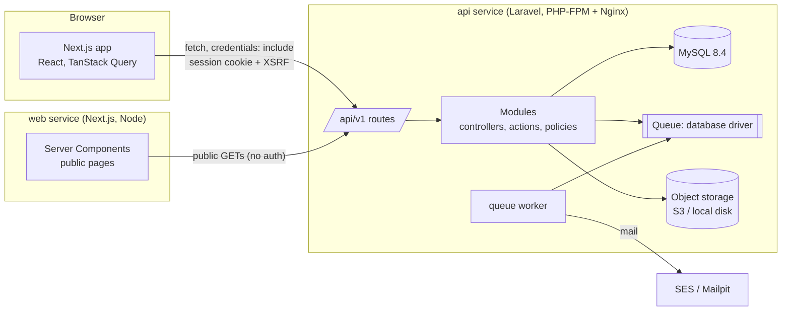
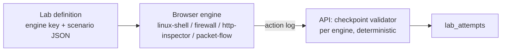
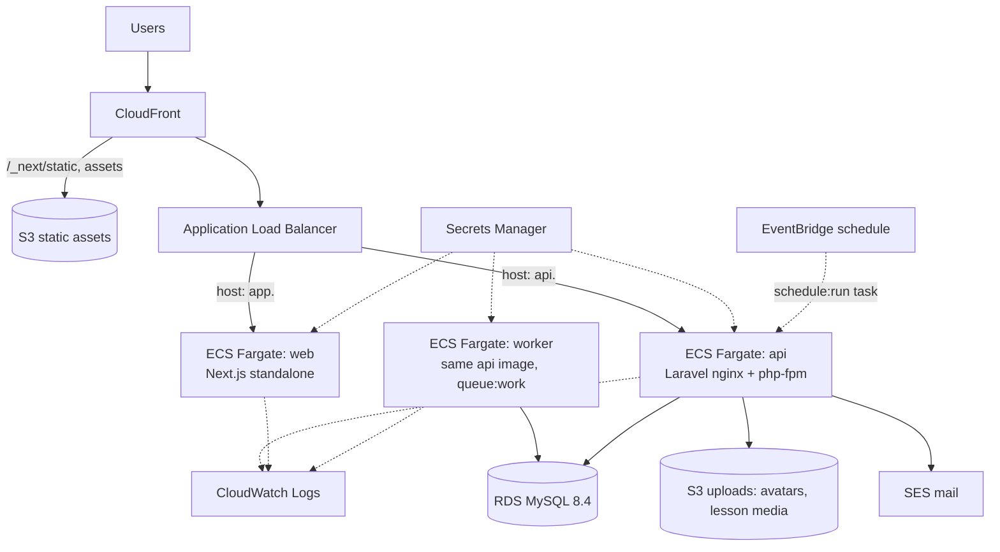

# Architecture

## 1. System overview



There are two independently deployable applications in one monorepo:

| App | Path | Runtime | Responsibility |
|---|---|---|---|
| Frontend | `frontend/` | Next.js (App Router), Node 22 | UI, routing, i18n, client state, rendering visuals and lab simulations |
| Backend | `backend/` | Laravel 13, PHP 8.5 | Auth, business rules, scoring, roadmap generation, persistence, notifications |

The frontend contains no business rules such as scoring, unlock logic or progress completion. It renders what the API returns. The only logic duplicated on the client is form validation for UX, and the server validates again as the authority.

## 2. Repository layout

```text
CyberCompass/
├── frontend/              Next.js app (independent package.json)
├── backend/               Laravel app (independent composer.json)
├── infrastructure/
│   ├── docker/            nginx/php config shared by images
│   └── aws/               ECS task definitions, deployment notes (no app code)
├── docs/
├── docker-compose.yml     local dev: mysql, mailpit, api, worker, web
├── .env.example           compose-level variables only
└── README.md
```

## 3. Backend architecture

### 3.1 Module layout

The code is organized by business domain. Each module owns its HTTP layer, actions and policies. Eloquent models stay in `app/Models` because many modules share them, and splitting them by module causes circular imports.

```text
backend/app/
├── Models/                         Eloquent models + relationships only
├── Modules/
│   ├── Auth/         Http/{Controllers,Requests}, Actions/
│   ├── Profile/      Http/..., Actions/
│   ├── Catalog/      courses, chapters, favorites, enrollments
│   ├── Content/      block registry (JSON Schema per block type), importer, serializer, lesson editor: drafts, publish, revisions, media (Phase 3.5)
│   ├── Admin/        EnsureAdmin, user administration, append-only audit log, make-admin command (Phase 3.5)
│   ├── Learning/     lessons, lesson progress, exercises, attempts
│   ├── Assessment/   assessments, attempts, ScoringService
│   ├── Careers/      careers, goal selection
│   ├── Roadmap/      learning paths, RoadmapGenerator, node status resolver
│   ├── Labs/         labs, attempts, checkpoint validators
│   ├── Progress/     dashboard stats, activities, streaks
│   └── Notifications/ list/read/delete, preferences, Notification classes
│       each: Http/Controllers, Http/Requests, Http/Resources, Actions/, Services/, Policies/, routes.php
├── Support/                        ApiResponse helpers, base exceptions, enums
└── Providers/
```

`routes/api.php` mounts each module's `routes.php` under `/api/v1`.

### 3.2 Layer rules

| Layer | Does | Doesn't |
|---|---|---|
| Controller | Accepts a Form Request, calls one action or service, returns a Resource | Query building, business rules |
| Form Request | Validation and `authorize()` through policies | Side effects |
| Action | One use case (`SubmitAssessmentAttempt`, `CompleteLesson`), wrapped in `DB::transaction` when it writes several rows | HTTP concerns |
| Service | Reusable domain logic (`AssessmentScorer`, `RoadmapGenerator`, `StreakCalculator`) | Persistence of unrelated aggregates |
| Resource | Turns models into the public JSON shape | Exposing internal columns (`is_correct` before submission, password hashes) |
| Policy | Ownership and visibility (`AttemptPolicy::view` checks that the attempt belongs to the user) | |

Cross-module side effects use **domain events** (`LessonCompleted`, `AssessmentSubmitted`, `MilestoneReached`). Listeners record activities and send notifications, so modules don't call each other's internals.

### 3.3 Error handling

One exception renderer in `bootstrap/app.php` produces the error envelope described in [API_SPECIFICATION.md](API_SPECIFICATION.md#errors). Stack traces never reach clients outside `local`.

## 4. Authentication and authorization

**Decision: Laravel Sanctum in SPA mode, with a cookie-based session.**

- The browser first calls `GET /sanctum/csrf-cookie`, then `POST /api/v1/auth/login`. Laravel sets an `HttpOnly`, `Secure`, `SameSite=Lax` session cookie. JavaScript never sees a token, which satisfies the rule against storing tokens in unsafe browser storage.
- Mutating requests send `X-XSRF-TOKEN`, which the API client reads from the `XSRF-TOKEN` cookie. This is Laravel's standard CSRF protection.
- "Remember me" uses Laravel's remember-token cookie.
- Password reset uses Laravel's password broker. The reset link points to the frontend route `/reset-password?token=…&email=…`.
- **Constraint:** the frontend and the API must share a registrable domain (for example `app.example.com` and `api.example.com`, or a single host with the ALB routing `/api/*`). Locally this means `localhost:3000` and `localhost:8000`. `SANCTUM_STATEFUL_DOMAINS` and `CORS_ALLOWED_ORIGINS` list the frontend origin, and CORS uses `supports_credentials`.
- **Route protection on the frontend:** the `(app)` route group is wrapped in `RequireAuth`, which asks `GET /api/v1/me` and redirects guests to `/login?next=…`. Laravel issues a session cookie to *every* visitor, so a cookie-presence check (the original `proxy.ts` plan) cannot tell guests from learners. The API's `auth:sanctum` middleware is the real gate. `next` only accepts same-site paths, so login cannot become an open redirect.
- **Brute force:** login locks an email+IP pair for 60 s after 5 failures. Register is limited to 10 per hour per IP, and password endpoints to 5 per minute.
- **Session hygiene:** the session id is regenerated on login. Logout invalidates the session and rotates the CSRF token. A password change ends all *other* sessions, and a password reset ends *all* of them.
- **Rate limits:** `login` allows 5 requests per minute per email+IP, `password` 3 per minute, `api` 120 per minute per user.
- **Roles:** `learner` and `admin`, as an enum column on `users`. `role` is not fillable; it changes only through `Admin\Actions\ChangeUserRole` or the `cybercompass:make-admin` command (D16).
- **Admin console (Phase 3.5, D16):** `/api/v1/admin/*` runs `auth:sanctum`, then `EnsureAdmin` (learners get 403), then the `admin` rate limiter (120 per minute per admin). Each action is also checked by `UserAdminPolicy`. An admin can't demote or suspend themselves, and the last active admin can't lose access; those checks lock the admin rows inside the transaction. Every mutating admin action writes an append-only `admin_audit_logs` row in the same transaction, with secrets stripped from `changes`. Admins never see or set passwords; they can only trigger the standard reset email. The frontend `(admin)` route group is wrapped in `RequireAuth` and `RequireAdmin`, which shape the interface only; the API is the gate.
- **Suspension:** a suspended account is refused at login (told so only after the correct password). Suspending, and changing a role, deletes the user's sessions and rotates their remember token (`Auth\Actions\EndUserSessions`). `RejectSuspendedUsers` on the `api` group signs out any request that still arrives as a suspended user.

## 5. Frontend architecture

```text
frontend/src/
├── app/                    routes only: layouts, pages, loading/error boundaries
│   ├── (marketing)/        landing, public careers and courses
│   ├── (auth)/             login, register, forgot/reset password
│   └── (app)/              authenticated shell: dashboard, roadmap, learn, labs, profile
├── components/
│   ├── ui/                 shadcn primitives, restyled with tokens
│   ├── layout/             header, app shell, footer
│   └── shared/             cross-feature pieces (EmptyState, Measured, StatusChip)
├── features/<feature>/     components/, hooks/, api.ts, types.ts per feature
├── lib/                    api client, query client, utils, env
├── i18n/                   next-intl config, messages/en.json, messages/vi.json
├── styles/                 tokens.css, globals.css
└── types/                  generated API types (openapi-typescript)
```

- **Data fetching:** public pages (landing, course detail, careers) are Server Components using `serverGet` (`lib/api/server.ts`), revalidated every 60 s, through `INTERNAL_API_URL` when the API has a private address. Signed-in state on those pages (enrolled, favorited, lesson status) loads separately on the client, so the public HTML is the same for everyone. Authenticated pages are client components using **TanStack Query** through a single `apiClient` (base URL from `NEXT_PUBLIC_API_URL`, `credentials: 'include'`, XSRF header, envelope unwrapping, typed errors). No component calls `fetch` directly.
- **Types:** the backend publishes an OpenAPI document (generated by **Scramble**). `npm run api:types` turns it into `src/types/api.d.ts`. That gives the frontend one contract and no hand-copied interfaces.
- **State:** server state lives in TanStack Query. The only global client state is the theme (`next-themes`) and transient UI state such as the exercise draft. No Redux, and no Zustand unless a real need appears.
- **i18n:** **next-intl**, with the locale stored in a cookie and synced from the user's saved preference. There is no locale prefix in URLs (assumption: SEO for a second locale is not a goal). Every user-facing string lives in `messages/*.json`.
- **Visuals:** lesson diagrams are static SVG from `lib/graph` (dagre layout, D23); React Flow (`@xyflow/react`) on the same layout for the roadmap and knowledge map, Recharts for analytics, and Motion for state transitions. React Three Fiber is loaded only on the specific lessons that use it (dynamic import), and never on first paint.

## 6. Personalization engine

Rule-based, deterministic and documented, so a learner can see why a node was recommended.

### 6.1 Assessment scoring

- Each question has a domain and a difficulty of 1, 2 or 3. The **weight is the difficulty**.
- `domain_score = Σ weight(correct) / Σ weight(answered in domain) × 100`
- Unanswered questions count as incorrect once the attempt is submitted.
- Bands: **gap** below 40, **developing** from 40 to 74, **strength** from 75 up.
- The overall score uses the same weighted formula across all questions.
- The result page shows the formula and the counts per domain.

### 6.2 Roadmap generation

Input: the career goal's ordered topics (each with a required domain level) and the latest submitted assessment attempt.

For each topic in the career template:

| Condition | Node recommendation | Reason shown |
|---|---|---|
| Domain score ≥ 75 and the topic's level ≤ intermediate | `review`: optional, unlocked | "You scored 82% in Networking" |
| Domain score below 40 | `required`, with foundation topics of that domain inserted before it if they're missing | "Networking is a gap (31%)" |
| Otherwise | `required` | "Needed for SOC Analyst" |

The path is stored as a snapshot (`learning_paths` and `learning_path_nodes`), so it stays stable while the learner works through it. Reassessing or changing career creates a **new version** and archives the old one. Progress lives in `lesson_progress` and is never copied, so it carries over automatically.

### 6.3 Node status (computed on read, never stored)

- **completed:** every required lesson in the topic is completed.
- **in_progress:** at least one lesson started or completed.
- **available:** every prerequisite topic is completed, or marked `review`.
- **locked:** otherwise.

Lesson completion rule: the learner marks the lesson complete at its end (the client reports time on page, capped at 4 hours per visit) **and**, from Phase 5, has a passing attempt if the lesson has an exercise (score at or above the exercise's `pass_percent`). Completing the last lesson of an enrolled course stamps `enrollments.completed_at` once.

## 7. Labs architecture



- Each lab names an **engine** and a scenario. A scenario holds a virtual filesystem, a list of rules or a captured request, plus checkpoints.
- Engines are pure TypeScript simulations. The Linux shell, for example, interprets a whitelisted command subset against an in-memory filesystem. Nothing executes on a server.
- The server re-validates checkpoints from the submitted action log, so completion can't be faked by editing client state.
- **Future sandboxes:** a `LabProvider` interface (`browser-sim` today) leaves room for a `container` provider, such as isolated ECS tasks with no egress, without changing the lab or attempt schema.

## 8. Deployment architecture (AWS)



MVP deliberately leaves out:

- ElastiCache. Sessions, cache and queue use the **database** driver, which is enough at this scale. Switching to Redis is a config change.
- NAT-free VPC endpoints and WAF. Both are documented as hardening steps.

Configuration is read from environment variables only. Secrets come from Secrets Manager, injected through ECS task definitions. No AWS resource names appear in application code. Files go through Laravel's `Storage` facade (`s3` disk in production, `local` disk in development).

## 9. Key decisions

| # | Decision | Alternatives considered | Why |
|---|---|---|---|
| D1 | Sanctum SPA cookie auth | JWT in localStorage, Next.js BFF proxy | Tokens can't be read by scripts, CSRF protection is built in, and it's the least custom code. The cost is the same-site domain constraint. |
| D2 | Modules under `app/Modules`, shared `app/Models` | Full DDD packages, nwidart/modules | Clear boundaries without a framework that fights Laravel's conventions |
| D3 | Rule-based personalization | ML or LLM recommendations | Transparent, testable, and honest about what it is |
| D4 | Roadmap snapshot plus computed status | Store status per node | No derived state that can drift, and history is kept across versions |
| D5 | OpenAPI (Scramble) to generated TS types | Hand-written types | One source of truth for the contract |
| D6 | Database queue, cache and session in the MVP | Redis | Fewer moving parts on AWS. Easy to switch later. |
| D7 | next-intl with a cookie locale | URL-prefixed locales | Simpler routing for an app that is mostly behind auth |
| D8 | Browser-simulated labs | Live containers | Safe by construction. A provider interface leaves room for containers later. |
| D9 | Next.js 16 with **Cache Components off** | Cache Components + `use cache: private` | Every route reads request cookies (locale, theme, session), and user data comes from the API on the client. With it on, every cookie read would need its own Suspense boundary for no real gain. Public catalog pages can opt into `fetch` revalidation. |
| D10 | Route protection by a client `RequireAuth` gate backed by `/me` (revised in Phase 2) | Cookie-presence check in `proxy.ts`; server-side `/me` call per navigation | Laravel gives guests a session cookie too, so its presence means nothing. A server-side check would add an API round trip to every navigation. The API enforces auth on every route regardless. |
| D11 | Dev containers keep `vendor/` in a named volume, with OPcache on and timestamp validation | Plain bind mount of the whole tree | On Docker Desktop for Windows, reading vendor files through the 9p mount made each boot about 6s. With the volume it is under 1s, and the test suite runs in 2s instead of 85s. |
| D12 | Backend tests run on MySQL (`cybercompass_testing`), not SQLite | In-memory SQLite | The schema uses MySQL features (FULLTEXT, enums, JSON). Tests run against the engine that runs in production. |
| D13 | Next.js dev server runs on the host (`npm run dev`); the `web` container is opt-in (`--profile web`) | Next.js inside Docker for development | Docker Desktop on Windows and macOS delays or drops file events across its file share, so hot reload in the container was unreliable. This is the setup Next.js's own docs recommend. The API, MySQL and the worker stay in Docker. |
| D14 | Diagram content lives in lesson data (`lesson_sections.payload.data`), validated by a zod schema per diagram; React components only draw it | Text inside diagram components | Keeps learning content out of UI code (master prompt rule 5). A diagram whose data is malformed shows a notice instead of breaking the lesson. |
| D15 | Catalog search is a case-insensitive substring match on title and summary (`LIKE`, wildcards escaped) | MySQL FULLTEXT | FULLTEXT ignores words under 3 characters and does not match prefixes ("netw"). At catalog scale substring search is predictable and fast enough. Revisit with a search engine if the catalog grows into the thousands. |
| D16 | An admin console exists: `/api/v1/admin/*` and a `/admin` web area for users, lessons, course structure and lesson images | Seeders as the only way to change content or accounts | The Phase 3.5 prompt. One `admin` role (assumption A1), with a policy method per action so finer roles change one class. Details: [PHASE_3_5_CONTENT_AND_ADMIN.md](PHASE_3_5_CONTENT_AND_ADMIN.md) §5, §8. |
| D17 | One `Content` module owns every write to content tables, through one `BlockRegistry` | The seeder and the admin each validating payloads their own way | Block rules exist once. The importer (seeder, `content:import`) and the admin actions call the same registry. |
| D18 | JSON Schema per block type is the canonical contract (backend, opis/json-schema); zod mirrors it for rendering; shared fixtures are checked by both test suites | zod only; PHP rules only | The backend must reject bad content before it is stored, and errors name the exact field (`sections.1.payload.items.1`). Fixtures stop the two schemas drifting. |
| D19 | Once a lesson is edited in the admin (`updated_by` set, or a draft exists), the database owns it; imports skip it unless `--force` | The seeder always overwrites | Re-seeding must never destroy an admin's work. Lessons removed from a content file are archived, never deleted. |
| D20 | Lesson sections have stable UUIDs (uuid5 of lesson slug + section key for seeded content; content files carry an explicit `uuid` for sections made in the admin console, added by `content:export`); the API's section `id` is the UUID | Position-based ids | Phase 5 exercises link to theory sections; references must survive edits, reordering and re-imports. |
| D21 | One MySQL schema, with table ownership per module | A separate content database | Foreign keys from progress, topics and future exercises to lessons and sections, and the transactions across them, need one schema. No new AWS service. |
| D22 | Interactive 3D lesson blocks run only in a sandbox: `<iframe sandbox="allow-scripts">` (opaque origin) under a no-network CSP, with Three.js in a Web Worker on an OffscreenCanvas and a watchdog. Two block types share it: `scene-3d` (declarative, the default) and `script-3d` (admin-written Three.js, operator kill switch `CONTENT_SCRIPTED_3D`) | Author JS in the page; sanitising JS; a sandboxed iframe running code on its own thread; declarative-only | Admins asked for creative freedom up to code. Code on the app origin would be account takeover; a same-thread sandbox can still freeze the page and phish by navigating. The worker has no DOM, origin, storage or network and can be terminated. Decision record and threat model: [SANDBOXED_3D.md](SANDBOXED_3D.md). |
| D23 | Lesson graph blocks (`flow`, `tree`, `topology`) render as static, themed SVG. `flow` and `tree` are laid out by a pure dagre function (`lib/graph/layout.ts`); `topology` uses the author's positions. Nodes with details are keyboard buttons, and every graph has a text version | React Flow for lesson diagrams | Lesson diagrams are read-only. A pan-and-zoom canvas traps page scrolling and touch, and React Flow adds about 50 KB plus its CSS for no interaction a reader needs. SVG prints, follows theme tokens and stays legible because wide graphs scroll in their own box. dagre (about 19 KB gzip) loads only on lessons with a flow or tree. The Phase 5 roadmap can still use React Flow, fed by the same `layoutGraph()`. |

## 10. Risks

| Risk | Mitigation |
|---|---|
| Cookie auth breaks across domains in deployment | Document the domain setup, and test the deployed CSRF/login flow in Phase 7 |
| Writing lesson content takes most of the time | Fixed content budget per phase; see IMPLEMENTATION_ROADMAP |
| Roadmap graph readability on mobile | A list/outline view of the same data below the `md` breakpoint |
| 3D adds bundle weight | Dynamic import per lesson, and a static fallback image |
| Bilingual content doubles authoring | See open decision in IMPLEMENTATION_ROADMAP |
