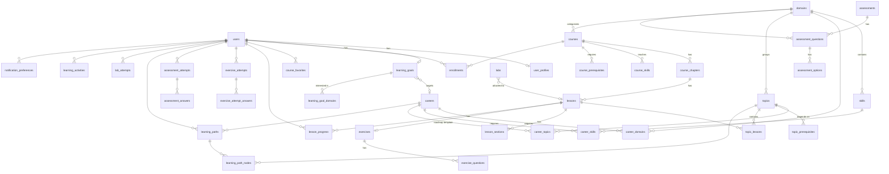

# Database Schema

MySQL 8, InnoDB, `utf8mb4_unicode_ci`. Every table has `id BIGINT UNSIGNED` as its primary key and `created_at`/`updated_at` columns unless noted. Foreign keys are explicit and cascade only where a child has no meaning without its parent.

## Normalization notes (changes from the initial entity list)

| Initial suggestion | Decision |
|---|---|
| `course_categories` + `skills` | Split into **`domains`** (Networking, Linux, … the 8 assessment domains) and **`skills`** (finer-grained, each in one domain). Courses, questions, careers and topics all reference `domains`, so one taxonomy drives the whole personalization flow. |
| `learning_path_nodes` holding lessons | Paths hold **topics**. Lessons belong to topics through `topic_lessons`, so a lesson can appear in several careers' roadmaps without copying rows. |
| `learning_path_progress` | **Dropped.** Node status is computed from `lesson_progress` and topic prerequisites ([ARCHITECTURE §6.3](ARCHITECTURE.md#63-node-status-computed-on-read-never-stored)). |
| `lesson_contents` | Becomes **`lesson_sections`**: ordered, typed blocks (`prose`, `callout`, `diagram`, `steps`, `visual_3d`, `code`) with a JSON payload. |
| `user_favorites` | Becomes **`course_favorites`**, since only courses are favorited. |
| `notifications` | Uses Laravel's standard **`notifications`** table, plus **`notification_preferences`**. |
| Assessment statistics | Only `score_percent` is kept on a submitted attempt, as an immutable snapshot. Domain breakdowns are computed from `assessment_answers`. |
| Labs | Added `labs` and `lab_attempts`. |

## ERD

## Tables

Built so far: identity tables (Phase 2), plus taxonomy, careers, roadmap content, courses and lessons, enrollments, favorites and lesson progress (Phase 3), plus the lesson lifecycle, section UUIDs, lesson drafts and revisions, account suspension and the admin audit log (Phase 3.5 Part A), and `lesson_media` (Part B). The rest is designed and arrives with its phase. Every Phase 3.5 migration is additive (expand only) and safe to run while the previous release is still serving.

### Identity

**users**: `name`, `email` (unique), `email_verified_at`, `password`, `role` enum(`learner`,`admin`) default learner, `suspended_at` null, `suspension_reason` varchar(300) null, `last_login_at` null, `remember_token`. Index (`role`,`suspended_at`) for the active-admin count. `role`, `suspended_at`, `suspension_reason` and `last_login_at` are not fillable (Phase 3.5).
Plus the Laravel defaults `password_reset_tokens` and `sessions`.

**admin_audit_logs** (✅ Phase 3.5): `actor_id` FK users null (null on delete; null for the command line), `action` varchar(60) (e.g. `user.role_changed`), `subject_type` varchar(40) (`user`, `lesson`, `chapter`), `subject_id` null, `changes` JSON null (`{field: [from, to]}` plus context such as `reason`; passwords and tokens are stripped at any depth), `ip`, `created_at`. No `updated_at`. Append-only: the model throws on update and delete, and no code path does either. Indexes (`subject_type`,`subject_id`,`id`), (`actor_id`,`id`), `action`.

**user_profiles** (✅ Phase 2): `user_id` (unique FK, cascade), `avatar_path` null, `phone` null, `date_of_birth` date null, `education_level` enum(`high_school`,`undergraduate`,`graduate`,`other`) null, `locale` enum(`en`,`vi`) default `en`, `theme` enum(`light`,`dark`,`system`) default `system`.

**learning_goals** (Phase 4): `user_id` (unique FK), `career_id` FK null, `self_level` enum(`beginner`,`intermediate`,`advanced`), `weekly_minutes` smallint.
**learning_goal_domains**: `learning_goal_id`, `domain_id`. The primary key is the pair (areas of interest).

### Taxonomy

**domains**: `slug` (unique), `name`, `description`, `position`.
**skills**: `domain_id` FK, `slug` (unique), `name`.

### Careers

**careers**: `slug` (unique), `title`, `summary`, `description`, `responsibilities` JSON (an ordered list of strings), `is_published`.
**career_domains**: `career_id`, `domain_id`, `required_level` tinyint (1 to 3). Primary key is the pair.
**career_skills**: `career_id`, `skill_id`. Primary key is the pair.
**career_topics**: `career_id`, `topic_id`, `stage` tinyint (milestone grouping), `position`. Unique (`career_id`,`topic_id`).

### Roadmap content

**topics**: `domain_id` FK, `slug` (unique), `title`, `summary`, `level` tinyint (1 to 3).
**topic_prerequisites**: `topic_id`, `prerequisite_topic_id`. Primary key is the pair, with a check constraint against self-reference. Cycles are rejected in the seeder and validator.
**topic_lessons**: `topic_id`, `lesson_id`, `position`, `is_required` bool. Primary key is the pair.

### Courses and lessons

**courses**: `domain_id` FK, `slug` (unique), `title`, `summary`, `description`, `difficulty` tinyint (1 to 3), `thumbnail_path`, `objectives` JSON, `is_published`, `published_at`. Indexes: (`is_published`,`domain_id`,`difficulty`) and (`is_published`,`published_at`). Search uses a substring match rather than FULLTEXT (ARCHITECTURE D15).
`estimated_minutes` and `lesson_count` are **not stored**. They are aggregated with `withSum`/`withCount` in queries.
**course_prerequisites**: `course_id`, `prerequisite_course_id`.
**course_skills**: `course_id`, `skill_id`.
**course_chapters**: `course_id` FK cascade, `title`, `position`.
**lessons**: `course_chapter_id` FK cascade, `slug` (unique), `title`, `summary`, `objectives` JSON, `key_takeaways` JSON, `resources` JSON (a list of {label, url}), `estimated_minutes` smallint, `position`, `status` enum(`draft`,`published`,`archived`) default `published` (Phase 3.5), `published_at` null, `created_by` and `updated_by` FK users null (null on delete). Index `status`. Learners only ever see published lessons in published courses: one scope, `Lesson::scopeVisibleToLearners`, is used by every learner query (reader, counts and durations, curriculum, progress and navigation, career topics).
**lesson_sections**: `lesson_id` FK cascade, `uuid` char(36) unique (Phase 3.5, ARCHITECTURE D20), `position`, `type` varchar(40) (was an enum; the `BlockRegistry` validates it), `heading` null, `payload` JSON. Unique (`lesson_id`,`position`). Each type's payload is defined by a JSON Schema in `backend/app/Modules/Content/Blocks/schemas/` (D18): prose `{text}`, callout `{text, tone}`, steps `{items}`, code `{code, language}`, diagram `{key, caption, data}`. The diagram's data is the content the component draws (D14).
**lesson_drafts** (Phase 3.5): `lesson_id` unique FK cascade, `snapshot` JSON (metadata plus ordered sections with UUIDs, registry-validated), `lock_version` int default 1 (optimistic locking), `updated_by` FK users null. Edits go here; the live `lessons`/`lesson_sections` rows change only on publish. Used by the lesson editor (Part B).
**lesson_media** (✅ Phase 3.5 B): `uuid` unique (also the file name), `path` (`lesson-media/{uuid}.webp` on `uploads_disk`), `alt` varchar(250) required, `width`, `height`, `size_bytes`, `uploaded_by` FK users null. Always WebP (re-encoded on upload). `media` blocks store only `{media: uuid, caption}`; the serializer resolves url/alt/size on read.
**lesson_revisions** (Phase 3.5): `lesson_id` FK cascade, `version` int, `snapshot` JSON, `note` varchar(300) null, `created_by` FK users null, `created_at`. Unique (`lesson_id`,`version`). One row per publish.

### Exercises

**exercises**: `lesson_id` (unique FK, cascade), `pass_percent` tinyint default 70.
**exercise_questions**: `exercise_id` FK cascade, `position`, `type` enum(`single_choice`,`multi_choice`,`true_false`,`fill_blank`,`matching`,`ordering`,`scenario`), `prompt` text, `payload` JSON (options, pairs, items: what the learner sees), `answer` JSON (**never serialized before submission**), `explanation` text, `lesson_section_id` FK null (the theory reference).
**exercise_attempts**: `user_id`, `exercise_id`, `score_percent`, `passed` bool, `submitted_at`. Index (`user_id`,`exercise_id`,`passed`).
**exercise_attempt_answers**: `exercise_attempt_id` FK cascade, `exercise_question_id`, `response` JSON, `is_correct` bool.

### Assessment

**assessments**: `slug` (unique), `title`, `description`, `is_active`, `time_limit_minutes` null.
**assessment_questions**: `assessment_id` FK, `domain_id` FK, `difficulty` tinyint (1 to 3), `prompt`, `explanation`, `position`. Index (`assessment_id`,`domain_id`).
**assessment_options**: `assessment_question_id` FK cascade, `label`, `is_correct` bool, `position`.
**assessment_attempts**: `user_id`, `assessment_id`, `started_at`, `submitted_at` null, `score_percent` null. Index (`user_id`,`submitted_at`). Multiple attempts are allowed.
**assessment_answers**: `assessment_attempt_id` FK cascade, `assessment_question_id`, `assessment_option_id` null, `is_correct` bool null (set on submit). Unique (`attempt_id`,`question_id`), so saving an answer is an upsert.

### Personalized paths

**learning_paths**: `user_id`, `career_id`, `assessment_attempt_id` null, `version` smallint, `status` enum(`active`,`archived`), `generated_at`. Only one `active` path per user, enforced in the generator action inside a transaction.
**learning_path_nodes**: `learning_path_id` FK cascade, `topic_id`, `stage`, `position`, `recommendation` enum(`required`,`review`), `reason_key` + `reason_params` JSON (rendered through i18n). Unique (`learning_path_id`,`topic_id`).

### Progress and engagement

**enrollments**: `user_id`, `course_id`, `enrolled_at`, `completed_at` null (an event timestamp, set once). Unique pair.
**course_favorites**: `user_id`, `course_id`, `created_at`. Unique pair.
**lesson_progress**: `user_id`, `lesson_id`, `status` enum(`started`,`completed`), `started_at`, `completed_at` null, `time_spent_seconds` int. Unique pair. Index (`user_id`,`completed_at`).
**learning_activities**: `user_id`, `type` enum(`lesson_started`,`lesson_completed`,`exercise_submitted`,`assessment_submitted`,`lab_completed`,`study_session`), `subject_type`/`subject_id` (morph), `duration_seconds` int default 0, `occurred_at`. Index (`user_id`,`occurred_at`). This is an append-only source for streaks, weekly time and the recent-activity feed.

### Labs

**labs**: `slug` (unique), `title`, `summary`, `domain_id`, `lesson_id` FK null, `engine` varchar (`linux-shell`, `firewall-rules`, `http-inspector`, `packet-flow`), `provider` varchar default `browser-sim`, `scenario` JSON, `difficulty`.
**lab_attempts**: `user_id`, `lab_id`, `actions` JSON, `checkpoints_passed` JSON, `completed_at` null.

### Notifications

**notifications**: Laravel standard (uuid `id`, `type`, `notifiable_*`, `data` JSON, `read_at`).
**notification_preferences**: `user_id`, `type` enum(`recommendation`,`lesson_completed`,`milestone`,`reminder`,`assessment_result`), `in_app` bool, `email` bool. Unique (`user_id`,`type`).

## Transactions

| Operation | Rows written atomically |
|---|---|
| Register | users, user_profiles, notification_preferences defaults |
| Submit assessment | answers scored, attempt score + submitted_at, activity |
| Generate roadmap | archive old path, insert path + nodes |
| Submit exercise | attempt, attempt answers, lesson_progress completion when passed, activity |
| Complete lesson | lesson_progress, enrollment.completed_at when the course is done, activity |

Notifications are dispatched **after commit** (`afterCommit` listeners).

## Seed data

`DatabaseSeeder` runs, in order: domains → skills → careers (7 roles) → topics + prerequisites + career_topics → courses → chapters → lessons + sections → exercises → the assessment (about 40 questions, 5 per domain, mixed difficulty) → labs → a demo learner with progress (`demo@cybercompass.test`, password from `.env`, never committed). Content lives in `database/seeders/content/*.php` (or JSON) files so it's reviewable separately from the seeder code.
