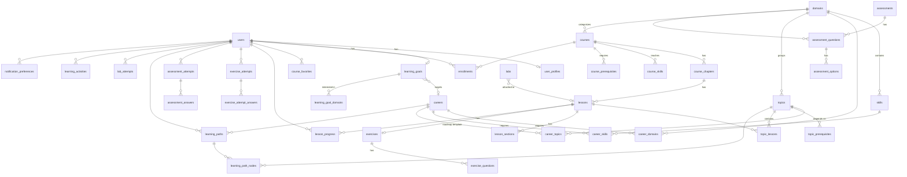

# Database Schema

MySQL 8, InnoDB, `utf8mb4_unicode_ci`. Every table has `id BIGINT UNSIGNED` as its primary key and `created_at`/`updated_at` columns unless noted. Foreign keys are explicit and cascade only where a child has no meaning without its parent.

## Normalization notes (changes from the initial entity list)

| Initial suggestion | Decision |
|---|---|
| `course_categories` + `skills` | Split into **`domains`** (Networking, Linux, … the 8 assessment domains) and **`skills`** (finer-grained, each in one domain). Courses, questions, careers and topics all reference `domains`, so one taxonomy drives the whole personalization flow. |
| `learning_path_nodes` holding lessons | Paths hold **topics**. Lessons belong to topics through `topic_lessons`, so a lesson can appear in several careers' roadmaps without copying rows. |
| `learning_path_progress` | **Dropped.** Node status is computed from `lesson_progress` and topic prerequisites ([ARCHITECTURE §6.3](ARCHITECTURE.md#63-node-status-computed-on-read-never-stored)). |
| `lesson_contents` | Becomes **`lesson_sections`**: ordered, typed blocks (`prose`, `callout`, `diagram`, `steps`, `visual_3d`, `code`) with a JSON payload. |
| `user_favorites` | Becomes **`course_favorites`**, since only courses are favorited. |
| `notifications` | Uses Laravel's standard **`notifications`** table, plus **`notification_preferences`**. |
| Assessment statistics | Only `score_percent` is kept on a submitted attempt, as an immutable snapshot. Domain breakdowns are computed from `assessment_answers`. |
| Labs | Added `labs` and `lab_attempts`. |

## ERD

## Tables

Built so far: identity tables (Phase 2), plus taxonomy, careers, roadmap content, courses and lessons, enrollments, favorites and lesson progress (Phase 3), plus the lesson lifecycle, section UUIDs, lesson drafts and revisions, account suspension and the admin audit log (Phase 3.5 Part A), and `lesson_media` (Part B), plus the assessment tables, learning goals and personal roadmaps (Phase 4). The rest is designed and arrives with its phase. Every Phase 3.5 migration is additive (expand only) and safe to run while the previous release is still serving.

### Identity

**users**: `name`, `email` (unique), `email_verified_at`, `password`, `role` enum(`learner`,`admin`) default learner, `suspended_at` null, `suspension_reason` varchar(300) null, `last_login_at` null, `remember_token`. Index (`role`,`suspended_at`) for the active-admin count. `role`, `suspended_at`, `suspension_reason` and `last_login_at` are not fillable (Phase 3.5).
Plus the Laravel defaults `password_reset_tokens` and `sessions`.

**admin_audit_logs** (✅ Phase 3.5): `actor_id` FK users null (null on delete; null for the command line), `action` varchar(60) (e.g. `user.role_changed`), `subject_type` varchar(40) (`user`, `lesson`, `chapter`), `subject_id` null, `changes` JSON null (`{field: [from, to]}` plus context such as `reason`; passwords and tokens are stripped at any depth), `ip`, `created_at`. No `updated_at`. Append-only: the model throws on update and delete, and no code path does either. Indexes (`subject_type`,`subject_id`,`id`), (`actor_id`,`id`), `action`.

**user_profiles** (✅ Phase 2): `user_id` (unique FK, cascade), `avatar_path` null, `phone` null, `date_of_birth` date null, `education_level` enum(`high_school`,`undergraduate`,`graduate`,`other`) null, `locale` enum(`en`,`vi`) default `en`, `theme` enum(`light`,`dark`,`system`) default `system`, `timezone` varchar(64) null (IANA; Phase 6, D33: filled from the browser, editable under Preferences, UTC until set), `compass_enabled` boolean default true and `shortcuts` json null (F1, D53: action id to a key binding, or null for a disabled shortcut).

**learning_goals** (✅ Phase 4): `user_id` (unique FK cascade), `career_id` FK null (null on delete), `self_level` enum(`beginner`,`intermediate`,`advanced`) null, `weekly_minutes` smallint null (30 to 2400).
**learning_goal_domains**: `learning_goal_id`, `domain_id`. The primary key is the pair (areas of interest).

### Taxonomy

**domains**: `slug` (unique), `name`, `description`, `position`.
**skills**: `domain_id` FK, `slug` (unique), `name`.

### Careers

**careers**: `slug` (unique), `title`, `summary`, `description`, `responsibilities` JSON (an ordered list of strings), `is_published`.
**career_domains**: `career_id`, `domain_id`, `required_level` tinyint (1 to 3). Primary key is the pair.
**career_skills**: `career_id`, `skill_id`. Primary key is the pair.
**career_topics**: `career_id`, `topic_id`, `stage` tinyint (milestone grouping), `position`. Unique (`career_id`,`topic_id`).

### Roadmap content

**topics**: `domain_id` FK, `slug` (unique), `title`, `summary`, `level` tinyint (1 to 3).
**topic_prerequisites**: `topic_id`, `prerequisite_topic_id`. Primary key is the pair, with a check constraint against self-reference. Cycles are rejected in the seeder and validator.
**topic_lessons**: `topic_id`, `lesson_id`, `position`, `is_required` bool. Primary key is the pair.

### Courses and lessons

**courses**: `domain_id` FK, `slug` (unique), `title`, `summary`, `description`, `difficulty` tinyint (1 to 3), `thumbnail_path`, `objectives` JSON, `is_published`, `published_at`. Indexes: (`is_published`,`domain_id`,`difficulty`) and (`is_published`,`published_at`). Search uses a substring match rather than FULLTEXT (ARCHITECTURE D15).
`estimated_minutes` and `lesson_count` are **not stored**. They are aggregated with `withSum`/`withCount` in queries.
**course_prerequisites**: `course_id`, `prerequisite_course_id`.
**course_skills**: `course_id`, `skill_id`.
**course_chapters**: `course_id` FK cascade, `title`, `position`.
**lessons**: `course_chapter_id` FK cascade, `slug` (unique), `title`, `summary`, `objectives` JSON, `key_takeaways` JSON, `resources` JSON (a list of {label, url}), `estimated_minutes` smallint, `position`, `status` enum(`draft`,`published`,`archived`) default `published` (Phase 3.5), `published_at` null, `created_by` and `updated_by` FK users null (null on delete). Index `status`. Learners only ever see published lessons in published courses: one scope, `Lesson::scopeVisibleToLearners`, is used by every learner query (reader, counts and durations, curriculum, progress and navigation, career topics).
**lesson_sections**: `lesson_id` FK cascade, `uuid` char(36) unique (Phase 3.5, ARCHITECTURE D20), `position`, `type` varchar(40) (was an enum; the `BlockRegistry` validates it), `heading` null, `payload` JSON, `sources` JSON null (F6, D68: `[{label, url, kind, note?}]`, at most 8, validated once for every block type by `Content\Documents\SectionSources`). Unique (`lesson_id`,`position`). Each type's payload is defined by a JSON Schema in `backend/app/Modules/Content/Blocks/schemas/` (D18): prose `{text}`, callout `{text, tone}`, steps `{items}`, code `{code, language}`, diagram `{key, caption, data}`. The diagram's data is the content the component draws (D14).
**lesson_drafts** (Phase 3.5): `lesson_id` unique FK cascade, `snapshot` JSON (metadata plus ordered sections with UUIDs, registry-validated), `lock_version` int default 1 (optimistic locking), `updated_by` FK users null. Edits go here; the live `lessons`/`lesson_sections` rows change only on publish. Used by the lesson editor (Part B).
**lesson_media** (✅ Phase 3.5 B): `uuid` unique (also the file name), `path` (`lesson-media/{uuid}.webp` on `uploads_disk`), `source` varchar(255) null (F2, D56: the content-file image it was imported from, relative to `database/seeders/content`; null for uploads), `alt` varchar(250) required, `width`, `height`, `size_bytes`, `uploaded_by` FK users null. Always WebP (re-encoded on upload and on import). `media` blocks store only `{media: uuid, caption}`; the serializer resolves url/alt/size on read. Shared by lessons and blog posts (covers and `media` blocks).
**lesson_revisions** (Phase 3.5): `lesson_id` FK cascade, `version` int, `snapshot` JSON, `note` varchar(300) null, `created_by` FK users null, `created_at`. Unique (`lesson_id`,`version`). One row per publish.

**course_graphs** (✅ F3, D57, D58): `course_id` unique FK cascade, `graph` JSON (`{version, problem, layout, lanes?, placement?, edges}`, lessons named by slug; contract in `Content/CourseMap/schemas/course-graph.json`), `lock_version` int default 1, `updated_by` FK users null (null on delete; set by an admin save, which makes the database the map's owner for imports), timestamps. History is the audit log (`course_graph.saved`, `course_graph.restored` with the whole map before and after).

**lesson_architectures** (✅ F3, D57): `lesson_id` unique FK cascade, `architecture` JSON (`{version, problem, shape, nodes, edges, rows?, cols?}`; `architecture.json` plus `shapes/<shape>.json`), timestamps. The published architecture only, written by publishing and the importer; drafts and revisions carry it in their snapshot under `architecture` (a snapshot without the key has none). Sub-node `section` values are UUIDs of that lesson's own sections. Separate tables rather than JSON columns so `SELECT *` lesson queries never carry them.

### Blog (✅ F2, D55)

Twins of the lesson tables, for posts that are never part of a course. All four migrations are additive.

**posts**: `slug` varchar(120) unique, `title` varchar(160), `summary` varchar(300) default '', `cover` uuid null (a `lesson_media` uuid; no foreign key, checked on save like `media` blocks), `tags` JSON (at most 8 lowercase slugs), `estimated_minutes` smallint (computed from the content on every save and import, never typed), `status` varchar(20) (`draft`, `published`, `archived`; the `LessonStatus` enum), `published_at` null, `created_by` and `updated_by` FK users null (null on delete). Index (`status`,`published_at`). Readers see only published posts through one scope, `Post::scopeVisibleToReaders` (list, detail, search). A post that was ever published is archived, never deleted.
**post_sections**: `post_id` FK cascade, `uuid` unique (uuid5 of post slug + section key for seeded posts, in a namespace of their own), `position` smallint, `type` varchar(40), `heading` varchar(160) null, `payload` JSON, `sources` JSON null (D68, as on `lesson_sections`). Unique (`post_id`,`position`). The same block types and JSON Schemas as `lesson_sections`, at most 150 per post.
**post_drafts**: `post_id` unique FK cascade, `snapshot` JSON (`{slug, title, summary, cover, tags, estimated_minutes, sections}`), `lock_version` int, `updated_by` FK users null.
**content_transfers** (✅ F6, D70): `user_id` FK cascade (the admin who owns it), `direction` (`import`, `export`), `status` varchar(20) (`uploading`, `validating`, `ready`, `applying`, `applied`, `exporting`, `failed`), `file_name`, `size_bytes` null, `path` (key on the transfers disk: `imports/{id}/package`, `exports/{id}/<file>`), `upload_id` (S3 multipart) null, `parts` null, `subject` JSON null (exports: `{type, id, sections}`), `report` JSON null (the preview with the lock versions it saw, or what was exported), `error` varchar(1000) null, `expires_at` (7 days; `content:prune-transfers` removes the row and the file hourly), timestamps. Index (`user_id`,`created_at`), (`expires_at`).

**post_revisions**: `post_id` FK cascade, `version` int, `snapshot` JSON, `note` varchar(300) null, `created_by` FK users null, `created_at`. Unique (`post_id`,`version`). One row per publish.

### Exercises

**exercises** (✅ Phase 5, D29): `lesson_id` (unique FK, cascade), `pass_percent` tinyint default 70. A lesson "has an exercise" when it has at least one active question.
**exercise_questions**: `exercise_id` FK cascade, `key` (stable identity in the content file; unique with `exercise_id`), `position`, `type` varchar (`single_choice`, `multi_choice`, `true_false`, `fill_blank`, `matching`, `ordering`, `scenario`; enum `ExerciseQuestionType`), `prompt` text, `payload` JSON (what the learner sees), `answer` JSON (hidden on the model, **never serialized before submission**), `explanation` text, `lesson_section_id` FK null, null on delete (the theory reference; a section an active question uses cannot be deleted, D30), `is_archived` bool (removed from the file; never deleted). Index (`exercise_id`,`is_archived`,`position`).
**exercise_attempts**: `user_id`, `exercise_id`, `score_percent`, `passed` bool, `time_spent_seconds` (capped at 4 hours), `submitted_at`. Index (`user_id`,`exercise_id`,`passed`). Scored on submission; there is no open attempt on the server.
**exercise_attempt_answers**: `exercise_attempt_id` FK cascade, `exercise_question_id` FK, `response` JSON null (null: unanswered), `is_correct` bool. Unique (`attempt`,`question`), named explicitly.

### Assessment (✅ Phase 4 Part A, D24)

**assessments**: `slug` (unique), `title`, `description`, `is_active` (one active at a time), `time_limit_minutes` null.
**assessment_questions**: `assessment_id` FK, `domain_id` FK, `key` (stable identity in the content file; unique with `assessment_id`), `difficulty` tinyint (1 to 3, also the weight), `prompt`, `code` text null (snippet), `explanation`, `position`, `is_archived` bool (removed from the file; never deleted). Index (`assessment_id`,`is_archived`,`position`).
**assessment_options**: `assessment_question_id` FK cascade, `label`, `is_correct` bool (hidden on the model, never serialized before submission), `position`. Unique (`question_id`,`position`).
**assessment_attempts**: `user_id`, `assessment_id`, `started_at`, `submitted_at` null, `score_percent` null (snapshot set on submit), `open_marker` (generated: 1 while open, null once submitted). Unique (`user_id`,`assessment_id`,`open_marker`): one open attempt per learner, any number of submitted ones. Index (`user_id`,`submitted_at`).
**assessment_answers**: `assessment_attempt_id` FK cascade, `assessment_question_id` FK, `assessment_option_id` FK null, `position`, `is_correct` bool null (set on submit). Unique (`attempt_id`,`question_id`). One row per question the attempt drew, created when it starts, so an attempt keeps its own question set (a larger random pool needs no schema change). An unanswered question has no option and counts as incorrect.

### Personalized paths

**learning_paths** (✅ Phase 4): `user_id`, `career_id`, `assessment_attempt_id` null (null on delete), `version` smallint, `status` enum(`active`,`archived`), `generated_at`, `active_marker` (generated: 1 while active, null once archived). Unique (`user_id`,`version`) and (`user_id`,`active_marker`): one active path per user, also serialised by a row lock in the generator.
**learning_path_nodes** (✅ Phase 4): `learning_path_id` FK cascade, `topic_id`, `stage`, `position`, `recommendation` enum(`required`,`review`), `reason_key` + `reason_params` JSON (rendered through i18n). Unique (`learning_path_id`,`topic_id`).

### Progress and engagement

**enrollments**: `user_id`, `course_id`, `enrolled_at`, `completed_at` null (an event timestamp, set once). Unique pair.
**course_favorites**: `user_id`, `course_id`, `created_at`. Unique pair.
**lesson_progress**: `user_id`, `lesson_id`, `status` enum(`started`,`completed`), `started_at`, `completed_at` null, `time_spent_seconds` int. Unique pair. Index (`user_id`,`completed_at`).
**learning_activities**: `user_id`, `type` enum(`lesson_started`,`lesson_completed`,`exercise_submitted`,`assessment_submitted`,`lab_completed`,`study_session`), `subject_type`/`subject_id` (morph), `duration_seconds` int default 0, `occurred_at`. Index (`user_id`,`occurred_at`). This is an append-only source for streaks, weekly time and the recent-activity feed (✅ Phase 6, D33). Rows are written only by the Progress listener (`ActivityRecorder`), after commit; the subject morph uses the aliases `lesson`, `lab`, `exercise_attempt` and `assessment_attempt`. `lesson_completed` is the first completion; a later visit to a completed lesson is a `study_session` with its time. A lesson completed by a passing exercise carries 0 seconds, because the `exercise_submitted` row holds that time. `progress:backfill` fills rows for earlier progress once.

### Labs

**labs** (✅ Phase 5, D28): `slug` (unique), `title`, `summary`, `briefing` (markdown), `domain_id`, `lesson_id` FK null (null on delete), `engine` varchar (`linux-shell`, `firewall-rules`, `http-inspector`), `provider` varchar default `simulated`, `scenario` JSON (checkpoints with their answers, hidden packets and routes; hidden on the model, never serialized), `difficulty`, `estimated_minutes`, `position`, `is_archived` bool (left the content file; never deleted). Index (`is_archived`,`position`).
**F7 additions (D73 to D79), all expand-only:** `labs.status` (`draft` or `published`, default `published`), `labs.updated_by` (FK users, null on delete: the database owns the lab), `labs.scenario_version` (starts at 1, goes up on a publish that changes the engine or scenario), `labs.lock_version`, `labs.solutions` (JSON, hidden: `{solutions, decoys}`); `lab_attempts.scenario_version` and `restarted_at`; **lab_drafts** (`lab_id` unique, `snapshot` JSON, `lock_version`, `updated_by`) and **lab_revisions** (`lab_id`, `version`, `snapshot` JSON, `note`, `created_by`; unique `lab_id`+`version`). Snapshots hold the whole definition, answers included: admin routes only.
**lab_attempts**: `user_id`, `lab_id`, `state` JSON ({engine, answers}; at most 256 KB), `state_version` int (optimistic lock), `action_count` int, `checkpoints_passed` JSON (ids), `completed_at` null (set once, kept through a reset). Unique (`user_id`,`lab_id`): one attempt per learner and lab; reset starts its state over.

### Notifications

**notifications** (✅ Phase 6, D34): Laravel standard (uuid `id`, `type`, `notifiable_*`, `data` JSON, `read_at`), with `type` holding the notification type (`recommendation`, …) and `data` `{params, url}`. Index (`notifiable_type`,`notifiable_id`,`read_at`). No foreign key (polymorphic), so `User` deletes its notifications when deleted.
**notification_preferences**: `user_id`, `type` enum(`recommendation`,`lesson_completed`,`milestone`,`reminder`,`assessment_result`), `in_app` bool, `email` bool. Unique (`user_id`,`type`). A row exists only once a learner changes a type; the defaults live in code (in app on, email off; D34).
**notification_sends**: `user_id` (cascade), `key` varchar(120), `created_at`. Unique (`user_id`,`key`). The one-off sends already decided (`course:{id}`, `roadmap:{career_id}:{25|50|75|100}`, `streak:{days}:{first day}`, `reminder:{local date}`, `recommendation:lesson:{id}`); claiming a key is atomic, and deleting a notification never brings it back.

## Transactions

| Operation | Rows written atomically |
|---|---|
| Register | users, user_profiles (notification preferences have code defaults, D34) |
| Submit assessment | answers scored, attempt score + submitted_at (the activity row is added by a Phase 6 listener on `AssessmentSubmitted`) |
| Generate roadmap | archive old path, insert path + nodes |
| Lab action | the attempt row is locked and its version checked; new state, version, action count, checkpoints passed and `completed_at` on the first completion (`LabCompleted` after commit) |
| Submit exercise | attempt, attempt answers, lesson_progress completion when passed (the activity row is added by a Phase 6 listener on `ExerciseSubmitted`) |
| Complete lesson | lesson_progress, enrollment.completed_at when the course is done (the activity row is added after commit by the listener on `LessonCompleted`) |

Notifications are dispatched **after commit** (`afterCommit` listeners).

## Seed data

`DatabaseSeeder` runs, in order: domains → skills → careers (7 roles) → topics + prerequisites + career_topics → courses → chapters → lessons + sections → exercises → the assessment (about 40 questions, 5 per domain, mixed difficulty) → labs → a demo learner with progress (`demo@cybercompass.test`, password from `.env`, never committed). Content lives in `database/seeders/content/*.php` (or JSON) files so it's reviewable separately from the seeder code. Blog posts are content files too (`content/posts/<slug>.php`, F2), imported after the courses; their images sit beside them under `content/posts/media/` and are uploaded on import (D56).
