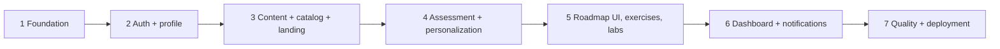

# Implementation Roadmap

Seven phases. Each one ends with the same gate: tests pass, `tsc --noEmit` is clean, Laravel has no errors, the UI has been checked in a real browser at 1280px and 390px in both themes, the docs are updated, and a report lists what was done and what remains.

## Phase 1: Foundation ✅ (completed 2026-11-19)

- Monorepo, git, `.env.example` files, `.gitattributes` (LF)
- `frontend/`: Next.js 16 (TS strict), Tailwind 4, design tokens with light/dark/system, next-intl (en/vi), TanStack Query, typed API client, Vitest
- `backend/`: Laravel 13 on PHP 8.5, Sanctum (SPA mode), CORS with credentials, module structure (`app/Modules`), central error envelope, `/api/v1/health`, Scramble OpenAPI, Pest on MySQL, rate limiting
- `docker-compose.yml`: mysql 8.4 (with a separate test database), mailpit, api, worker, web. Production Dockerfile targets for api and web.
- Marketing layout, foundation home page with live system status, `/design-system` reference
- README with Docker setup

**Exit, verified:** the web container calls `/api/v1/health` from a real browser and shows the API and database as reachable, with no console errors. Frontend: typecheck, lint, 8 tests. Backend: Pint, 14 Pest tests. Hallmark sloplint is clean. Both production images build and serve.

**Moved to Phase 2:** the auth layout and the app shell (they need auth to be meaningful) and route protection. shadcn primitives are added per component as screens need them, rather than initialised up front.

## Phase 2: Auth and user management ✅ (completed 2026-11-20)

- **API:** `Auth` module (register, login with remember me and per-account lockout, logout, forgot and reset password, `/me`) and `Profile` module (personal info, avatar upload re-encoded to WebP, preferences, password change). `users.role` and `user_profiles` migrations. Vietnamese validation, auth and email strings. The reset email follows the user's language. Demo user seeder.
- **Web:** login, register, forgot and reset password screens. The header account menu. The `(app)` area behind `RequireAuth`. Settings with three routed tabs: personal information (with avatar), security (password, log out) and preferences (theme and language, saved to the account and applied on login).
- **Exit, verified:** 66 Pest tests and 29 Vitest tests. A real-browser journey through the Docker stack covered guest redirect, register, profile edit, avatar upload, preferences in Vietnamese and dark, logout, wrong password then login with remember me, and forgot then reset through the Mailpit email. Phone width has no overflow. Hallmark sloplint is clean on every public auth page.
- **Deferred, with reasons:** the *Learning goals* tab moves to Phase 4, because it needs careers and domains, which arrive in Phases 3 and 4. *Notification preferences* move to Phase 6 with notifications. *Email verification* (O4) is not built; accounts work unverified, and `email_verified_at` is already in the schema. *Changing the email address* is not offered yet.

## Phase 3: Learning content and the landing page ✅ (completed 2026-11-21)

- **Content (seeded, validated):** 8 domains with 20 skills, 8 published courses (one per domain) with 30 fully written lessons, 13 roadmap topics with prerequisites, and 7 careers with staged roadmap templates. Content lives in `backend/database/seeders/content/`. The seeder validates references, prerequisite cycles and stage ordering, and upserts by slug so learners' progress survives re-seeding.
- **API:** `Catalog` (domains; courses with search, filters, sorting and pagination; course detail with related courses; per-learner progress, enrollment, favorites), `Careers` (catalog and detail with roadmap template and suggested courses), `Learning` (lesson reader with cross-chapter navigation, start, complete with capped study time, course completion stamp).
- **Web:** course catalog with URL-backed filters; course detail with enroll, start or continue, favorite, progress and per-lesson status; lesson reader (table of contents, safe prose renderer, callouts, steps, code with copy, three data-driven interactive diagrams: OSI layers, TCP handshake, CIA triad); careers catalog and detail with the roadmap preview; header navigation with a mobile menu. The **landing page** was built with Hallmark: a Map/Diagram page whose signature is the real career topic graph, followed by domains, featured courses, questions and a first-lesson close.
- **Exit, verified:** 97 Pest tests and 40 Vitest tests. A real-browser journey covered catalog filters, search, pagination, guest-to-login-to-lesson return, diagram keyboard use, completion, continue, favorites and the favorites filter. No phone overflow, no console errors. Hallmark sloplint is clean on every public route; the landing has 2 confirmed warnings. The production build passes.
- **Deferred, with reasons:** exercises (Phase 5); recording `learning_activities` for streaks and weekly time (Phase 6, when the dashboard reads them); global `/search` (Phase 6); "choose this career as my goal" (Phase 4, with the assessment); the interactive personal roadmap graph (Phase 5). The landing's roadmap is the career template, and the page says so.
- **Content budget change:** the plan said 6 full courses plus outline-only ones. Instead, all 8 courses are complete and nothing is outline-only, because outline lessons would have been empty pages.

## Phase 3.5: Content platform and admin console ✅ (completed 2026-11-21)

Inserted between Phase 3 and Phase 4 by the Phase 3.5 prompt. Design and every change to the prompt: [PHASE_3_5_CONTENT_AND_ADMIN.md](PHASE_3_5_CONTENT_AND_ADMIN.md). Delivered in three gated parts.

### Part A: content core and user management ✅ (completed 2026-11-20)

- **Content core:** a `Content` module with one `BlockRegistry`; a JSON Schema per block type (prose, callout, steps, code, diagram) with valid and invalid fixtures; errors keyed to the exact field. A `ContentImporter` (used by the seeder and `php artisan content:import [--force]`) gives sections stable UUIDs, renumbers lessons without tripping the unique index, archives lessons removed from a file, and skips lessons an admin owns. Lessons have a status (draft, published, archived), and one visibility scope hides drafts and archived lessons from every learner query.
- **Admin foundation:** `Admin` module with `EnsureAdmin`, an `admin` rate limiter, `UserAdminPolicy`, an append-only audit log, `cybercompass:make-admin {email}` for the first admin and recovery, and a demo admin (`admin@cybercompass.test`) whose password comes from `DEMO_ADMIN_PASSWORD` in `backend/.env`.
- **User management:** overview, user list (search, role and status filters, sort, pagination), user detail, role change, suspend with reason, reactivate, send the standard reset email, and the audit log, in the API and the `/admin` web area (en and vi). Safety rules: no self-demotion or self-suspension, the last active admin is protected, and role changes and suspensions end the user's sessions. Suspended users are refused at login and signed out mid-session. Logins record `last_login_at`.
- **Exit, verified:** 178 Pest tests (81 new in Phase 3.5, including guest 401 and learner 403 on every admin route read from the router) and 45 Vitest tests; Pint, tsc and ESLint clean; Hallmark sloplint clean on the admin code. A headless-browser run as the demo admin covered the overview, search, row navigation, suspend (with reason validation), the suspended learner refused at login, reactivate, own-account protections, the audit log, phone layouts with no horizontal scroll, and the learner seeing "Admins only" and a 403 from the API.

### Part B: lesson editor ✅ (completed 2026-11-20)

- **API:** the content authoring endpoints in [API_SPECIFICATION.md](API_SPECIFICATION.md#admin--phase-35-part-a): block types, course structure (chapters, chapter and lesson order), lesson list, create, draft save with `lock_version` (409 on conflict), discard, publish (revision n+1, re-validated), archive, delete (never-published only), revisions with a change summary, restore into the draft, and image upload (WebP, alt required, SVG refused). A `media` block type (pulled forward from Part C) and a shared `SectionWriter` used by both publishing and the importer. Schema errors now read in plain words (en and vi) and are keyed at the exact field, including missing ones. Content is stored exactly as written (exempt from string trimming).
- **Web:** `/admin/lessons` (filters, new-lesson dialog with an automatic address), the editor at `/admin/lessons/{id}` (details, numbered block cards with a form per type or a validated JSON editor, image picker with upload, sticky Save/Publish bar, Ctrl+S, leave-page warning, field-level errors that clear as you fix them, conflict recovery, Preview with the learner renderer, History with restore), and `/admin/courses` (add and rename chapters, reorder chapters and lessons). The learner reader renders `media` blocks.
- **Bug found by the browser run and fixed:** a save that finished while the author kept editing replaced the form with the saved copy and lost the newer edits; the editor now keeps them and only adopts the ids the server assigned.
- **Exit, verified:** 212 Pest tests (34 new in Part B) and 53 Vitest tests; Pint, tsc, ESLint and Hallmark sloplint clean; the production build passes. A headless-browser run on throwaway content (removed afterwards) covered creating a lesson, refusal to publish an empty one, a block error on its field, save, image upload, preview, learners not seeing the draft, publishing with a note, a two-tab conflict and recovery, history, lesson reorder, archive, and phone layouts with no horizontal scroll. The Part A admin run still passes.

### Part C1: interactive 3D blocks ✅ (completed 2026-11-20)

- **Decision:** [SANDBOXED_3D.md](SANDBOXED_3D.md) (D22) compares six approaches and picks two block types on one sandbox: `scene-3d` (declarative: shapes, labels, links with moving packets, animations, click-to-explain, guided steps with camera moves) and `script-3d` (admin-written Three.js). Both run in `<iframe sandbox="allow-scripts">` under a no-network CSP, inside a Web Worker on an OffscreenCanvas, watched by a 3-second watchdog. The runtime (Three.js 0.186.1, pinned and self-hosted, 180 KB brotli) loads only when a 3D block scrolls near, and never enters the app bundle.
- **Editor:** form fields plus a scene JSON editor or a code editor, each with a live preview through the same sandbox learners get; client-side checks with exact paths; runtime errors with line numbers; inline references. Learners always have a required text description, shown instead of the view when 3D can't run.
- **Operations:** `CONTENT_SCRIPTED_3D=false` refuses new scripts and stops sending script code to readers.
- **Exit, verified:** 236 Pest tests (24 new, incl. fixtures and the kill switch; the fixtures found a duplicate-id check that never fired and empty code passing) and 75 Vitest tests (22 new: zod and JSON Schema agree on all 17 fixtures; step logic). Attacks from a real app page in headless Edge: scene code had no fetch/XHR/WebSocket/Worker/importScripts/DOM/storage, could not recover fetch from the prototype chain, endless loops were shut down in setup (3 s) and in the frame loop, a busy scene cost the lesson page at most 7 ms per frame, and the host page's storage and URL were untouched. Editor flow: live previews, a broken reference flagged before saving, a syntax error reported, publish, learner view in both themes, phone width without overflow.

### Part C2: 2D generic blocks ✅ (completed 2026-11-20)

- **Blocks:** `layer-stack`, `sequence`, `flow`, `tree`, `topology`, `comparison`, `timeline`, `bitfield`, `calculator` (`cidr`, `chmod`, `password-entropy`; browser-only), `step-through`, `knowledge-check` (ungraded, never affects progress), and extended `prose` (https links and numbered lists; other links are refused on save). Each has a JSON Schema plus cross-reference checks (unique ids, references, one tree root, no parent loops, one value per column, 64 bits per row, a correct option per question), mirrored in zod.
- **Rendering:** themed SVG for graphs from a pure dagre layout in `lib/graph` (D23; React Flow is not used for read-only lesson diagrams). dagre loads only with a flow or tree (about 19 KB gzip). Selectable nodes are keyboard buttons, graphs have a text version, comparison tables become cards on phones, and wide diagrams scroll inside their own box.
- **Editor:** a grouped add-block menu; forms for comparison, timeline, calculator and knowledge check; validated JSON with a field reference generated from the schema for the rest. Every visual block shows the learner renderer as a live preview, with issues listed at their paths (C17 to C19 in PHASE_3_5).
- **Migration:** the OSI lesson uses `layer-stack` and the TCP handshake uses `sequence`; the bespoke components are deleted. The old diagram keys stay valid (no longer offered) and render through the generic components, so old revisions still restore.
- **Exit, verified:** 331 Pest tests (95 new) and 261 Vitest tests (186 new: all 19 block types agree with the backend on every fixture, with a check that no type lacks fixtures or a schema; every valid fixture renders; calculator maths including /0, /31, /32 and setuid and sticky bits; layout). Pint, tsc, ESLint and Hallmark sloplint clean (0 FAIL); the production build passes. Headless Edge on throwaway content (removed afterwards), 21 of 21: every new block starts from its example with a live preview, an unknown flow id is flagged while typing, a question with no correct option is flagged, a new column adds a value to every row, an `http://` link is refused at its field, save and publish, learner rendering with no notices, knowledge-check feedback, CIDR maths, flow node details, dark and light themes, phone width with no page overflow and comparison cards, the migrated OSI and TCP lessons, and no console errors. The browser run led to two fixes: a wrong knowledge-check answer no longer reveals the correct option, and topology and two-actor sequence text was enlarged to stay legible.

### Part C3: pilot content ✅ (completed 2026-11-21)

- **Pilot courses rewritten** on the block library, keeping lesson slugs and headings so section UUIDs are stable. Networking Fundamentals: a 3D "follow a packet" scene (intro), encapsulation as a step-through and the OSI layer stack, TCP/IP as a layer stack with TCP vs UDP as a comparison and the handshake as a sequence, IPv4 and a /26 as bit fields with a CIDR calculator, a segmented office network as a topology, the DNS tree, DNS resolution and DHCP as sequences. Security Fundamentals: the CIA triad, vulnerability/threat/risk as a comparison, a risk score as a step-through and the response as a flow, defense in depth as a 3D scene (C20), control types and three frameworks as comparisons, ATT&CK as a tree. Every lesson ends with a practice check (22 questions with explanations).
- **`content:export {course}`** writes a course's published lessons back to its content file; sections made in the admin console keep their UUIDs through an explicit `uuid` (C21).
- **[CONTENT_AUTHORING_GUIDE.md](CONTENT_AUTHORING_GUIDE.md):** principles, choosing a block, how to write each one well (with the limits that matter in practice), 3D guidance, the console and file workflows, and a pre-publish checklist.
- **Found while reviewing the lessons and fixed:** topology zones overlapped each other and hid the next zone's label (zone padding was one-sided); trees drew children in reverse author order (dagre now gets sibling order constraints); five-actor sequences overflowed their lanes (content shortened, guidance added); the intro 3D scene was framed too wide; the knowledge check's intro repeated the section heading.
- **Exit, verified:** 337 Pest tests (6 new: every course exports and re-imports with nothing changed, section UUIDs included; admin-made sections keep their UUID; drafts are not exported; a UUID owned by another lesson is refused; the PHP writer reproduces tricky strings exactly; the command) and 262 Vitest tests. Pint, tsc, ESLint and Hallmark sloplint clean; the production build passes. Headless Edge as a learner, 21 of 21: all 10 pilot lessons render every block with no unavailable notices, both 3D scenes run in the sandbox, every lesson has its practice check, no page overflow at phone width, no console errors. A catalog test that hard-coded the longest course (90 minutes) now derives it from the content (Networking Fundamentals is now 108).
- **Known caveat (testing only):** a full-page screenshot in headless Edge, which renders WebGL in software, can stall a 3D scene long enough for the sandbox watchdog to close it, so the text description appears instead. At normal viewport size the same scene runs steadily (watched for 12 s). Capture 3D blocks at viewport size, not full page.

## Phase 4: Assessment and personalization

Impact check (2026-11-21, CLAUDE.md §5) against Phase 3.5's changes, with the user's decisions: D24 (the `Assessment` module owns its question bank and loader), D25 (the personal roadmap ships as an outline in Phase 4; the graph stays in Phase 5), D26 (the result reveals answers and explanations only for wrongly answered questions; the roadmap updates only on request). The planned `GET /careers/{slug}/roadmap` endpoint was dropped as a duplicate of `GET /careers/{slug}`.

Delivered in three gated parts:

- **Part A, assessment backend ✅ (2026-11-21):** assessment tables (questions carry a stable `key` and `is_archived`), a 40-question bank in `seeders/content/assessment.php` (5 per domain, difficulties 1, 1, 2, 2, 3, each with an explanation, none reused from lesson practice checks), `ScoringService`, start or resume, autosave, submit (one transaction, 409 on resubmit, fires `AssessmentSubmitted` for Phase 6 listeners), result and history endpoints.
- **Part B, assessment UI ✅ (2026-11-21):** intro (states that this is a fixed questionnaire), the attempt flow grouped by domain with progress, previous and next, autosave and a review step, the result page (overall and domain scores, bands, formula, strengths, gaps, rule-based next steps, review of wrong answers), history, and the header link.
- **Part C, goals and the personal roadmap:** `learning_goals` with `PUT /me/learning-goal` and the goal in `/me`, the Learning goals settings tab, "Set as my goal" on career pages, the `RoadmapGenerator` (ARCHITECTURE §6.2) with versioning and a single active path, `GET /learning-path` with computed statuses and the next lesson, `POST /learning-path/generate`, `GET /learning-paths`, the `/roadmap` outline page, the header link, and a demo learner with a submitted attempt and an active path.

**Part A exit, verified:** 374 Pest tests (37 new: the formula, bands at their edges, rounding, the overall score not being a mean of domains; the answer key absent from every pre-submission response; reveals only for wrong or unanswered questions; 404 for another learner's attempt on every route; 401 on every route for guests; one open attempt enforced by the database; 409 on resubmit, on saving after submit and on a result before submit; next steps weakest first; the loader's validation, idempotent reload by key, archive and restore, and refusal to change an answered question's option count). Pint clean.

**Part B exit, verified:** routes `/assessment`, `/assessment/attempts/{id}` and `/assessment/attempts/{id}/result`, plus the header link. Autosave keeps one queue per question and always sends the latest choice, so quick changes land in order; failed saves are listed with a retry, and submitting waits until everything is saved. The band edges come from the API (`formula`), never from frontend constants. 269 Vitest tests (7 new: progress helpers, ordered autosave, failed-save retry, review then submit, result reviewing only missed questions) and 374 Pest; tsc, ESLint and Pint clean; Hallmark sloplint 0 FAIL (2 REFLEX accepted: plain text links have no disabled state); the production build passes. Headless Edge as a throwaway learner (deleted afterwards), 21 of 22 checks: intro, start, 10 autosaved answers, focus moving to each question, reload resuming at the first unanswered question, jumping back through the rail and changing an answer, the review warning, submit, the result with 8 domains and only the missed questions reviewed, intro history and retake, a submitted attempt redirecting to its result, phone width with no overflow in dark and light, and no console errors. The one failure was the check itself: it expected a Vietnamese assessment title, but the title is content, which stays English (O2); the Vietnamese UI rendered correctly. The run found that phones could reach the review step only by paging through all 40 questions, so the phone view gained a "Review and submit" button, and two counts that wrapped beside long domain names now stay on one line.

**Tests:** scoring unit tests (weights, bands, unanswered questions), answer keys never leak before submission and only for wrong answers after, attempt ownership (404), generator rules (review, gap with inserted foundations, no assessment, hidden lessons), single active path, status computation.

**Shifts recorded:** the outline view moves here from Phase 5 (D25); the next-lesson calculation moves here from Phase 6 and is reused by `/progress/next`. Activity records and the assessment-result notification stay in Phase 6, as listeners on `AssessmentSubmitted`.

## Phase 5: Interactive learning

Roadmap graph on the Phase 4 `GET /learning-path` response, laid out by `lib/graph` (whether it renders with React Flow or the D23 static SVG is decided at the start of this phase): expand and collapse, statuses, prerequisites, lesson drawer. The outline view from Phase 4 (D25) stays as the phone view. Knowledge map by domain. Exercise mode in all seven question types, split-screen and mobile tabs, feedback with theory references, completion rules. Labs: `linux-shell`, `firewall-rules`, `http-inspector` engines with server checkpoint validation. ~~One 3D visual (packet traversal across a topology)~~: already delivered in Phase 3.5 C3 as the `scene-3d` "follow a packet" scene in the networking intro lesson; new 3D is content on the D22 blocks.

## Phase 6: Progress and engagement

Activity recording through events, streak calculator (local-date aware), dashboard summary, weekly time, assessment history, skill-by-domain chart, recent activity, next lessons. Notifications (list, read, read-all, delete, preferences). Scheduled reminder job. Header bell with unread count.

## Phase 7: Quality and deployment

Critical-path E2E tests (Playwright: register, assess, roadmap, lesson, exercise, dashboard). Security review (OWASP checklist, dependency audit, headers, rate limits). Performance (bundle analysis, image sizes, N+1 checks). Responsive and accessibility audit. Hallmark sweep. Production Dockerfiles, ECS task definitions, step-by-step AWS deployment guide.

## Follow-ups (not scheduled in a phase)

- **Larger assessment question pool with random selection per attempt** (content task). The Phase 4 bank is fixed at 40 questions, so a retake asks the same questions; D26 limits answer reveals to wrong answers until the pool grows. Scoring and the attempt schema already support it: an attempt would record which questions it drew.
- **Question bank admin area** (D24). Phase 4 keeps the bank in a seed file; an admin area follows the CLAUDE.md §3 admin recipe when needed.

## Decisions made

| # | Decision | Outcome (2026-11-19) |
|---|---|---|
| O1 | Local toolchain | **Docker Desktop.** PHP, Composer, MySQL and Mailpit run in containers. The host needs only Node and Docker. |
| O2 | Learning content language | **English content.** The UI is bilingual (en/vi). Translatable content columns can be added later without changing the API shape. |

## Open decisions
| O3 | **Production domain layout.** Sanctum needs the frontend and API on the same site. | `app.<domain>` and `api.<domain>` behind one ALB | AWS docs, CORS config |
| O4 | **Email verification required before learning?** | Not required in the MVP. No verification email yet. | Auth flow |
