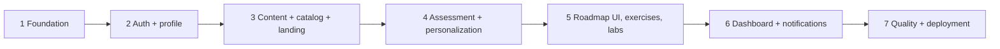

# Implementation Roadmap

Seven phases. Each one ends with the same gate: tests pass, `tsc --noEmit` is clean, Laravel has no errors, the UI has been checked in a real browser at 1280px and 390px in both themes, the docs are updated, and a report lists what was done and what remains.

## Phase 1: Foundation ✅ (completed 2026-11-19)

- Monorepo, git, `.env.example` files, `.gitattributes` (LF)
- `frontend/`: Next.js 16 (TS strict), Tailwind 4, design tokens with light/dark/system, next-intl (en/vi), TanStack Query, typed API client, Vitest
- `backend/`: Laravel 13 on PHP 8.5, Sanctum (SPA mode), CORS with credentials, module structure (`app/Modules`), central error envelope, `/api/v1/health`, Scramble OpenAPI, Pest on MySQL, rate limiting
- `docker-compose.yml`: mysql 8.4 (with a separate test database), mailpit, api, worker, web. Production Dockerfile targets for api and web.
- Marketing layout, foundation home page with live system status, `/design-system` reference
- README with Docker setup

**Exit, verified:** the web container calls `/api/v1/health` from a real browser and shows the API and database as reachable, with no console errors. Frontend: typecheck, lint, 8 tests. Backend: Pint, 14 Pest tests. Hallmark sloplint is clean. Both production images build and serve.

**Moved to Phase 2:** the auth layout and the app shell (they need auth to be meaningful) and route protection. shadcn primitives are added per component as screens need them, rather than initialised up front.

## Phase 2: Auth and user management ✅ (completed 2026-11-20)

- **API:** `Auth` module (register, login with remember me and per-account lockout, logout, forgot and reset password, `/me`) and `Profile` module (personal info, avatar upload re-encoded to WebP, preferences, password change). `users.role` and `user_profiles` migrations. Vietnamese validation, auth and email strings. The reset email follows the user's language. Demo user seeder.
- **Web:** login, register, forgot and reset password screens. The header account menu. The `(app)` area behind `RequireAuth`. Settings with three routed tabs: personal information (with avatar), security (password, log out) and preferences (theme and language, saved to the account and applied on login).
- **Exit, verified:** 66 Pest tests and 29 Vitest tests. A real-browser journey through the Docker stack covered guest redirect, register, profile edit, avatar upload, preferences in Vietnamese and dark, logout, wrong password then login with remember me, and forgot then reset through the Mailpit email. Phone width has no overflow. Hallmark sloplint is clean on every public auth page.
- **Deferred, with reasons:** the *Learning goals* tab moves to Phase 4, because it needs careers and domains, which arrive in Phases 3 and 4. *Notification preferences* move to Phase 6 with notifications. *Email verification* (O4) is not built; accounts work unverified, and `email_verified_at` is already in the schema. *Changing the email address* is not offered yet.

## Phase 3: Learning content and the landing page ✅ (completed 2026-11-21)

- **Content (seeded, validated):** 8 domains with 20 skills, 8 published courses (one per domain) with 30 fully written lessons, 13 roadmap topics with prerequisites, and 7 careers with staged roadmap templates. Content lives in `backend/database/seeders/content/`. The seeder validates references, prerequisite cycles and stage ordering, and upserts by slug so learners' progress survives re-seeding.
- **API:** `Catalog` (domains; courses with search, filters, sorting and pagination; course detail with related courses; per-learner progress, enrollment, favorites), `Careers` (catalog and detail with roadmap template and suggested courses), `Learning` (lesson reader with cross-chapter navigation, start, complete with capped study time, course completion stamp).
- **Web:** course catalog with URL-backed filters; course detail with enroll, start or continue, favorite, progress and per-lesson status; lesson reader (table of contents, safe prose renderer, callouts, steps, code with copy, three data-driven interactive diagrams: OSI layers, TCP handshake, CIA triad); careers catalog and detail with the roadmap preview; header navigation with a mobile menu. The **landing page** was built with Hallmark: a Map/Diagram page whose signature is the real career topic graph, followed by domains, featured courses, questions and a first-lesson close.
- **Exit, verified:** 97 Pest tests and 40 Vitest tests. A real-browser journey covered catalog filters, search, pagination, guest-to-login-to-lesson return, diagram keyboard use, completion, continue, favorites and the favorites filter. No phone overflow, no console errors. Hallmark sloplint is clean on every public route; the landing has 2 confirmed warnings. The production build passes.
- **Deferred, with reasons:** exercises (Phase 5); recording `learning_activities` for streaks and weekly time (Phase 6, when the dashboard reads them); global `/search` (Phase 6); "choose this career as my goal" (Phase 4, with the assessment); the interactive personal roadmap graph (Phase 5). The landing's roadmap is the career template, and the page says so.
- **Content budget change:** the plan said 6 full courses plus outline-only ones. Instead, all 8 courses are complete and nothing is outline-only, because outline lessons would have been empty pages.

## Phase 4: Assessment and personalization

Assessment (about 40 questions), autosaving attempt flow, scoring service, result page with domain bands and the formula, career goal selection, the roadmap generator and versioning.
**Tests:** scoring unit tests (weights, bands, unanswered questions), answer keys never leak, generator rules, single active path.

## Phase 5: Interactive learning

Roadmap graph (React Flow + dagre): expand and collapse, statuses, prerequisites, lesson drawer, mobile outline view. Knowledge map by domain. Exercise mode in all seven question types, split-screen and mobile tabs, feedback with theory references, completion rules. Labs: `linux-shell`, `firewall-rules`, `http-inspector` engines with server checkpoint validation. One 3D visual (packet traversal across a topology), lazy-loaded.

## Phase 6: Progress and engagement

Activity recording through events, streak calculator (local-date aware), dashboard summary, weekly time, assessment history, skill-by-domain chart, recent activity, next lessons. Notifications (list, read, read-all, delete, preferences). Scheduled reminder job. Header bell with unread count.

## Phase 7: Quality and deployment

Critical-path E2E tests (Playwright: register, assess, roadmap, lesson, exercise, dashboard). Security review (OWASP checklist, dependency audit, headers, rate limits). Performance (bundle analysis, image sizes, N+1 checks). Responsive and accessibility audit. Hallmark sweep. Production Dockerfiles, ECS task definitions, step-by-step AWS deployment guide.

## Decisions made

| # | Decision | Outcome (2026-11-19) |
|---|---|---|
| O1 | Local toolchain | **Docker Desktop.** PHP, Composer, MySQL and Mailpit run in containers. The host needs only Node and Docker. |
| O2 | Learning content language | **English content.** The UI is bilingual (en/vi). Translatable content columns can be added later without changing the API shape. |

## Open decisions
| O3 | **Production domain layout.** Sanctum needs the frontend and API on the same site. | `app.<domain>` and `api.<domain>` behind one ALB | AWS docs, CORS config |
| O4 | **Email verification required before learning?** | Not required in the MVP. No verification email yet. | Auth flow |
