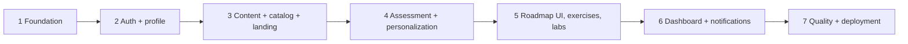

# Implementation Roadmap

Seven phases. Each one ends with the same gate: tests pass, `tsc --noEmit` is clean, Laravel has no errors, the UI has been checked in a real browser at 1280px and 390px in both themes, the docs are updated, and a report lists what was done and what remains.

## Phase 1: Foundation ✅ (completed 2026-11-19)

- Monorepo, git, `.env.example` files, `.gitattributes` (LF)
- `frontend/`: Next.js 16 (TS strict), Tailwind 4, design tokens with light/dark/system, next-intl (en/vi), TanStack Query, typed API client, Vitest
- `backend/`: Laravel 13 on PHP 8.5, Sanctum (SPA mode), CORS with credentials, module structure (`app/Modules`), central error envelope, `/api/v1/health`, Scramble OpenAPI, Pest on MySQL, rate limiting
- `docker-compose.yml`: mysql 8.4 (with a separate test database), mailpit, api, worker, web. Production Dockerfile targets for api and web.
- Marketing layout, foundation home page with live system status, `/design-system` reference
- README with Docker setup

**Exit, verified:** the web container calls `/api/v1/health` from a real browser and shows the API and database as reachable, with no console errors. Frontend: typecheck, lint, 8 tests. Backend: Pint, 14 Pest tests. Hallmark sloplint is clean. Both production images build and serve.

**Moved to Phase 2:** the auth layout and the app shell (they need auth to be meaningful) and `proxy.ts` route protection. shadcn primitives are added per component as screens need them, rather than initialised up front.

## Phase 2: Auth and user management

Register, login (remember me), logout, forgot and reset password (Mailpit locally), protected routes, profile tabs (personal info, avatar upload, security, preferences), notification-preference defaults.
**Tests:** auth feature tests (happy path, validation, throttling, CSRF), profile policy tests, form component tests.

## Phase 3: Learning content and the landing page

Migrations and seeders for domains, skills, careers, topics, courses, chapters, lessons and sections. Course catalog (search, filters, sort, favorites, pagination), course detail, enrollment, lesson reader with section renderers (prose, callout, steps, code, SVG diagrams), reading completion. Career catalog and detail. **Landing page** built with Hallmark from the real data.
**Content budget:** 8 domains, 7 careers, 6 courses with full lessons (about 30 lessons), the rest as published outlines.

## Phase 4: Assessment and personalization

Assessment (about 40 questions), autosaving attempt flow, scoring service, result page with domain bands and the formula, career goal selection, the roadmap generator and versioning.
**Tests:** scoring unit tests (weights, bands, unanswered questions), answer keys never leak, generator rules, single active path.

## Phase 5: Interactive learning

Roadmap graph (React Flow + dagre): expand and collapse, statuses, prerequisites, lesson drawer, mobile outline view. Knowledge map by domain. Exercise mode in all seven question types, split-screen and mobile tabs, feedback with theory references, completion rules. Labs: `linux-shell`, `firewall-rules`, `http-inspector` engines with server checkpoint validation. One 3D visual (packet traversal across a topology), lazy-loaded.

## Phase 6: Progress and engagement

Activity recording through events, streak calculator (local-date aware), dashboard summary, weekly time, assessment history, skill-by-domain chart, recent activity, next lessons. Notifications (list, read, read-all, delete, preferences). Scheduled reminder job. Header bell with unread count.

## Phase 7: Quality and deployment

Critical-path E2E tests (Playwright: register, assess, roadmap, lesson, exercise, dashboard). Security review (OWASP checklist, dependency audit, headers, rate limits). Performance (bundle analysis, image sizes, N+1 checks). Responsive and accessibility audit. Hallmark sweep. Production Dockerfiles, ECS task definitions, step-by-step AWS deployment guide.

## Decisions made

| # | Decision | Outcome (2026-11-19) |
|---|---|---|
| O1 | Local toolchain | **Docker Desktop.** PHP, Composer, MySQL and Mailpit run in containers. The host needs only Node and Docker. |
| O2 | Learning content language | **English content.** The UI is bilingual (en/vi). Translatable content columns can be added later without changing the API shape. |

## Open decisions
| O3 | **Production domain layout.** Sanctum needs the frontend and API on the same site. | `app.<domain>` and `api.<domain>` behind one ALB | AWS docs, CORS config |
| O4 | **Email verification required before learning?** | Not required in the MVP; verification email sent, banner shown | Auth flow |
