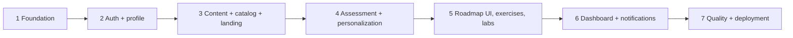

# Implementation Roadmap

Seven phases. Each one ends with the same gate: tests pass, `tsc --noEmit` is clean, Laravel has no errors, the UI has been checked in a real browser at 1280px and 390px in both themes, the docs are updated, and a report lists what was done and what remains.

## Phase 1: Foundation ✅ (completed 2026-11-19)

- Monorepo, git, `.env.example` files, `.gitattributes` (LF)
- `frontend/`: Next.js 16 (TS strict), Tailwind 4, design tokens with light/dark/system, next-intl (en/vi), TanStack Query, typed API client, Vitest
- `backend/`: Laravel 13 on PHP 8.5, Sanctum (SPA mode), CORS with credentials, module structure (`app/Modules`), central error envelope, `/api/v1/health`, Scramble OpenAPI, Pest on MySQL, rate limiting
- `docker-compose.yml`: mysql 8.4 (with a separate test database), mailpit, api, worker, web. Production Dockerfile targets for api and web.
- Marketing layout, foundation home page with live system status, `/design-system` reference
- README with Docker setup

**Exit, verified:** the web container calls `/api/v1/health` from a real browser and shows the API and database as reachable, with no console errors. Frontend: typecheck, lint, 8 tests. Backend: Pint, 14 Pest tests. Hallmark sloplint is clean. Both production images build and serve.

**Moved to Phase 2:** the auth layout and the app shell (they need auth to be meaningful) and route protection. shadcn primitives are added per component as screens need them, rather than initialised up front.

## Phase 2: Auth and user management ✅ (completed 2026-11-20)

- **API:** `Auth` module (register, login with remember me and per-account lockout, logout, forgot and reset password, `/me`) and `Profile` module (personal info, avatar upload re-encoded to WebP, preferences, password change). `users.role` and `user_profiles` migrations. Vietnamese validation, auth and email strings. The reset email follows the user's language. Demo user seeder.
- **Web:** login, register, forgot and reset password screens. The header account menu. The `(app)` area behind `RequireAuth`. Settings with three routed tabs: personal information (with avatar), security (password, log out) and preferences (theme and language, saved to the account and applied on login).
- **Exit, verified:** 66 Pest tests and 29 Vitest tests. A real-browser journey through the Docker stack covered guest redirect, register, profile edit, avatar upload, preferences in Vietnamese and dark, logout, wrong password then login with remember me, and forgot then reset through the Mailpit email. Phone width has no overflow. Hallmark sloplint is clean on every public auth page.
- **Deferred, with reasons:** the *Learning goals* tab moves to Phase 4, because it needs careers and domains, which arrive in Phases 3 and 4. *Notification preferences* move to Phase 6 with notifications. *Email verification* (O4) is not built; accounts work unverified, and `email_verified_at` is already in the schema. *Changing the email address* is not offered yet.

## Phase 3: Learning content and the landing page ✅ (completed 2026-11-21)

- **Content (seeded, validated):** 8 domains with 20 skills, 8 published courses (one per domain) with 30 fully written lessons, 13 roadmap topics with prerequisites, and 7 careers with staged roadmap templates. Content lives in `backend/database/seeders/content/`. The seeder validates references, prerequisite cycles and stage ordering, and upserts by slug so learners' progress survives re-seeding.
- **API:** `Catalog` (domains; courses with search, filters, sorting and pagination; course detail with related courses; per-learner progress, enrollment, favorites), `Careers` (catalog and detail with roadmap template and suggested courses), `Learning` (lesson reader with cross-chapter navigation, start, complete with capped study time, course completion stamp).
- **Web:** course catalog with URL-backed filters; course detail with enroll, start or continue, favorite, progress and per-lesson status; lesson reader (table of contents, safe prose renderer, callouts, steps, code with copy, three data-driven interactive diagrams: OSI layers, TCP handshake, CIA triad); careers catalog and detail with the roadmap preview; header navigation with a mobile menu. The **landing page** was built with Hallmark: a Map/Diagram page whose signature is the real career topic graph, followed by domains, featured courses, questions and a first-lesson close.
- **Exit, verified:** 97 Pest tests and 40 Vitest tests. A real-browser journey covered catalog filters, search, pagination, guest-to-login-to-lesson return, diagram keyboard use, completion, continue, favorites and the favorites filter. No phone overflow, no console errors. Hallmark sloplint is clean on every public route; the landing has 2 confirmed warnings. The production build passes.
- **Deferred, with reasons:** exercises (Phase 5); recording `learning_activities` for streaks and weekly time (Phase 6, when the dashboard reads them); global `/search` (Phase 6); "choose this career as my goal" (Phase 4, with the assessment); the interactive personal roadmap graph (Phase 5). The landing's roadmap is the career template, and the page says so.
- **Content budget change:** the plan said 6 full courses plus outline-only ones. Instead, all 8 courses are complete and nothing is outline-only, because outline lessons would have been empty pages.

## Phase 3.5: Content platform and admin console ✅ (completed 2026-11-21)

Inserted between Phase 3 and Phase 4 by the Phase 3.5 prompt. Design and every change to the prompt: [PHASE_3_5_CONTENT_AND_ADMIN.md](PHASE_3_5_CONTENT_AND_ADMIN.md). Delivered in three gated parts.

### Part A: content core and user management ✅ (completed 2026-11-20)

- **Content core:** a `Content` module with one `BlockRegistry`; a JSON Schema per block type (prose, callout, steps, code, diagram) with valid and invalid fixtures; errors keyed to the exact field. A `ContentImporter` (used by the seeder and `php artisan content:import [--force]`) gives sections stable UUIDs, renumbers lessons without tripping the unique index, archives lessons removed from a file, and skips lessons an admin owns. Lessons have a status (draft, published, archived), and one visibility scope hides drafts and archived lessons from every learner query.
- **Admin foundation:** `Admin` module with `EnsureAdmin`, an `admin` rate limiter, `UserAdminPolicy`, an append-only audit log, `cybercompass:make-admin {email}` for the first admin and recovery, and a demo admin (`admin@cybercompass.test`) whose password comes from `DEMO_ADMIN_PASSWORD` in `backend/.env`.
- **User management:** overview, user list (search, role and status filters, sort, pagination), user detail, role change, suspend with reason, reactivate, send the standard reset email, and the audit log, in the API and the `/admin` web area (en and vi). Safety rules: no self-demotion or self-suspension, the last active admin is protected, and role changes and suspensions end the user's sessions. Suspended users are refused at login and signed out mid-session. Logins record `last_login_at`.
- **Exit, verified:** 178 Pest tests (81 new in Phase 3.5, including guest 401 and learner 403 on every admin route read from the router) and 45 Vitest tests; Pint, tsc and ESLint clean; Hallmark sloplint clean on the admin code. A headless-browser run as the demo admin covered the overview, search, row navigation, suspend (with reason validation), the suspended learner refused at login, reactivate, own-account protections, the audit log, phone layouts with no horizontal scroll, and the learner seeing "Admins only" and a 403 from the API.

### Part B: lesson editor ✅ (completed 2026-11-20)

- **API:** the content authoring endpoints in [API_SPECIFICATION.md](API_SPECIFICATION.md#admin--phase-35-part-a): block types, course structure (chapters, chapter and lesson order), lesson list, create, draft save with `lock_version` (409 on conflict), discard, publish (revision n+1, re-validated), archive, delete (never-published only), revisions with a change summary, restore into the draft, and image upload (WebP, alt required, SVG refused). A `media` block type (pulled forward from Part C) and a shared `SectionWriter` used by both publishing and the importer. Schema errors now read in plain words (en and vi) and are keyed at the exact field, including missing ones. Content is stored exactly as written (exempt from string trimming).
- **Web:** `/admin/lessons` (filters, new-lesson dialog with an automatic address), the editor at `/admin/lessons/{id}` (details, numbered block cards with a form per type or a validated JSON editor, image picker with upload, sticky Save/Publish bar, Ctrl+S, leave-page warning, field-level errors that clear as you fix them, conflict recovery, Preview with the learner renderer, History with restore), and `/admin/courses` (add and rename chapters, reorder chapters and lessons). The learner reader renders `media` blocks.
- **Bug found by the browser run and fixed:** a save that finished while the author kept editing replaced the form with the saved copy and lost the newer edits; the editor now keeps them and only adopts the ids the server assigned.
- **Exit, verified:** 212 Pest tests (34 new in Part B) and 53 Vitest tests; Pint, tsc, ESLint and Hallmark sloplint clean; the production build passes. A headless-browser run on throwaway content (removed afterwards) covered creating a lesson, refusal to publish an empty one, a block error on its field, save, image upload, preview, learners not seeing the draft, publishing with a note, a two-tab conflict and recovery, history, lesson reorder, archive, and phone layouts with no horizontal scroll. The Part A admin run still passes.

### Part C1: interactive 3D blocks ✅ (completed 2026-11-20)

- **Decision:** [SANDBOXED_3D.md](SANDBOXED_3D.md) (D22) compares six approaches and picks two block types on one sandbox: `scene-3d` (declarative: shapes, labels, links with moving packets, animations, click-to-explain, guided steps with camera moves) and `script-3d` (admin-written Three.js). Both run in `<iframe sandbox="allow-scripts">` under a no-network CSP, inside a Web Worker on an OffscreenCanvas, watched by a 3-second watchdog. The runtime (Three.js 0.186.1, pinned and self-hosted, 180 KB brotli) loads only when a 3D block scrolls near, and never enters the app bundle.
- **Editor:** form fields plus a scene JSON editor or a code editor, each with a live preview through the same sandbox learners get; client-side checks with exact paths; runtime errors with line numbers; inline references. Learners always have a required text description, shown instead of the view when 3D can't run.
- **Operations:** `CONTENT_SCRIPTED_3D=false` refuses new scripts and stops sending script code to readers.
- **Exit, verified:** 236 Pest tests (24 new, incl. fixtures and the kill switch; the fixtures found a duplicate-id check that never fired and empty code passing) and 75 Vitest tests (22 new: zod and JSON Schema agree on all 17 fixtures; step logic). Attacks from a real app page in headless Edge: scene code had no fetch/XHR/WebSocket/Worker/importScripts/DOM/storage, could not recover fetch from the prototype chain, endless loops were shut down in setup (3 s) and in the frame loop, a busy scene cost the lesson page at most 7 ms per frame, and the host page's storage and URL were untouched. Editor flow: live previews, a broken reference flagged before saving, a syntax error reported, publish, learner view in both themes, phone width without overflow.

### Part C2: 2D generic blocks ✅ (completed 2026-11-20)

- **Blocks:** `layer-stack`, `sequence`, `flow`, `tree`, `topology`, `comparison`, `timeline`, `bitfield`, `calculator` (`cidr`, `chmod`, `password-entropy`; browser-only), `step-through`, `knowledge-check` (ungraded, never affects progress), and extended `prose` (https links and numbered lists; other links are refused on save). Each has a JSON Schema plus cross-reference checks (unique ids, references, one tree root, no parent loops, one value per column, 64 bits per row, a correct option per question), mirrored in zod.
- **Rendering:** themed SVG for graphs from a pure dagre layout in `lib/graph` (D23; React Flow is not used for read-only lesson diagrams). dagre loads only with a flow or tree (about 19 KB gzip). Selectable nodes are keyboard buttons, graphs have a text version, comparison tables become cards on phones, and wide diagrams scroll inside their own box.
- **Editor:** a grouped add-block menu; forms for comparison, timeline, calculator and knowledge check; validated JSON with a field reference generated from the schema for the rest. Every visual block shows the learner renderer as a live preview, with issues listed at their paths (C17 to C19 in PHASE_3_5).
- **Migration:** the OSI lesson uses `layer-stack` and the TCP handshake uses `sequence`; the bespoke components are deleted. The old diagram keys stay valid (no longer offered) and render through the generic components, so old revisions still restore.
- **Exit, verified:** 331 Pest tests (95 new) and 261 Vitest tests (186 new: all 19 block types agree with the backend on every fixture, with a check that no type lacks fixtures or a schema; every valid fixture renders; calculator maths including /0, /31, /32 and setuid and sticky bits; layout). Pint, tsc, ESLint and Hallmark sloplint clean (0 FAIL); the production build passes. Headless Edge on throwaway content (removed afterwards), 21 of 21: every new block starts from its example with a live preview, an unknown flow id is flagged while typing, a question with no correct option is flagged, a new column adds a value to every row, an `http://` link is refused at its field, save and publish, learner rendering with no notices, knowledge-check feedback, CIDR maths, flow node details, dark and light themes, phone width with no page overflow and comparison cards, the migrated OSI and TCP lessons, and no console errors. The browser run led to two fixes: a wrong knowledge-check answer no longer reveals the correct option, and topology and two-actor sequence text was enlarged to stay legible.

### Part C3: pilot content ✅ (completed 2026-11-21)

- **Pilot courses rewritten** on the block library, keeping lesson slugs and headings so section UUIDs are stable. Networking Fundamentals: a 3D "follow a packet" scene (intro), encapsulation as a step-through and the OSI layer stack, TCP/IP as a layer stack with TCP vs UDP as a comparison and the handshake as a sequence, IPv4 and a /26 as bit fields with a CIDR calculator, a segmented office network as a topology, the DNS tree, DNS resolution and DHCP as sequences. Security Fundamentals: the CIA triad, vulnerability/threat/risk as a comparison, a risk score as a step-through and the response as a flow, defense in depth as a 3D scene (C20), control types and three frameworks as comparisons, ATT&CK as a tree. Every lesson ends with a practice check (22 questions with explanations).
- **`content:export {course}`** writes a course's published lessons back to its content file; sections made in the admin console keep their UUIDs through an explicit `uuid` (C21).
- **[CONTENT_AUTHORING_GUIDE.md](CONTENT_AUTHORING_GUIDE.md):** principles, choosing a block, how to write each one well (with the limits that matter in practice), 3D guidance, the console and file workflows, and a pre-publish checklist.
- **Found while reviewing the lessons and fixed:** topology zones overlapped each other and hid the next zone's label (zone padding was one-sided); trees drew children in reverse author order (dagre now gets sibling order constraints); five-actor sequences overflowed their lanes (content shortened, guidance added); the intro 3D scene was framed too wide; the knowledge check's intro repeated the section heading.
- **Exit, verified:** 337 Pest tests (6 new: every course exports and re-imports with nothing changed, section UUIDs included; admin-made sections keep their UUID; drafts are not exported; a UUID owned by another lesson is refused; the PHP writer reproduces tricky strings exactly; the command) and 262 Vitest tests. Pint, tsc, ESLint and Hallmark sloplint clean; the production build passes. Headless Edge as a learner, 21 of 21: all 10 pilot lessons render every block with no unavailable notices, both 3D scenes run in the sandbox, every lesson has its practice check, no page overflow at phone width, no console errors. A catalog test that hard-coded the longest course (90 minutes) now derives it from the content (Networking Fundamentals is now 108).
- **Known caveat (testing only):** a full-page screenshot in headless Edge, which renders WebGL in software, can stall a 3D scene long enough for the sandbox watchdog to close it, so the text description appears instead. At normal viewport size the same scene runs steadily (watched for 12 s). Capture 3D blocks at viewport size, not full page.

## Phase 4: Assessment and personalization ✅ (completed 2026-11-21)

Impact check (2026-11-21, CLAUDE.md §5) against Phase 3.5's changes, with the user's decisions: D24 (the `Assessment` module owns its question bank and loader), D25 (the personal roadmap ships as an outline in Phase 4; the graph stays in Phase 5), D26 (the result reveals answers and explanations only for wrongly answered questions; the roadmap updates only on request). The planned `GET /careers/{slug}/roadmap` endpoint was dropped as a duplicate of `GET /careers/{slug}`.

Delivered in three gated parts:

- **Part A, assessment backend ✅ (2026-11-21):** assessment tables (questions carry a stable `key` and `is_archived`), a 40-question bank in `seeders/content/assessment.php` (5 per domain, difficulties 1, 1, 2, 2, 3, each with an explanation, none reused from lesson practice checks), `ScoringService`, start or resume, autosave, submit (one transaction, 409 on resubmit, fires `AssessmentSubmitted` for Phase 6 listeners), result and history endpoints.
- **Part B, assessment UI ✅ (2026-11-21):** intro (states that this is a fixed questionnaire), the attempt flow grouped by domain with progress, previous and next, autosave and a review step, the result page (overall and domain scores, bands, formula, strengths, gaps, rule-based next steps, review of wrong answers), history, and the header link.
- **Part C, goals and the personal roadmap ✅ (2026-11-21):** `learning_goals` with `PUT /me/learning-goal` and the goal in `/me`, the Learning goals settings tab, "Set as my goal" on career pages, the `RoadmapGenerator` (ARCHITECTURE §6.2) with versioning and a single active path, `GET /learning-path` with computed statuses and the next lesson, `POST /learning-path/generate`, `GET /learning-paths`, the `/roadmap` outline page, the header link, and a demo learner with a submitted attempt and an active path.

**Part A exit, verified:** 374 Pest tests (37 new: the formula, bands at their edges, rounding, the overall score not being a mean of domains; the answer key absent from every pre-submission response; reveals only for wrong or unanswered questions; 404 for another learner's attempt on every route; 401 on every route for guests; one open attempt enforced by the database; 409 on resubmit, on saving after submit and on a result before submit; next steps weakest first; the loader's validation, idempotent reload by key, archive and restore, and refusal to change an answered question's option count). Pint clean.

**Part B exit, verified:** routes `/assessment`, `/assessment/attempts/{id}` and `/assessment/attempts/{id}/result`, plus the header link. Autosave keeps one queue per question and always sends the latest choice, so quick changes land in order; failed saves are listed with a retry, and submitting waits until everything is saved. The band edges come from the API (`formula`), never from frontend constants. 269 Vitest tests (7 new: progress helpers, ordered autosave, failed-save retry, review then submit, result reviewing only missed questions) and 374 Pest; tsc, ESLint and Pint clean; Hallmark sloplint 0 FAIL (2 REFLEX accepted: plain text links have no disabled state); the production build passes. Headless Edge as a throwaway learner (deleted afterwards), 21 of 22 checks: intro, start, 10 autosaved answers, focus moving to each question, reload resuming at the first unanswered question, jumping back through the rail and changing an answer, the review warning, submit, the result with 8 domains and only the missed questions reviewed, intro history and retake, a submitted attempt redirecting to its result, phone width with no overflow in dark and light, and no console errors. The one failure was the check itself: it expected a Vietnamese assessment title, but the title is content, which stays English (O2); the Vietnamese UI rendered correctly. The run found that phones could reach the review step only by paging through all 40 questions, so the phone view gained a "Review and submit" button, and two counts that wrapped beside long domain names now stay on one line.

**Part C exit, verified:**
- **Delivered:** `learning_goals` and `PUT /me/learning-goal` (slugs, partial updates; the goal on `/me`), the Learning goals settings tab, "Set as my goal" on career pages (replacing the Phase 3 "arrives later" notice), the `Roadmap` module (`RoadmapGenerator`, `PathProgress`, `GenerateLearningPath`, three endpoints), the `/roadmap` outline (summary with completion, time left and next lesson; out-of-date notice with an update button; stages of topic nodes with reasons, prerequisites and lessons; earlier versions), the result page's roadmap action and self-rating, the header link, and a demo learner with a goal, a submitted attempt, one finished lesson and a roadmap (seeded once, never overwritten).
- **Rule refinement found while building (ARCHITECTURE §6.2):** foundation topics are inserted only when the gap topic sits above its domain's lowest level. Otherwise a gap in a foundation topic would pull a same-level sibling ahead of it and lose its own "gap" reason. Topics whose lessons were all archived count as completed, so they never block (§6.3).
- **Tests:** 407 Pest (33 new: goal saving, partial updates and validation; generator rules for no assessment, strength review up to level 2, developing, foundation insertion with prerequisite order, no insertion for foundation-level gaps, no duplicates, hidden lessons; generation 422 without a goal; versioning and archiving; one active path enforced by the database; statuses from progress and prerequisites; review prerequisites opening topics; completion and estimate; out-of-date reasons without auto-rebuild; privacy; interests ordering next steps) and 275 Vitest (6 new: roadmap outline, update on request, empty states, goal form validation and payload). tsc, ESLint and Pint clean; Hallmark sloplint 0 FAIL; the production build passes.
- **Browser run:** headless Edge as a throwaway learner (deleted afterwards), 22 of 22: empty roadmap asking for a goal, setting the goal on the career page, building without an assessment (9 topics, 3 stages, locked topics naming their prerequisites), saving goals in settings, the result offering "Update my roadmap" with the self-rating and the interest first among equal gaps, the out-of-date notice, updating to version 2 with gap reasons, earlier versions and the weekly estimate, completing a lesson moving its topic to in progress, phone width with no overflow on the roadmap, settings and career pages, Vietnamese, and no console errors. The run found a topic card stretching to the height of its open lesson list; fixed.

**Phase 4 totals:** 407 Pest and 275 Vitest (from 337 and 262).

**Tests:** scoring unit tests (weights, bands, unanswered questions), answer keys never leak before submission and only for wrong answers after, attempt ownership (404), generator rules (review, gap with inserted foundations, no assessment, hidden lessons), single active path, status computation.

**Shifts recorded:** the outline view moves here from Phase 5 (D25); the next-lesson calculation moves here from Phase 6 and is reused by `/progress/next`. Activity records and the assessment-result notification stay in Phase 6, as listeners on `AssessmentSubmitted`.

## Phase 5: Interactive learning ✅ (completed 2026-11-21)

**Plan (impact check 2026-11-21; decisions D27 to D31), four gated parts:**
- **Part A:** roadmap graph (layout function separate from the renderer, `RoadmapNodeCard` buttons over SVG prerequisite edges, lessons as child nodes, lesson drawer), knowledge map at `/roadmap/map` (`GET /knowledge-map`: domains by topic level, cross-domain prerequisites, score, band and completion per domain).
- **Part B:** exercises backend (`Learning` module, `ExerciseLoader`, seven question types, D31 scoring and completion rule, D30 section-delete guard, `ExerciseSubmitted`) and exercise content for the networking and security fundamentals lessons (10 lessons).
- **Part C:** exercise UI (split screen with theory from the existing block renderers, tabs on phones, keyboard inputs for every type, feedback and retry) and the reader's end-of-lesson action.
- **Part D:** labs on server engines (D28, §7.1 security rules): `linux-shell`, `firewall-rules`, `http-inspector`, one lab each, `/labs` pages, `LabCompleted`.

**Part A exit, verified (2026-11-21):**
- **Delivered:** `lib/graph/grid.ts` (pure grid layout and edge routing, separate from rendering; edges that skip a column run through a free gap between nodes), `TopicGraph` (topic nodes are `RoadmapNodeCard` buttons with `aria-expanded` and a description of status, reason and prerequisites; lessons open as child rows; pointing at or focusing a topic lights its prerequisite edges), the roadmap graph on `/roadmap` from 48rem with "Show all lessons" and "Collapse all", the lesson drawer (native dialog as a side sheet: status, required, minutes, summary, Start, Continue or Review), the knowledge map at `/roadmap/map` (`GET /knowledge-map`; domains as rows with assessment band, score and completion, depth as columns; a list by domain on phones), tabs between the two views. `TopicStatus` now holds the status rule for both views; roadmap lessons gain `summary`. Starting or completing a lesson refreshes the roadmap and the map. No new dependency.
- **Found and fixed in the browser:** edges that skipped a stage ran behind the cards between (now routed through gaps); a full-page capture, like resizing across the breakpoint, briefly flipped the width query and reset which topics were open (state now lives above the graph-or-outline switch); a two-line title on a map card with "On your roadmap" overlapped its status line.
- **Tests:** 414 Pest (7 new: knowledge map without goal or assessment, prerequisites opening topics, domain completion, latest scores, topics on the roadmap, hidden lessons, drawer data) and 288 Vitest (13 new: grid layout and routing, roadmap graph with drawer and keyboard expansion, knowledge map on phones and wide screens). tsc, ESLint and Pint clean; sloplint 0 FAIL; production build passes.
- **Browser run:** headless Edge as a throwaway learner (deleted), 32 of 32: map with 8 domains and 13 topics, Enter expands every node with no overlap, roadmap graph with 9 nodes and the next topic open, focus lights prerequisite edges, drawer opens at the right edge, Escape returns focus to the lesson, 800px scrolls the graph in its own box, outline and list at 390px with no overflow, both themes, Vietnamese, no console errors.

**Part B exit, verified (2026-11-21):**
- **Delivered:** exercise tables and models; `QuestionTypes` (file validation, compiling into payload and hidden key, response shapes, all-or-nothing grading, shuffled matching and ordering that are never shown already solved); `ExerciseLoader` and `ExerciseSeeder` (whole set validated first, upsert by key, archive on removal, theory references resolved by section key or UUID and checked to exist in the lesson, type change refused once answered); `SubmitExercise` (one transaction: attempt, answers, lesson completion when passed; `ExerciseSubmitted` after commit); three endpoints with a per-user rate limit; the completion rule in `RecordLessonProgress` (422 until passed, earlier completions kept); `exercise` on the lesson and on roadmap and knowledge map lessons; the D30 guard in `SectionWriter` (publish and import) with `exercise_references` in the admin lesson response, a "used by" note on the editor's blocks and a confirmation before removing one; the reader states how a lesson with an exercise is completed instead of offering a button that would be refused (Part C turns it into the exercise action). Content: 54 questions over the 10 lessons of Networking Fundamentals and Security Fundamentals, every type used (matching 10, scenario 10, true/false 9, fill in the blank 8, ordering 7, multiple choice 6, single choice 4), each pointing at the block that teaches it, none repeating a knowledge check. The demo learner passes the CIA triad exercise.
- **Tests:** 474 Pest (60 new: question types, loader rules and messages, no key before submission, pass and fail with the key revealed only for wrong answers, unanswered questions, malformed answers rejected with nothing written, completion blocked until passed and earlier completions kept, attempt privacy, exercise fields on the lesson and the map, the section guard on publish with archived references cleared, demo learner) and 288 Vitest. Existing tests that complete lessons now pass the exercise through `passLesson()`. tsc, ESLint and Pint clean.
- **Browser run:** 12 of 12: the reader line on a lesson with an exercise (no complete button) and the button kept on one without, the exercise served with sections and no key, completing by hand refused, Vietnamese, the editor marking 3 blocks of the CIA triad lesson and asking before removing one (cancel keeps it), no console errors. Throwaway learners deleted.

**Part C exit, verified (2026-11-21):**
- **Delivered:** `/learn/[slug]/exercise` (`features/exercise`): from 64rem the theory panel (the section that teaches the current question, drawn by the lesson's own block renderers, then key concepts and objectives) sits beside the questions; below it, Exercise and Theory are tabs. One question at a time with numbered jumps, a review step listing unanswered questions, and the draft in session storage (stale responses that no longer fit a question are ignored). Inputs for all seven types work by keyboard: radio and checkbox groups, inline text fields for blanks, a select per left item for matching, and move buttons for ordering with focus kept on the moved item and the move announced. The result shows the score against the pass mark, each question's status, the learner's answer, the correct answer when wrong (D31), the explanation and "Read the theory", which loads that section into the panel (or switches to the Theory tab); a pass offers the next lesson, a fail offers a retry from a clean draft. The reader's end-of-lesson action is now "Take the exercise", and a completed lesson shows "Exercise passed" and "Practise again"; the roadmap drawer shows a lesson's exercise state. Submitting refreshes the lesson, course progress, roadmap and knowledge map.
- **Found and fixed in the browser:** lesson blocks chose their layout from the viewport, so in the narrow theory panel the layer stack squeezed into two columns and clipped. Blocks now use container queries: every `Section` is a CSS container and the 9 breakpoint uses in 5 block files became `@xl:` (36rem of their own width); the editor's live preview is a container too. The reader keeps its layouts (checked at 1280 and 390: layer stack and CIA triad in two columns and the comparison as a table on desktop, stacked and as cards on phones).
- **Tests:** 474 Pest and 297 Vitest (9 new: answer helpers and stale drafts; the exercise screen answering all seven types by pointer and keyboard and submitting only the answered ones, the result with the key for a wrong answer and its theory, tabs on narrow screens, the draft surviving a reload, retry from a clean draft, a lesson without an exercise). tsc, ESLint and Pint clean; sloplint 0 FAIL; the production build passes.
- **Browser run:** 19 of 19 on `osi-model` as a throwaway learner (deleted): reader to exercise, the split screen with the question's section and no key in the page, a failing attempt with every correct answer and explanation and "Read the theory" switching the panel, a retry passing at 100% through the real controls (ordering by keyboard with focus kept), the lesson completing with the next lesson offered, the reader showing the exercise as passed, tabs and no overflow at 390 on the question, the theory and the matching and ordering questions, Vietnamese, both themes, no console errors. The answer key for the passing run was read from the database by the test script, never by the page.

**Part D exit, verified (2026-11-21):**
- **Delivered:** the `Labs` module on server engines (D28): `LinuxShellEngine` (with `ShellParser`; pwd, ls, cd, cat, head, tail, grep, wc, sort, uniq, cut, find, echo, whoami, id, hostname, help, clear, up to five pipe stages, over a virtual file system), `FirewallRulesEngine` (ordered first-match rules with CIDR sources, a default policy, packet tests, hidden traffic checkpoints), `HttpInspectorEngine` (a simulated app answering from its routes, cookie checks, hidden routes); the `LabProvider` seam with `SimulatedLabProvider` (answer checkpoints for every engine) and `LabSession` (row lock and version check, 409 for a stale tab, 256 KB state cap, completion once with `LabCompleted` after commit); `LabLoader` and `seeders/content/labs.php` (validated per engine, archived when removed); five endpoints with `throttle:lab-actions`. Three labs, each linked to a lesson: investigate a suspicious login (`linux-logs`), lock down a web server's firewall (`hardening-basics`), inspect an online shop's session (`http-essentials`). Frontend `features/labs`: `/labs` and `/labs/[slug]` with the briefing, tasks with answer forms and hints, start over, a terminal (history recall, full output for the latest command, transcript kept by the server), a firewall rule editor and packet tester, and an HTTP inspector (recorded traffic, request composer with the learner's session cookie, responses); a header link; the reader's "Practise in a lab" links.
- **Security rules (ARCHITECTURE §7.1), each tested:** a token scan of every engine file fails on any process, file system, network or dynamic-code call, backticks or includes; shell syntax (`;`, `&&`, `||`, `&`, redirects, backticks, `$()`, `${}`, subshells, `find -exec`/`-delete`) is refused with a message; grep is literal by default and `grep -E` is length-capped and runs under lowered PCRE limits with the JIT off (a catastrophic pattern returns "pattern too complex" in well under a second); command, output, pipe, state, action and request sizes are capped; 60 actions per minute per learner; optimistic locking returns 409 to a stale tab and changes nothing.
- **Found and fixed in the browser:** on phones the lab grid's implicit column grew to the firewall table's width, and a screen-reader-only header label escaped the table's scroll box (absolutely positioned outside a non-positioned scroller), widening the page by 51px; the grid now has an explicit `minmax(0,1fr)` column and the scroll box is `relative`.
- **Tests:** 561 Pest (87 new: the engine safety scan, the shell parser and engine with every refusal, ReDoS and the output and history caps, the firewall and HTTP engines, and the API: no leaks, start, actions, 409, 404, malformed actions, the state cap, the rate limit, all three labs completed through their engines, completion through a reset, lesson links, the loader) and 303 Vitest (6 new: list, the shell flow with answers, the 409 reload, firewall actions, HTTP requests with the session cookie, a missing lab). tsc, ESLint and Pint clean; sloplint 0 FAIL; the production build passes.
- **Browser run:** 27 of 27 as a throwaway learner (deleted): all three labs completed through the real UI (shell commands with pipes, refusals for `;`, `>` and `rm`, a wrong answer, the read checkpoint; firewall rules edited, moved, the default set to deny and a packet test showing the deciding rule; the captured login response's cookie and server header, a replayed request returning another customer's order), a second tab getting the conflict notice and reloading to the latest state, the list showing all three completed, the lesson linking to its lab, phone width with no overflow on every lab page and the list, dark theme, Vietnamese, no console errors.

**Phase 5 totals:** 561 Pest and 303 Vitest (from 407 and 275).

**Shifts:** the per-domain aggregation (latest score, band, completion) is built here for the knowledge map and reused by Phase 6 `/progress/skills`. Topic status moves from `PathProgress` into one shared calculator so the knowledge map can show topics outside the path; status is still computed in one place. Additive API fields: roadmap lessons gain `summary` and `exercise`, the lesson response gains `exercise`. The `packet-flow` lab engine is dropped (the 3D scene covers packet traversal).

Roadmap graph on the Phase 4 `GET /learning-path` response (status, reasons, `requires` and `edges` already computed by `PathProgress`), rendered as static SVG edges with focusable HTML nodes (D27, no React Flow), with stage-based layout kept separate from rendering (`lib/graph` dagre only for coordinates when needed), no pan or zoom canvas: expand and collapse, statuses, prerequisites, lesson drawer, overall completion. The outline view from Phase 4 (D25) stays as the phone view. Knowledge map by domain, on the same SVG approach (D27). Exercise mode in all seven question types, split-screen and mobile tabs, feedback with theory references, completion rules. Labs: `linux-shell`, `firewall-rules`, `http-inspector` engines with server checkpoint validation. ~~One 3D visual (packet traversal across a topology)~~: already delivered in Phase 3.5 C3 as the `scene-3d` "follow a packet" scene in the networking intro lesson; new 3D is content on the D22 blocks.

## Phase 6: Progress and engagement ✅ (completed 2026-11-21)

Activity recording through events, streak calculator (local-date aware), dashboard summary, weekly time, assessment history, skill-by-domain chart, recent activity, next lessons. Notifications (list, read, read-all, delete, preferences). Scheduled reminder job. Header bell with unread count. Global search.

**Impact check (decisions D32 to D36):**
- **Conflict, decided:** the brief names Recharts; the charts are our own SVG components in `lib/charts`, as D23 and D27 did for graphs (D32).
- **Shift, decided:** global search was deferred to Phase 6 by Phase 3 and the API spec but missing from this line; it is Part E (D36).
- **Decided:** in-app notifications plus opt-in email; preferences default in code, not rows at registration (D34). A stored timezone for streaks and reminders (D33). `/dashboard` becomes the page after login (D35).
- **Reused, not rebuilt:** `PathProgress`, `KnowledgeMap::domains()`, `AttemptResult::scores()`, `CourseProgress`, the Phase 4 and 5 events, the queue worker and Mailpit.
- **Known gap:** reading a lesson without reaching its end records no time, as before.

**Parts:** A activity and progress API; B dashboard; C notifications backend (types, milestones, reminders, scheduler service); D notifications UI (bell, page, settings tab); E search.

**Part A exit, verified (2026-11-21):**
- **Delivered:** `learning_activities` and `user_profiles.timezone`; `LessonStarted` and `LessonCompleted` from `RecordLessonProgress` (a review is a `study_session`; a completion by exercise carries no time, so exercise time counts once); the `Progress` module: `RecordLearningActivity` listening to all five events, `ActivityRecorder` (the only writer), `LearnerClock`, `StreakCalculator` (pure rule on local dates; today never breaks a streak), `ProgressReport` and the seven `/progress/*` endpoints; `PathProgress::nextLessons()` and `KnowledgeMap::skills()` reused rather than recomputed; `timezone` on `PATCH /me/preferences` and `/me`; `progress:backfill` (idempotent, takes the exercise's time off pre-Phase 6 lesson time).
- **Tests:** 595 Pest (34 new: streak rule edges, every event to its row, no double-counted exercise time, nothing recorded on a refused completion, backfill run twice, 401 on every progress route, local-date streaks and weeks across a UTC+7 boundary, range validation, feed shapes and isolation, next lessons from courses then roadmap, course completion, assessment history order, skills, timezone validation). Pint clean.
- **Checked on the dev stack:** the backfill recorded 41 activities, then 0 on a second run; the demo learner shows a 2-day streak, 25 minutes, roadmap 6% and three next lessons. Over HTTP as a throwaway learner (deleted): login, a lesson completed, timezone set to Asia/Ho_Chi_Minh, summary, 4-week activity and the feed returned as specified, and `range=99w` returned 422. The UI arrives in Part B.

**Part B exit, verified (2026-11-21):**
- **Delivered:** `/dashboard` (D35), the page after login and the first header link: a greeting with a streak sentence that says what keeps it going; six figures (streak, this week against the weekly goal, lessons, courses, total time, roadmap); study next (roadmap or courses, with a start button); study over time with one range control (4, 12, 26, 52 weeks) over minutes per week against the goal and the running total of lessons; assessment results (a number for one attempt, a line for two or more); recent activity with links; skills by domain (score, band, lesson completion); course completion. `lib/charts` (D32): `ColumnChart`, `LineChart`, `ChartTable`, pure `scale.ts`; each chart is one tab stop with an announced readout, hover tooltips and a table view. The timezone is filled from the browser once (`TimezoneSync` in the signed-in layout) and can be changed under Preferences. en and vi.
- **Found and fixed in the browser:** Edge reports `Asia/Saigon`, a legacy alias the API refused, so the timezone never saved; the API and `LearnerClock` now accept aliases. The first next lesson rendered muted; the hovered week drew a near-black band in dark mode; the line's end label ran past the panel (the right margin now fits the label); "1 h 30 min" ticks were too wide (ticks are now "1.5 h"); lesson starts doubled the feed and are left out of it.
- **Tests:** 595 Pest (feed without starts, legacy timezone alias) and 319 Vitest (16 new: scales and minute ticks, column rounding, label thinning, chart keyboard readout, table view, dashboard figures and links, range switching, empty states, running totals, timezone sync and never overwriting). tsc, ESLint, Pint clean; Hallmark sloplint 0 FAIL on `features/progress` and `lib/charts`; the production build passes.
- **Browser run:** headless Edge in the Asia/Ho_Chi_Minh timezone as a throwaway learner with nine weeks of history created through the real actions (deleted afterwards), 28 of 28: login lands on `/dashboard`, the header link is current, the timezone saved from the browser, the streak sentence, six figures, next lessons from the roadmap, the feed, columns for weeks with study at most 24px wide, the goal line, arrow-key and hover readouts, the 4-week range redrawing both charts, the table view, the assessment line, the Preferences timezone (change saved, device hint), no overflow at 390 (dark and light) and 768, Vietnamese, and no console errors. A first run hit the API's 120 requests a minute from back-to-back runs (each dashboard load makes 8 requests); a later run after the window passed was clean.

**Part C exit, verified (2026-11-21):**
- **Delivered:** the `Notifications` module: `notifications`, `notification_preferences` and `notification_sends` tables; one queued `LearningNotification` (database plus opt-in mail, after commit, channels from preferences at send time, nothing for suspended accounts; the row stores type, parameters and a path, never text; emails in the account language from `lang/{en,vi}/notifications.php`); `NotificationPreferences` (defaults in code), `SendOnce` (atomic one-off keys); `NotifyLearner` on `LessonCompleted` (first time), `AssessmentSubmitted`, `MilestoneReached` and the new Content event `LessonPublished` (first publish only) → `RecommendNewLesson` job (roadmap topic or enrolled course, unless done, chunked); `MilestoneDetector` and `CheckMilestones` in Progress (course finished, roadmap 25/50/75/100% keyed by career so a new version does not repeat them, 7/30/100-day streaks); `notifications:send-reminders`, scheduled hourly, at 18:00 local time for learners with a goal and no study that day, once a day; the `scheduler` compose service (`schedule:work`); the seven endpoints. `User` deletes its notifications with the account.
- **Changed from the plan:** recommendations also reach learners enrolled in the lesson's course, because a lesson created in the admin console has no roadmap topic until the content file maps it, so topic-only recommendations would almost never fire.
- **Tests:** 627 Pest (32 new: 401 on every route, first completion only, assessment result, list, filter, count, read, read all, delete and 404 for another learner's notification, preference defaults, updates and validation, channels off and email on, suspended accounts, emails in English and Vietnamese, deletion with the account, the course, roadmap and streak milestones each once, never again after deleting, reminders by local hour and day, skips, the hourly schedule, recommendations by course and by roadmap topic, first publish only). Pint clean.
- **Checked on the dev stack:** the scheduler service runs; as a throwaway learner over HTTP (deleted afterwards), email turned on for lesson completions, a completion produced the in-app notification through the queue worker and an email in Mailpit; after switching the account to Vietnamese the next email arrived in Vietnamese; with the timezone set to one where it was 18:00, `notifications:send-reminders` sent one reminder and nothing on a second run. The bell, the notifications page and the settings tab are Part D.

**Part D exit, verified (2026-11-21):**
- **Delivered:** `features/notifications`: `NotificationBell` in the header for signed-in learners (the unread count in its accessible name and a badge capped at 9+, polled every 60 seconds while visible and on focus, no websockets; a panel with the latest five, mark all read, opening an item marks it read; Escape and outside click close it, focus returns to the bell; on phones the panel spans the screen under the header); `/notifications` (All or Unread, mark read, mark all read, delete, pagination, empty states, a link to the settings); `/settings/notifications`, a fifth settings tab with in-app and email switches per type, each saved on change. Every sentence is built in the frontend from the type and parameters (`useNotificationText`), so notifications follow the interface language. Unread items say "New" in words. en and vi.
- **Tests:** 327 Vitest (8 new: nothing for guests, the count in the bell's name and the 9+ cap, polling every minute, the panel's latest five with read on open and read all, every type and milestone kind worded, filtering, read and delete with named buttons, empty states, saving a channel). tsc, ESLint clean; sloplint 0 FAIL with the global styles in scope (its file-scoped run cannot see the global `:focus-visible` ring); the bell gained a pressed state; the production build passes.
- **Browser run:** headless Edge as a throwaway learner whose notifications came from the real actions through the queue worker (deleted afterwards), 23 of 23: the bell named "6 unread" with its badge, the panel's latest five worded and marked New, Escape returning focus, opening an item going to its link and the count dropping, the page listing six, the unread filter, mark read, delete, mark all read clearing the bell, a notification created on the server appearing in the bell by polling in 59 seconds without a reload, the settings tab current and an email switch persisting across a reload, no overflow at 390px in dark on the three pages, the phone panel staying on screen, Vietnamese wording of stored notifications, and no console errors. The phone panel showed a blank box while loading; it now says "Loading notifications".

**Part E exit, verified (2026-11-21):**
- **Delivered:** the `Search` module: `GET /search` (open to guests, its own `search` limiter) over `GlobalSearch`, with the D15 escaping moved into `App\Support\Search\Like` and reused by the catalog; header search (`features/search`): an icon button with `/` and Ctrl+K, a native dialog, debounced queries, results grouped as courses, lessons and careers with the match marked, the count announced, one Escape closing it. The Dashboard link now shows only to signed-in learners.
- **Found and fixed in the browser:** focus landed on the dialog's close button (the native dialog focuses its first control before the panel mounts), so typing went nowhere; the box is now focused on mount. Escape in a search field only cleared it; one Escape now closes the search. The guest header cut off "Sign up" at 1280px, and the signed-in header was 113px too wide at 1024 and 369px at 768: Phase 6 added the Dashboard link, the bell and search, and earlier checks measured only page overflow. The primary nav, language and theme now collapse into the Menu button below 1280px.
- **Tests:** 638 Pest (11 new: guests, groups and shapes, careers ignoring case, five per group with starts-with first, no drafts, archived lessons, unpublished courses or careers, wildcards as plain characters, length validation after trimming, the rate limit) and 333 Vitest (6 new: two-character minimum and one request per pause, grouped links, `/` and Ctrl+K but not while typing in a field, nothing found and errors, closing on a pick and on one Escape, safe highlighting). The long exercise-screen test now has a 15-second timeout: it drives seven question types and passed 5 seconds under a full run. tsc, ESLint, Pint clean; sloplint 0 FAIL; the production build passes.
- **Browser run:** 20 of 20, as a guest and a throwaway learner (deleted): `/` opening search with focus in the box, results grouped with matches marked, a result opening its course and closing the dialog, Ctrl+K, nothing found, Escape returning focus, `/` typed inside a field staying a slash, the signed-in header fitting at 1440, 1280, 1279, 1100, 1024, 820, 768 and 390px, the phone dialog on screen in dark, Vietnamese, and no console errors.

**Phase 6 totals:** 638 Pest and 333 Vitest (from 561 and 303). Decisions D32 to D36.

## Phase 7: Quality and deployment

Critical-path E2E tests (Playwright: register, assess, roadmap, lesson, exercise, dashboard). Security review (OWASP checklist, dependency audit, headers, rate limits, and the lab engine checklist: ARCHITECTURE §7.1 rules re-verified, the no-exec architecture test passing, ReDoS patterns tried against `grep -E`, oversized commands, output and state refused, the action rate limit and the 409 on stale state exercised). Performance (bundle analysis, image sizes, N+1 checks). Responsive and accessibility audit. Hallmark sweep. Production Dockerfiles, ECS task definitions, step-by-step AWS deployment guide, and a real deployment.

**Impact check (2026-11-21), decisions D37 to D45:**
- **Conflict, decided:** the `s3` uploads disk could not work in production (the S3 adapter was never installed); fixed in Part F (D39).
- **Conflict, decided:** an EventBridge rule running `schedule:run` every minute would skip hourly reminders (Fargate start-up passes minute 0) and cost as much as a container; the scheduler is a second container in the worker task (D38). The worker is its own service (D37).
- **Conflict, decided:** CloudFront in front of the API would make every client look like a CloudFront edge to the per-IP limits; the API stays on the ALB and only the web app and uploads sit behind CloudFront (D41, closes O3).
- **Gap:** no security headers outside `/sandbox`, and the reset token can leak through the Referer header (D42, Part C).
- **Decided:** SES through its API with the task role (D39), public task subnets without NAT (D40), RDS `db.t4g.micro` single AZ (D43), documented AWS CLI and JSON templates with no infrastructure as code and a real deployment run by the owner (D44), Playwright with Edge locally and throwaway accounts by command (D45).
- **Stale docs** (ARCHITECTURE §4 `password` limit, §5 Recharts, React Three Fiber and generated types) are fixed in Part G.
- **Shift:** dev dependencies `@playwright/test` and `@axe-core/playwright`, the backend dependency `league/flysystem-aws-s3-v3`.
- **Decided after the first check (D46 to D50):** CI on every pull request and push to `main` (Part A2); CD with GitHub OIDC and an approval gate; a budget, SNS email alarms and one dashboard; sleep and wake scripts; AWS WAF as a Count-mode trial. Each was checked against the phases: CI and CD reuse the E2E suite and the D44 templates, the queue metric is a small Part F command, and the WAF exclusions protect Phase 3.5 content and Phase 5 labs.

**Parts (each gated and reported):**
- **Part A, E2E suite:** Playwright against the Docker API and the Next.js app on port 3000; the learner journey (register, assessment, goal, roadmap, lesson, exercise, dashboard), the bell, search, a lab, auth edges, an admin smoke test, a phone pass; throwaway accounts through `cybercompass:e2e-users`.
- **Part A2, CI (D46):** `.github/workflows/ci.yml` with backend, frontend and E2E jobs; the suite on the compose stack with bundled Chromium; status shown in the README.
- **Part B, security review I (API):** every phase, with fixes and tests: auth and sessions, admin console, content and uploads, lab engines (§7.1 checklist), answer keys, search, notifications, the route and middleware inventory, error responses, `composer audit`. Results in `docs/SECURITY_REVIEW.md`.
- **Part C, security review II (web and headers):** D42 headers and CSP (report-only, then enforced with the E2E suite green), the sandbox re-test, open redirects, `npm audit`, proxy and client IP handling for D41.
- **Part D, performance:** bundle report per route, image sizes, query counts on hot endpoints, indexes, the dashboard's requests against the `api` limit.
- **Part E, responsive, accessibility and Hallmark:** every route at 390, 768 and 1280px in both themes with the header-fit check, axe in Playwright, keyboard and focus, sloplint across the app.
- **Part F, production build:** S3 adapter and SES mailer, hardened production images, worker and scheduler containers, production environment templates, the migrate-and-import task, the queue metric log line (D48), `docker-compose.prod.yml` running the production images locally (uploads checked against a temporary S3-compatible container).
- **Part G, AWS documentation:** `infrastructure/aws/` (task definitions, IAM policies, CLI steps, the OIDC role, alarms, the WAF template, the sleep and wake scripts), `docs/DEPLOYMENT_AWS.md` (the brief's ten items, costs, logs and monitoring, IaC as future work), README, stale-doc fixes, the Phase 7 report.
- **Part H1, real deployment (D44):** the budget first (D48), then the owner runs each documented step in their AWS account; each is verified (login, a lesson, an email, an upload, the reminder schedule).
- **Part H2, operations:** CD with GitHub OIDC and the approval gate (D47), the SNS topic, alarms and dashboard (D48), sleep and wake scripts tried end to end (D49), the WAF in Count mode and the keep-or-detach decision (D50).

**Part A exit, verified (2026-11-21):**
- **Delivered:** Playwright (`@playwright/test` 1.65, dev only) in `frontend/e2e` with `npm run e2e`: Edge locally through the `msedge` channel, bundled Chromium with `E2E_CHANNEL=`; it reuses the dev server on port 3000 or builds and starts the app. `cybercompass:e2e-users` (Admin module) makes throwaway learners and admins through `RegisterUser`, prints them as JSON, purges every `e2e-*@example.test` account and refuses outside local and testing; global setup and teardown call it through `docker compose exec`. A console guard fails any page that logs an error, unless the spec names the expected status. Twelve tests in six specs: the learner journey (register, assessment, career goal, roadmap built from the result, an exercise failed and then passed from the answers the API reveals after submission, never from the database, the roadmap in progress, the lesson on the dashboard, the bell counting notifications delivered by the queue worker); auth (guest redirect and return, wrong password, login to the dashboard, logout, an open redirect through `next` ignored); labs (pipes, refusals for `;`, `>` and `rm`, a nested-quantifier `grep -E` answering quickly, a wrong answer, completion, a stale second tab getting the 409 and reloading); search (guest `/`, grouped and marked results, Ctrl+K, nothing found, focus returning, a slash typed in a field); the admin console (overview, user search, lessons; a learner told it is for admins only); a phone pass over seven signed-in pages (no page or header overflow, the Menu holding the navigation).
- **Found and fixed:** a dialog closed by its own content (search's Escape or a pick) lost the keyboard position. The content focused its box in an effect that ran before the dialog's own, so the box was recorded as the opener, and it unmounted before `close()`, so the browser restored nothing. `components/ui/dialog.tsx` now records the opener in a layout effect and restores it on close; a Vitest test fails without the fix. While building the suite: reloading the dashboard in a loop to wait for the bell hit the 120-per-minute `api` limit (8 requests a load), as designed; the suite polls the unread count instead.
- **Tests:** 642 Pest (4 new: accounts that can sign in, admins, purge limited to the pattern, refusal in production, bad counts), 334 Vitest (1 new) and 12 Playwright, green on two consecutive full runs (about one minute each) with nothing left behind. tsc, ESLint and Pint clean; the production build passes.

**Part A2 exit, verified (2026-11-21):**
- **Delivered:** `.github/workflows/ci.yml` (D46) on every pull request and every push to `main` (pushes that change only docs or Markdown are skipped), three parallel jobs: backend (Pint, Pest on MySQL 8.4) and end-to-end (the Playwright suite with bundled Chromium against the API, the queue worker and the app built for production) in the same Docker images as local development; frontend (tsc, ESLint, Vitest, the production build) on Node 22. `.github/scripts/prepare-stack.sh` copies the example environment files with a fresh key (no secrets exist in CI) and `start-stack.sh` waits for Composer, migrates (and seeds), then checks health. A failed run keeps the Playwright report for seven days. A CI badge in the README.
- **Found by the first runs and fixed:** `package-lock.json`, written on Windows, lacked three Linux-only optional packages, so `npm ci` failed on Linux (and would have broken the production web image); regenerated in a Linux container, `npm ci` passes on both. `npm run typecheck` relied on route types (`PageProps`, `LayoutProps`) that only a running dev server had generated; it now runs `next typegen` first. An unmigrated API answers 500 to its health check (the rate limiter's counters live in the database cache), so the stack migrates before it is checked. The journey waited for any notification, and in CI the assessment result arrived before the lesson's; it now waits for `lesson_completed` itself.
- **Result:** green on run 3 (backend 2.5 min, frontend 1.5 min, end-to-end 3.3 min, in parallel). Free on this public repository.

**Part B exit, verified (2026-11-21):**
- **Delivered:** [SECURITY_REVIEW.md](SECURITY_REVIEW.md), the API half of the review over every phase: findings, a checklist per area (auth and sessions, authorization, answer keys, the lab engines' §7.1 rules, injection and uploads, notifications and search, rate limits) with the test that proves each item, and an OWASP Top 10 summary.
- **Fixed:** password spraying (S1: `throttle:login`, 20 a minute per address on top of the per-account lockout); unsafe production configuration (S2: `cybercompass:preflight`, 16 checks, run by the migration task from Part F); bcrypt's 72-byte limit (S3: `MaxBytes(72)` in the password rules, en and vi messages); no guard on future routes (S4: `RouteInventoryTest` over all 85 routes, including a 401 for guests on every protected one).
- **Accepted:** unverified email addresses (S5, with the follow-up to verify before opt-in email) and per-account limits across addresses (S6). `composer audit` and `npm audit` clean.
- **Tests:** 667 Pest (25 new) and the 12 Playwright tests green with the new limiter. Pint clean.

**Part C exit, verified (2026-11-21):**
- **Delivered (D42):** `src/proxy.ts` sets a fresh nonce and the Content Security Policy from `lib/security/csp.ts` on every page (scripts only with the nonce, no inline script, no eval outside `next dev`, network only to the app and the API, images also from `CSP_MEDIA_ORIGIN`, `frame-ancestors 'none'`); next-themes gets the nonce from the root layout; `CSP_REPORT_ONLY=true` is the rollback switch. `next.config.ts` adds framing, sniffing, referrer, permissions, opener and HSTS headers to every page except `/sandbox`, and `no-referrer` on `/reset-password`. The API's `SecurityHeaders` middleware adds a deny-all CSP and CORP to every response (the image's nginx already sends the others; repeating them would have sent two conflicting `X-Frame-Options`). `e2e/security.spec.ts`: headers, no violation on the riskier pages in both themes and in the admin editor's live 3D preview, and the sandbox probed from inside its frame.
- **Found and fixed:** `trustProxies('*')` trusted every address, so a client could forge `X-Forwarded-For` and escape every per-address limit (S9, High); only the ALB and its own headers are trusted now. On AWS the Next.js server's public reads would all share one address's limit (S8); they now carry `INTERNAL_API_TOKEN` and preflight requires it. The CSP was rolled out by running the whole suite under it, enforced, in development and in CI's production build; nothing was blocked.
- **Tests:** 680 Pest (13 new: headers, client addresses, the internal token, preflight), 339 Vitest (5 new: the policy) and 17 Playwright (5 new). tsc, ESLint and Pint clean.

**Carried from Phase 6:** E2E covers the dashboard, the bell and search. The security review adds the `search` limiter, 404 for another learner's notification, email only by opt-in, and drafts never reaching search. Deployment adds the scheduler container (D38, hourly reminders), the queue worker as a service (D37), SES for mail (D39), and a check that one dashboard load (8 API requests) stays well inside the 120-per-minute `api` limit for normal use.

## Follow-ups (not scheduled in a phase)

- **Larger assessment question pool with random selection per attempt** (content task). The Phase 4 bank is fixed at 40 questions, so a retake asks the same questions; D26 limits answer reveals to wrong answers until the pool grows. Scoring and the attempt schema already support it: an attempt would record which questions it drew.
- **Question bank admin area** (D24). Phase 4 keeps the bank in a seed file; an admin area follows the CLAUDE.md §3 admin recipe when needed.

## Decisions made

| # | Decision | Outcome (2026-11-19) |
|---|---|---|
| O1 | Local toolchain | **Docker Desktop.** PHP, Composer, MySQL and Mailpit run in containers. The host needs only Node and Docker. |
| O2 | Learning content language | **English content.** The UI is bilingual (en/vi). Translatable content columns can be added later without changing the API shape. |
| O3 | Production domain layout | **Closed 2026-11-21 (D41):** a Route 53 domain; `api.<domain>` on the ALB, `app.<domain>` through CloudFront to the same ALB, uploads through CloudFront from a private bucket. |

## Open decisions
| O4 | **Email verification required before learning?** | Not required in the MVP. No verification email yet. | Auth flow |
