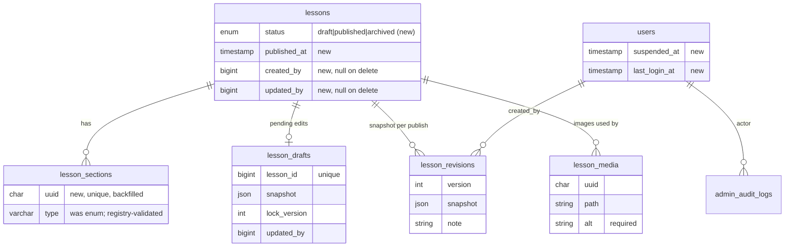

# Phase 3.5: Content Platform, Visual Learning Blocks and Admin Console

Design for the phase inserted between Phase 3 (learning content) and Phase 4 (assessment). It comes from the Phase 3.5 prompt, adapted where the repository called for it. Every adaptation is listed in §1 with its reason.

## 0. Decisions that change the architecture

| # | Decision | Replaces | Recorded as |
|---|---|---|---|
| M1 | **An admin console exists.** Admins manage users and lessons through `/api/v1/admin/*` and a `/admin` area in the web app. | ARCHITECTURE §4: "Admin endpoints for content authoring are not in the MVP. Seeders write the content." | D16 |
| M2 | **One `Content` module owns every write to content tables.** The seeder and the admin console both go through its block registry and actions. | ContentSeeder writing tables directly with its own checks | D17 |
| M3 | **JSON Schema is the canonical contract for each block type.** The backend validates every write against it. The frontend keeps zod for safe rendering, held in step by shared fixture files checked by both test suites. | Ad-hoc payload checks in the seeder, zod only on the frontend | D18 |
| M4 | **Once a lesson is edited in the admin, the database is its source of truth.** The seeder skips such lessons unless run with `--force`. An export command writes curated lessons back to the content files. | Seeder always overwrites | D19 |
| M5 | **Sections have stable UUIDs.** The API's section `id` becomes that UUID instead of `section-{position}`. | Position-based ids | D20 |
| M6 | **One MySQL schema, isolated by module table ownership** (§3.3), not a separate database. | n/a (confirms the default) | D21 |

All six follow the prompt's recommended option. None blocks Phase 4.

## 1. Changes to the Phase 3.5 prompt

| # | Prompt said | Changed to | Why |
|---|---|---|---|
| C1 | Decision numbers D15 to D19 | **D16 to D21** | D13 to D15 already exist (dev server on host, diagram data, catalog search). |
| C2 | Section type `visual` with a nested `kind` | **Each block kind is its own section type** (`layer-stack`, `sequence`, `flow`, …). The existing `diagram` type stays for bespoke diagrams. | One JSON Schema per type with no discriminator inside the payload. Validation, editor forms and error paths stay flat. The existing `diagram` type is already "bespoke visual by key", so it keeps that role. |
| C3 | One generic `interactive-calculator` | **`calculator` with a `tool` from a fixed set** (`cidr`, `chmod`, `password-entropy`). The payload sets labels and starting values only. | A calculator's logic is code. A payload can't safely describe arbitrary maths, so each tool is reviewed and tested code, and authors choose one. |
| C4 | `visual-3d` in the catalogue | **Pattern documented, implementation deferred to Phase 5** (the planned packet-traversal visual). No `three` dependency in this phase. | No pilot lesson needs 3D to be understood. `layer-stack`, `sequence` and `topology` cover the pilot topics in 2D. Adding about 600 KB of 3D dependencies for no lesson would break "one visual must earn its place". |
| C5 | Optimistic concurrency via `updated_at` or `lock_version` | **`lock_version` integer on the lesson's draft** | `updated_at` has one-second resolution, so two saves within a second would slip past it. |
| C12 | Draft, publish and archive as a status on the lesson row, editing it in place | **Edits go to a separate `lesson_drafts` row; the live rows change only on publish** (§5.1) | Editing a published lesson in place would show learners half-finished work, or make every learner query read JSON snapshots. A separate draft keeps learner queries on plain tables. |
| C6 | 403 or 404 for non-admins, to be decided | **403** with the standard envelope | The existing 404 rule hides *other users' records*. Admin routes aren't secret, and 403 makes the denial explicit in logs and tests. |
| C7 | Steps 2 to 7 as one run | **Three gated parts:** **A** content module, admin foundation and user management (steps 2 to 4); **B** lesson editor, revisions and media (step 5); **C** block library and pilot content (steps 6 and 7). Each ends demoable, tested and reported. | The phase is about three phases of work. Gating lets you redirect between parts without unwinding half-built features. Execution order is unchanged. |
| C8 | Keep bespoke OSI, TCP and CIA diagrams | **OSI moves to the generic `layer-stack` and TCP to the generic `sequence`.** CIA stays a bespoke `diagram`. | Two bespoke components become data on generic ones, which proves the generic blocks on real content. The CIA triangle has no generic equivalent worth building. |
| C9 | Editor forms generated from JSON Schema, with raw JSON fallback | **Generated forms for flat and list-shaped types** (prose, callout, steps, code, media, comparison, timeline, bitfield, calculator, knowledge-check). **A validated JSON editor for graph-shaped types** (sequence, flow, tree, topology, layer-stack), with schema errors shown at the exact path, plus the live preview. | Usable generated forms for nested node and edge structures would be a project of their own. The prompt allows the fallback, and the preview shows the result immediately. |
| C10 | JSON Schema validation in PHP, library unspecified | **`opis/json-schema` 2.6** (draft 2020-12) | Maintained, pure PHP, and verified to install against the current lock file. It is this phase's only new backend dependency. |
| C11 | Seeder upserts sections by UUID | Also **fixes the two seeder bugs found in the Phase 3 review**: reordering lessons trips the unique (`course_chapter_id`, `position`) index mid-seed, and lessons removed from a content file stay published. The fix is two-pass renumbering, and lessons dropped from a file are **archived**, not left live. | Same root cause as the prompt's ordering concern. |

## 2. Audit

### 2.1 Confirmed (prompt §0)

Every item in prompt §0 matches the repository at commit `6e3dae3`.

### 2.2 Additional findings

| Finding | Where | Consequence for this phase |
|---|---|---|
| Lesson counts and durations count every lesson | `Course::scopeWithLessonStats` (catalog, course detail, related courses, career suggested courses) | Must apply the visibility scope inside the aggregates, or a draft lesson would inflate "6 lessons, 1 h 30 min". |
| The curriculum loads every lesson | `CourseController::show` → `chapters.lessons` | Constrain the eager load with the visibility scope. |
| Progress and navigation order every lesson | `CourseProgress::orderedLessons` (progress percent, next lesson, prev and next links) | Same scope. Otherwise a draft lesson would block 100% completion. |
| Topic lesson counts count every lesson | `CareerController::show` → `withCount('lessons')` | Same scope. |
| Section anchors depend on position | `LessonResource` (`section-{position}`), the reader's table of contents | They become UUIDs (M5). Old `#section-2` links stop scrolling to the section, but the page still loads. Nothing outside the app links to them yet. |
| Suspended-user sessions | Sessions use the database driver and have a `user_id` column | Suspension can delete the user's session rows and rotate `remember_token`. A middleware also rejects a suspended user mid-session, in case a session row survives. |
| No last-login time | `users` | Add `last_login_at`, set by `AttemptLogin`. |
| The seeder checks only some payloads | `ContentSeeder::validate` (diagram key and data, callout tone) | Replaced by the registry (M2, M3). Prose, steps and code bodies become schema-checked too. |

## 3. Module boundaries

### 3.1 Backend

```text
app/Modules/
├── Content/            NEW: owns lesson content
│   ├── Blocks/         BlockType (interface), BlockRegistry, Types/*, schemas/*.json
│   ├── Actions/        CreateLesson, SaveDraft (metadata, sections), DiscardDraft, PublishLesson, ArchiveLesson,
│   │                   DeleteDraftLesson, RestoreRevision, StoreLessonMedia, MoveLesson,
│   │                   CreateChapter, UpdateChapter, ReorderChapters
│   ├── Services/       LessonSerializer (reader + admin preview), RevisionRecorder, ContentImporter (seeder), ContentExporter
│   ├── Http/…/Admin/   thin controllers, Form Requests, Resources for /admin/content/*
│   ├── Policies/       LessonPolicy, CourseChapterPolicy
│   ├── Console/        content:export
│   └── routes.php
├── Admin/              NEW: admin cross-cutting concerns and user administration
│   ├── Http/Middleware/EnsureAdmin.php
│   ├── Actions/        ChangeUserRole, SuspendUser, ReactivateUser, SendPasswordResetLink
│   ├── Services/       AuditLogger
│   ├── Http/Controllers/ AdminOverviewController, UserAdminController, AuditLogController
│   ├── Policies/       UserAdminPolicy
│   ├── Console/        cybercompass:make-admin
│   └── routes.php
└── Learning/           EXISTING: learner-facing only; LessonResource delegates sections to Content\LessonSerializer
```

**No duplication.**
- **Block types and payload rules** have one home, `BlockRegistry`, used by the seeder (through `ContentImporter`) and by the admin actions.
- **Section output** has one serializer, used by the learner endpoint and the admin preview.
- **Learner visibility** is one model scope, `Lesson::scopeVisibleToLearners`, used by every learner query listed in §2.2.

### 3.2 Frontend

```text
src/app/(admin)/admin/…        own layout (admin shell), code-split from learner routes
src/features/admin/            shell, nav, RequireAdmin, users, audit log
src/features/content-editor/   lesson list, editor, block editors, media picker, revisions
src/features/learning/blocks/  (was diagrams/) the only renderer: type → { zod schema, component, lazy? }
```

The editor preview mounts `features/learning` components directly. There is no second renderer.

### 3.3 Table ownership (one schema, M6)

| Owner module | Writes | Reads also by |
|---|---|---|
| Content | `courses`*, `course_chapters`, `lessons`, `lesson_sections`, `lesson_revisions`, `lesson_media`, `topic_lessons` | Catalog, Learning, Careers |
| Admin | `admin_audit_logs`, `users.role`, `users.suspended_at` | none |
| Auth, Profile | `users` (identity fields), `user_profiles`, sessions, password resets | everything |
| Catalog, Learning | `enrollments`, `course_favorites`, `lesson_progress` | Progress (Phase 6) |
| Careers (seeded) | `domains`, `skills`, `careers`, `career_*`, `topics`, `topic_prerequisites` | everything |

\* Course rows are still created only by the seeder in this phase (full course CRUD is a follow-up). Content owns the chapters within them.

A separate database would break the foreign keys from `lesson_progress`, `topic_lessons` and the future `exercise_questions` to lessons and sections, along with the transactions spanning them. It would also add an RDS instance. No benefit at this scale.

## 4. Data model delta

All migrations are additive (expand only). Existing migrations are not edited.



| # | Migration | Data step |
|---|---|---|
| 1 | `lesson_sections`: add `uuid` (nullable at first), backfill, add unique index | Every existing row gets a UUID in the migration. |
| 2 | `lesson_sections.type`: enum → `varchar(40)` | Values unchanged. |
| 3 | `lessons`: add `status` (default `published`), `published_at`, `created_by`, `updated_by` | `published_at` is backfilled from the course's `published_at`. |
| 4 | `lesson_drafts` (unique `lesson_id`, `snapshot`, `lock_version`, `updated_by`) and `lesson_revisions` (`lesson_id`, `version`, `snapshot`, `note`, `created_by`; unique (`lesson_id`, `version`)) | none |
| 5 | `lesson_media` | none |
| 6 | `users`: add `suspended_at`, `last_login_at` | none |
| 7 | `admin_audit_logs` (append-only; no update or delete path in code) | none |

Run order on AWS: migrations run as a one-off ECS task *before* the new service revision. Every step is safe with the previous code still running: new columns have defaults, and the enum-to-varchar change accepts the same values.

## 5. API contract

### 5.1 Admin (`/api/v1/admin`, `auth:sanctum` + `EnsureAdmin` + the `admin` rate limiter of 120/min per admin)

| Method | Path | Notes |
|---|---|---|
| GET | `/overview` | User, admin and suspended counts; lessons by status |
| GET | `/users` | `q`, `filter[role]`, `filter[status]=active\|suspended`, `sort` (`name`, `-created_at`, `last_login_at`), standard pagination |
| GET | `/users/{id}` | Profile, role, status, `created_at`, `last_login_at`, enrollment count, completed lessons, last 10 audit entries about the user |
| PATCH | `/users/{id}/role` | `{ role }`. 422 for self-demotion or for demoting the last active admin. Ends the target's sessions. |
| POST | `/users/{id}/suspend` | `{ reason }`. Same guards. Ends sessions and rotates the remember token. |
| POST | `/users/{id}/reactivate` | |
| POST | `/users/{id}/password-reset` | Sends the existing reset email. Admins never see or set passwords. |
| GET | `/audit-logs` | `filter[actor]`, `filter[subject_type]`, `filter[subject_id]` |
| GET | `/content/block-types` | `key`, `label`, `description`, `schema` (JSON Schema), `example`, `editor` (`form` or `json`) |
| GET | `/content/courses` | Id, title, chapters (for pickers) |
| POST | `/content/courses/{course}/chapters` | `{ title }` |
| PATCH | `/content/chapters/{chapter}` | `{ title }` |
| PUT | `/content/courses/{course}/chapters/order` | `{ chapter_ids: [] }`, two-pass renumbering |
| GET | `/content/lessons` | `q`, `filter[course]`, `filter[chapter]`, `filter[status]`; includes section count, visual count and last edited by and at |
| POST | `/content/lessons` | Creates a draft |
| GET | `/content/lessons/{id}` | Metadata, ordered sections with UUIDs, `lock_version`, topics |
| PATCH | `/content/lessons/{id}` | Metadata plus `lock_version`, saved to the draft; 409 `conflict` if stale |
| PUT | `/content/lessons/{id}/sections` | Full ordered list plus `lock_version`, saved to the draft. New sections get UUIDs. 422 errors are keyed `sections.{index}.payload.{path}`. |
| DELETE | `/content/lessons/{id}/draft` | Discard unpublished changes |
| POST | `/content/lessons/{id}/publish` | `{ lock_version, note? }`. Applies the draft to the live rows in a transaction (sections upserted by UUID), writes revision `n+1`, sets `published_at` |
| POST | `/content/lessons/{id}/archive` | |
| DELETE | `/content/lessons/{id}` | Only a never-published draft with no progress or topic links; otherwise 409 |
| GET | `/content/lessons/{id}/revisions` | Version, author, time, note, and a summary of changed fields and sections |
| POST | `/content/lessons/{id}/revisions/{version}/restore` | Restores the snapshot into the lesson as a **draft** (published content is untouched until the next publish) |
| POST | `/content/media` | Multipart `image` plus `alt`; jpg, png or webp; re-encoded to WebP; SVG rejected |

**Draft model.** All editing happens on a **draft**: one `lesson_drafts` row per lesson, holding a registry-validated snapshot of the lesson's metadata and ordered sections (with UUIDs).
- The live `lessons` and `lesson_sections` rows change **only on publish**. Publishing applies the draft in one transaction: it upserts sections by UUID, deletes the ones removed, writes revision `n+1` and drops the draft.
- A published lesson **stays live while it is being edited**. Learners never see half-finished work.
- A new lesson gets a `lessons` row with `status = draft`, which learners never see, plus its draft. Publishing it works exactly like publishing an edit.
- `GET /content/lessons/{id}` returns the draft when one exists, otherwise the live content, with a `has_unpublished_changes` flag. "Discard draft" deletes the draft row.
- **Restore a revision** writes that snapshot into the draft. The live lesson is untouched until it is published.

**Concurrency.** Draft writes carry `lock_version` (stored on `lesson_drafts`). The server increments it and returns 409 with code `conflict` when the version sent is stale. Publishing also checks the version, so an admin can't publish a draft someone else changed under them.

### 5.2 Learner endpoint change (additive)

`GET /api/v1/lessons/{slug}`: each section's `id` becomes its UUID, and new block types appear in `sections[]`. No field is removed.

## 6. Block catalogue

| Type | Knowledge shape | Pilot lessons | Renderer | Editor | This phase |
|---|---|---|---|---|---|
| `prose`, `callout`, `steps`, `code` | Text, notes, procedures, commands | All | existing | form | Schema-backed |
| `prose` (extended) | Adds inline links (`[text](https://…)`, https only) and numbered lists | All | existing, extended | form | Yes |
| `layer-stack` | Ordered layers, encapsulation | OSI model (replaces bespoke), TCP/IP model, defense in depth | HTML + Motion | json | Yes |
| `sequence` | Messages between actors over time | TCP handshake (replaces bespoke), DNS resolution, DHCP DORA | SVG step-through | json | Yes |
| `flow` | Process or decision flow | Risk response decision | React Flow + dagre | json | Yes |
| `tree` | Hierarchy | DNS hierarchy | React Flow + dagre (TB) | json | Yes |
| `topology` | Devices and links in space | LAN, router and firewall layout | React Flow, fixed positions | json | Yes |
| `comparison` | Side-by-side attributes | TCP vs UDP; threat vs vulnerability vs risk | Semantic table | form | Yes |
| `timeline` | Ordered events | Not needed in the pilot | HTML | form | Yes (generic) |
| `bitfield` | Bits and fields | IPv4 address in binary, subnet mask | HTML grid | form | Yes |
| `calculator` | Learner manipulates input | `cidr` (subnetting), `chmod` (Linux), `password-entropy` | Pure client logic | form | Yes, 3 tools |
| `step-through` | Annotated walkthrough with state | Encapsulation, risk score worked example | Motion | json | Yes |
| `media` | Screenshot with caption and alt text | Optional | `lesson_media` | form + media picker | Yes |
| `knowledge-check` | 1 to 3 ungraded questions | Every pilot lesson | Answer shown after answering | form | Yes, never affects progress |
| `diagram` (bespoke) | Concepts with no generic shape | CIA triad | existing | json | Kept |
| `visual-3d` | Spatial traversal | n/a | R3F, lazy, 2D fallback | n/a | **Phase 5** (C4) |

**Shared graph setup:** one `lib/graph` module (React Flow + dagre layout, theme-token styles, mobile outline fallback) serves `flow`, `tree` and `topology`. The Phase 5 roadmap graph reuses it.

**Contract fixtures:** `docs/content-blocks/fixtures/<type>.valid.json` and `.invalid.json`, checked by Pest (JSON Schema via the registry) and by Vitest (zod plus render). A type counts as done only when both suites pass the same fixtures.

## 7. Impact on later phases

| Phase | Risk | Handled by |
|---|---|---|
| 4: roadmap generator | Draft or archived lessons enter roadmaps | `Lesson::scopeVisibleToLearners` used by every learner query; archive, never delete |
| 4: question admin | Admin shell rework | Generic shell: adding an area is a route group plus one nav entry |
| 5: exercise theory references | References break on reorder or reseed | Section UUIDs; seeder upserts by UUID; no delete-and-recreate |
| 5: roadmap graph | Two graph setups | One `lib/graph` |
| 5: 3D visual | Bundle size, server-rendering errors | `visual-3d` pattern: `next/dynamic` with `ssr:false`, 2D fallback, reduced motion |
| 5: completion rules | Knowledge checks mistaken for exercises | `knowledge-check` is ungraded and excluded from completion by design |
| 6: activities, dashboard | Records pointing at deleted lessons | No hard delete of referenced lessons |
| 6: global search | Drafts leak into search | Search must use the same scope (noted in API_SPECIFICATION) |
| 7: security review | Admin surface unreviewed | Threat notes in §8, tests in Part A |
| 7: AWS | Media on local disk | Everything goes through `uploads_disk`; no new AWS service |

## 8. Admin threat notes

| Threat | Control |
|---|---|
| A learner reaches admin endpoints | `EnsureAdmin` on the route group plus a policy per action; tests for guest 401, learner 403 and admin 200 on every group |
| An admin locks everyone out | No self-demotion or self-suspension; the last active admin is protected; `make-admin` command for recovery |
| Privilege escalation through mass assignment | `role` is not fillable; role changes go through one action only |
| A suspended user keeps a session | Sessions deleted, remember token rotated, and middleware rejects suspended users on every request |
| XSS through authored content | Prose renders as React text plus https-only links; no HTML; media is raster only, re-encoded |
| Lost edits | `lock_version` conflicts (409); revisions; unsaved-changes guard |
| Repudiation | Append-only audit log of every mutating admin action, with no secrets in `changes` |
| Brute force or scraping of admin APIs | Dedicated rate limiter |

Optional later hardening (documented, not built): an ALB rule or AWS WAF IP allow-list on `/api/v1/admin/*`.

## 9. Assumptions

- **A1** One admin role is enough (no editor or reviewer split). Policies are written per action, so finer roles can be added without touching controllers.
- **A2** Course creation stays in the seeder this phase. Chapters are editable in the admin.
- **A3** One draft per lesson is enough: two admins editing the same lesson are serialised by `lock_version` conflicts rather than merged. Branching or per-admin drafts are out of scope.
- **A4** `knowledge-check` answers ship with the lesson payload, because they're ungraded: hiding them is a learning aid, not a security boundary. Graded exercises (Phase 5) keep their answers server-side, as already designed.
- **A5** The demo admin is `admin@cybercompass.test`, with its password from `DEMO_ADMIN_PASSWORD` in `backend/.env`; it is skipped when the variable is empty.
