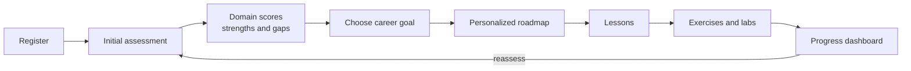

# CyberCompass: Project Overview

CyberCompass is a personalized learning platform for cybersecurity. A learner takes a knowledge assessment, picks a career goal, and gets a learning roadmap built from what they already know and what that career needs. They then study lessons, do exercises and browser-based labs, and track their progress.

This is an academic software engineering project. The bar is a product that works end to end, not a CRUD demo.

## Status

| Area | State |
|---|---|
| Architecture, schema, API conventions, design system | Designed (this `docs/` folder) |
| Application code | Not started. Phase 1 is next. |

This file and the README only call a feature *implemented* after it has been built and tested.

## Who it is for

- **Beginners** coming from IT or computer science who don't know where to start in security.
- **Career switchers** working towards a specific role (for example SOC Analyst).
- **Students** who want a structured path through the material their courses only touch on.

## Core journey

## Modules

| Code | Module | Purpose |
|---|---|---|
| A | Landing | Public homepage that explains the product and leads to registration |
| B | Auth | Register, login, logout, password reset, remember me |
| C | Assessment | Multiple-choice questions grouped by domain, scored transparently |
| D | Roadmap | Data-driven graph of topics (stages) and lessons (child nodes) with prerequisites |
| E | Catalog | Course search, filters, sorting, favorites, pagination, course detail |
| F | Learning | Lesson reader, interactive visuals, exercise mode with feedback |
| G | Labs | Safe browser simulations (Linux shell, firewall rules, HTTP inspection, packets) |
| H | Dashboard | Progress, streak, learning time, skill profile, recommendations |
| I | Careers | Role catalog, required domains and skills, goal selection |
| J | Notifications | In-app notifications, read state, preferences |
| K | Profile | Personal info, learning goals, security, preferences (theme, language) |

## Principles

1. **Honest personalization.** The roadmap comes from a rule-based engine using assessment scores and career requirements. The product doesn't call this AI, and the rules are documented in [ARCHITECTURE.md](ARCHITECTURE.md#personalization-engine).
2. **Content is data.** Roadmaps, lessons, exercises and labs live in the database and are seeded. UI components never hardcode them.
3. **One contract.** The frontend talks to the backend only through the versioned REST API (`/api/v1`) described in [API_SPECIFICATION.md](API_SPECIFICATION.md).
4. **Safe labs.** Labs are deterministic browser simulations. Nothing runs on the server, and nothing touches external systems.
5. **Designed, not generated.** The UI follows [DESIGN_SYSTEM.md](DESIGN_SYSTEM.md).

## Out of scope for the MVP

- Real sandboxed VMs or containers for labs. The architecture leaves room for them; see ARCHITECTURE.md.
- Payments, instructor authoring UI, social features.
- LLM-generated content or recommendations.

## Related documents

- [ARCHITECTURE.md](ARCHITECTURE.md): system design, modules, auth, AWS
- [DATABASE_SCHEMA.md](DATABASE_SCHEMA.md): entities, ERD, indexes
- [API_SPECIFICATION.md](API_SPECIFICATION.md): conventions and endpoints
- [DESIGN_SYSTEM.md](DESIGN_SYSTEM.md): visual direction, tokens, component rules
- [IMPLEMENTATION_ROADMAP.md](IMPLEMENTATION_ROADMAP.md): phases, dependencies, exit criteria
